# PCF8574 investigation journal

Working notes on why UMW PCF8574 chips misbehave on the AYAB interface board
with MCP23008-style writes, where TI chips reportedly do not.

Append-only from 2026-11-20 14:10: new entries go at the bottom with a
timestamp, and earlier entries are left as written even where later entries
contradict them. Times before 14:10 were reconstructed from file timestamps
and are approximate. Entries record what was done and seen; interpretation is
marked as such.

## Setup (as of 2026-11-20 14:05)

- **Board under test:** spare AYAB interface board, same batch as the failing
  machine. Two UMW PCF8574 (U2 at 0x20, U3 at 0x21), each driving a ULN2803
  through 1 kΩ pull-ups. No Metro Mini fitted.
- **Loads:** LEDs with resistors on the solenoid outputs, fed from a bench
  supply. No coils.
- **Controller:** Arduino UNO clone (USB id 0843:5740 "FIREPHX USB SER",
  ATmega328P signature confirmed) on USB, wired to the board's I2C header:
  GND, 5 V, SDA, SCL.
- **Scope:** Hantek 6022BE on the same Mac, driven directly over USB with
  [tools/scope.py](tools/scope.py). 16 MS/s, two channels, 8 bits, 20 MHz
  bandwidth. Ground clip on the UNO. Channel 1 on board ground (×1 probe).
  Channel 2 turned out to be on SCL (see the note in entry 6).
- **Machine with the actual problem** (not on the bench): Metro Mini on USB
  from a MacBook on battery, 12 V puck supply, real solenoids of about 150 Ω.
  Nothing earthed.

## 2026-11-19 18:45 — 1. Datasheet comparison

UMW and TI parts are specified alike for this use: same address, pinout, port
drive and port timing. Differences are at the edges. The one that mattered
later: UMW's part runs at 400 kHz and has a 2 MHz high-speed mode entered by a
`0000 1xxx` byte after START; TI's is 100 kHz only. UMW gives no figures for
supply-glitch immunity or per-pin current limits.

## 2026-11-19 evening — 2. What differs on the wire

The firmware's MCP-style write is `[address][0x09][data]`; the native write is
`[address][data]`. A PCF8574 has no registers, so it puts `0x09` on its
outputs for one byte time (about 90 µs at 100 kHz) before the real value.
During that time outputs 0 and 3 pulse on and every other energised output
drops out. Both chips are rewritten on every state change.

## 2026-11-20 11:44 — 3. Board layout

Rendered from `ayab-hardware/ayab-interface/layout/ayab_rs.pcb`, coloured by
net: green ground, orange 5 V, magenta solenoid supply, blue/cyan SDA/SCL, red
solenoid outputs, brown PCF8574-to-ULN2803 lines.

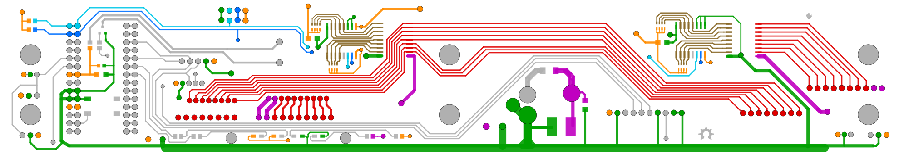

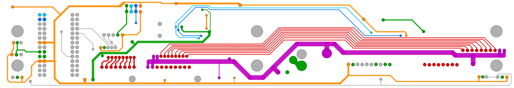

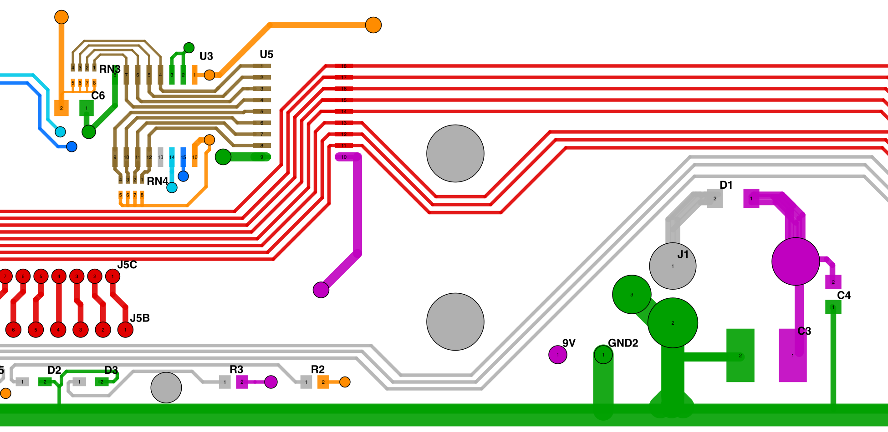

- Two layers, no ground plane. Ground is one 100 mil bus along the bottom edge.
- Each PCF8574 takes its ground from its ULN2803's ground pin. For U3/U5 that
  node is about 80 mm of 50 mil trace from the bus; for U2/U4 about 43 mm of
  40 mil trace. All of that ULN2803's solenoid return current shares it.
- ULN2803 COM pins are tied to the solenoid supply, so kicks are clamped.
- 1 µF at each PCF8574. No capacitor on the solenoid supply near either
  ULN2803; the only bulk capacitor (22 µF) is at the jack.

Estimate made at the time: with the machine's solenoids (about 75 mA each on
12 V, inductance estimated at 0.1–0.25 H from the service-manual force
figures) the ground step is roughly 50–80 mV per energised solenoid, a few
hundred millivolts with six dropping together. Not convincing as a sole cause.

## 2026-11-20 12:48 — 4. High-speed-code theory: tested and ruled out

*Firmware: pcf8574-probe root sketch on usbmodem (flashed 12:45).*

Idea: `0x09` matches the high-speed code pattern, so perhaps the UMW chip
weakens its input filter mid-transaction.

Test ([src/main.cpp](src/main.cpp)): bit-banged I2C, a deliberate low pulse of
62 ns to 1 µs injected on SCL or SDA in the middle of a data byte, port read
back afterwards. 20 trials per cell, both chips, both lines.

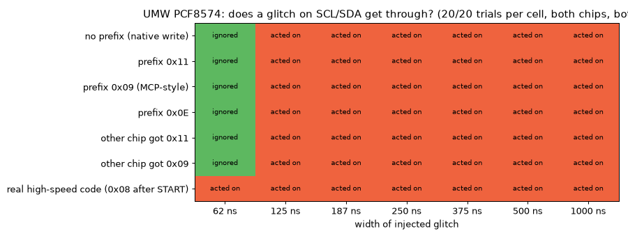

- In normal mode the chip ignores a 62 ns pulse and acts on 125 ns or wider.
- After a genuine high-speed code (`0x08` as first byte after START) it also
  acts on 62 ns. So the mode exists and the test can see it.
- `0x09` or `0x0E` as a second byte changes nothing, for the addressed chip or
  the other one. A chip never reacted to its own address appearing as a data
  byte in a write to the other chip.

Result: ruled out, on this board. Useful by-product: any disturbance of
125 ns or more on SCL or SDA is taken as a real edge by these chips.

The first run of this test was garbage (all read-backs `0xFF`, UNO restarting)
while the board's 5 V LED was seen to go out. Two later runs were clean and
identical.

## 2026-11-20 12:53 to 13:50 — 5. MCP-style writes with read-back

*Run with: [tools/toggle.py](tools/toggle.py), [tools/readserial_ts.py](tools/readserial_ts.py). Firmware: scratch sketch fw_mcp (not kept) on usbmodem (flashed 12:52); mcp-readback [default; -DOLD; -DMCPFIRST] on usbmodem (flashed 12:55, 12:56, 13:17, 13:20, 13:24, 13:30, 13:32).*

The real firmware was flashed and exercised through its test mode (467
commands accepted), but nobody was watching the LEDs and that firmware cannot
read the ports back, so that run gave no information.

A self-checking test ([mcp-readback/src/main.cpp](mcp-readback/src/main.cpp))
does the same writes through the same Adafruit library and reads both ports
after every write. Phases: walking single output, cumulative on/off, whole-bank
patterns, toggling one output with twelve held on, random single toggles,
random words.

| Test version | Passes | Result |
|---|---|---|
| Plain self-check | about 20 | UNO restarted or hung in most passes |
| Same after the ground wire was reseated | 3 | no change |
| With an ADC supply monitor running | 7 | all clean |
| Plain again (control) | 3 | two silent, one hung |
| ADC monitor, MCP-style bank phase first | 3 | all clean |

In the ten clean passes: about 175,000 writes with read-back, zero
mismatches, UNO supply between 5.19 and 5.33 V throughout.

One unexplained event in a crashing pass, with the UNO's counters still sane:
chip 0x20 read `0xFF` where `0x7F` was expected.

**Wrong turns here**, for the record:

- I blamed a bad ground wire. Reseating changed nothing.
- I then blamed the read-back step, because the first breadcrumbs pointed
  into it. A variant with no reads at all still crashes.
- I suspected the UNO's analog supply pin (which also powers the SDA/SCL
  pins) was floating. Measured: rock steady at 5.28 V under every load tried.

## 2026-11-20 13:54 — 6. Scope: board ground during the test

*Run with: [tools/scope.py](tools/scope.py), [tools/run_capture.py](tools/run_capture.py), [tools/analyze.py](tools/analyze.py). Firmware: mcp-readback [-DMCPFIRST] on usbmodem (flashed earlier, 11-20 13:32).*

Ring of 0.5 s captures, one per test phase, non-crashing test version.

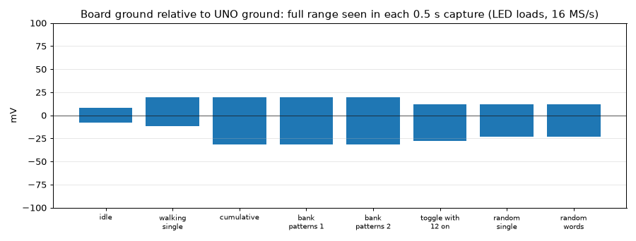

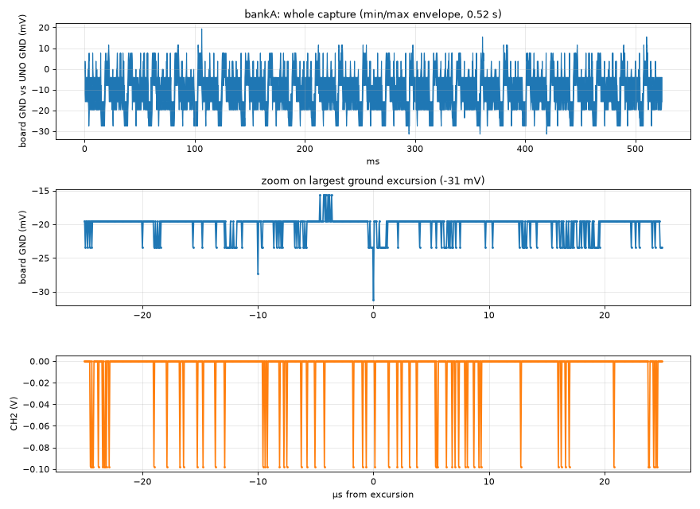

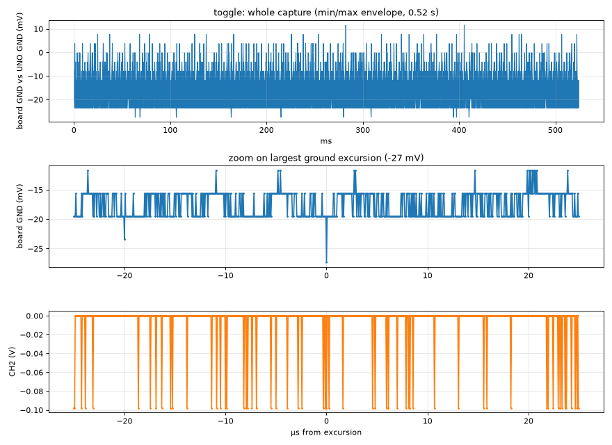

- Board ground stays within about +20 / −31 mV of UNO ground in every phase.
- The slow shift of about 20 mV follows the board's 5 V load (80 mA with all
  outputs off, 16 mA with all on) through the ground wire's resistance.
- Spikes are single samples of 10 mV or so.

With LED loads this board's ground is quiet at the scope's resolution. It says
little about the machine, where the loads are inductive.

**Note on channel 2:** in these captures channel 2 was not connected, which I
saw (flat 0 V, no edges) and did not report. It was connected afterwards. It
is on SCL, and reads off-scale at my assumed ×10 setting, so the probe is
probably switched to ×1. If so it adds about 100 pF to SCL.

## 2026-11-20 13:59 to 14:04 — 7. Scope: catching the UNO crash

*Run with: [tools/readserial_ts.py](tools/readserial_ts.py), [tools/crash_capture.py](tools/crash_capture.py). Firmware: mcp-readback [-DOLD; -DOLD -DNOREAD] on usbmodem (flashed 13:56, 14:00, 14:03); scratch sketch avcc_test (not kept) on usbmodem (flashed 14:02).*

The crashing test version was given breadcrumbs kept in memory across a
restart: test phase, step within a write, write count, last state written, and
whether an unhandled interrupt fired. At start-up it also records peripheral
registers before anything touches them.

What the breadcrumbs show, over about 25 crashes:

- **Not a hardware reset.** At restart the I2C, timer and serial registers
  still hold their configured values (`TWBR=72`, `TWCR=0x45`, `TCCR0B=3`,
  `UCSR0B=0x98`). The program jumped back to its start.
- **Often via an unused interrupt vector** (the bad-interrupt marker is set in
  roughly half of them), which is what a wild jump into the vector table
  looks like.
- **In the writes-only variant, every crash follows a write that left 15 or 16
  outputs on** (`0x7FFF` or `0xFFFF`), and happens in the 450 µs pause at the
  start of the next write, never during the 2 ms delay before it.
- Sometimes memory is visibly corrupted first: garbage text printed, a
  mismatch reported between equal values, counters with impossible values.

Scope ring buffer frozen when the restart banner arrives:

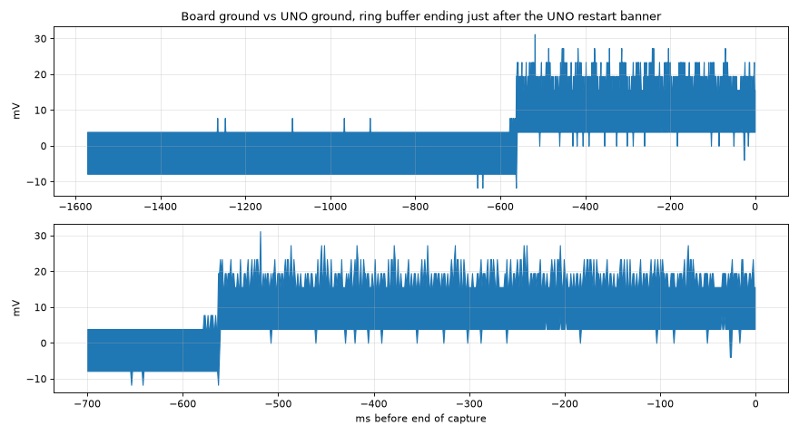

Board ground does nothing unusual across a crash (−12 to +31 mV).

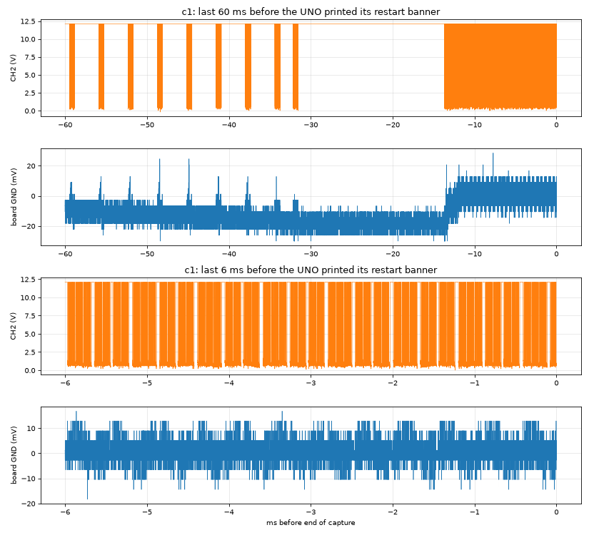

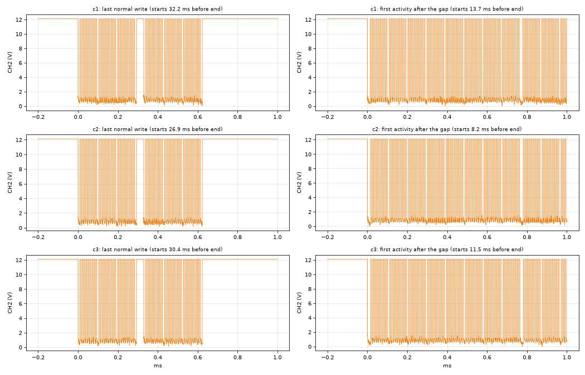

Channel 2 is SCL. Each normal write is two bursts of 27 clocks (one
three-byte transaction per chip), every 3.6 ms.

- The last write before each crash looks normal on SCL.
- Then SCL sits idle high for **18.5, 18.7 and 18.9 ms** (three crashes).
  Nothing is sent.
- Then continuous traffic starts: the restarted program's init sequence.

So the sequence is: a normal write that turns nearly all outputs on, about
19 ms of silence, then the program starts over without the UNO having been
reset.

## 2026-11-20 14:05 — Open questions at this point

1. What is the UNO doing during the 19 ms of silence, and why is it so
   repeatable?
2. Why does it only happen with 15 or 16 outputs on?
3. Why does a free-running ADC interrupt make it go away?
4. Is any of this related to the machine's problem, or is it purely an
   artefact of this UNO and bench?
5. The single `0x7F` → `0xFF` read: real, or a side effect of the crashing?

## 2026-11-20 14:05 — Not yet done at this point

- Probe the UNO's own 5 V pin and SDA during a crash (needs the probes moved).
- Repeat the glitch-filter sweep on a TI chip.
- Put a real inductive load on the bench. A 6 V / 5 Ω solenoid is available;
  it needs the supply turned down to about 2 V or a series resistor of 22 Ω or
  more, and must go on an output other than 0 and 3.
- On the machine: check whether resets happen from all-off or only with
  several solenoids on, and scope the PCF8574 ground and supply pins.

## 2026-11-20 14:10 — 8. More crash instrumentation; details are not stable

*Run with: [tools/readserial_ts.py](tools/readserial_ts.py). Firmware: mcp-readback [-DOLD -DNOREAD] on usbmodem (flashed 14:07).*

Added to the crashing (writes-only) variant: the interrupted address and all
interrupt-enable registers saved if an unused vector is reached, and a timer
around the 450 µs pause to catch it running long.

One 45 s run, 6 restarts:

- None went through an unused interrupt vector this time (in entry 7 about
  half did).
- No pause was ever measured as running long before a restart.
- Twice the program printed a phase line out of sequence without printing the
  start banner (for example `init: writes 95` in the middle of a run), so it
  jumped into the middle of its own setup code, not to the start.
- The "15 or 16 outputs on" pattern from entry 7 did not hold: restarts came
  at assorted points of the cumulative phase.

Interpretation: control flow is being corrupted in ways that change with
every rebuild. The specific breadcrumb patterns in entry 7 (unused vector,
all-outputs-on) should not be relied on. The 18.5 to 18.9 ms silence seen on
the scope is still unexplained.

What has held across every build so far: variants with the ADC free-running
with its interrupt on have never crashed (10 passes); variants without have
crashed in nearly every pass. Next: three variants to isolate which part of
that matters (ADC off entirely; ADC free-running with no interrupt; AVCC
reference selected but ADC idle).

## 2026-11-20 14:12 — 9. It is the AREF setting, not the ADC

*Run with: [tools/readserial_ts.py](tools/readserial_ts.py). Firmware: mcp-readback [-DOLD -DNOREAD -DADC_OFF; -DOLD -DNOREAD -DADC_FREE_NOIRQ; -DOLD -DNOREAD -DREF_ONLY; -DOLD -DNOREAD -DADC_OFF -DNO_I2C] on usbmodem (flashed 14:08, 14:11).*

Four variants of the crashing writes-only test, one run of about 55 s each:

| Variant | Result |
|---|---|
| ADC switched off entirely | restarted 9 times, about every 5 s (4.4 to 6.1 s apart) |
| ADC free-running on the internal 1.1 V channel, AVCC reference, no interrupt | clean, 16,882 writes |
| AVCC reference selected, ADC left idle | clean, 16,882 writes |
| ADC off and no I2C traffic at all | printed nothing in 58 s, not even the start banner; not understood, may be a failed run |

So the ADC interrupt is irrelevant, and conversions are irrelevant. The one
thing the two clean variants share is the reference selection bit. Its
physical effect: with it set, the AVR connects its AREF pin internally to its
5 V analog supply; with it clear (the power-on default) the AREF pin is a
high-impedance input.

Interpretation: the UNO behaves differently depending on whether it drives
its own AREF pin, so the suspicion is on what is attached to that pin. On a
UNO R3 the AREF pin sits right next to SDA and SCL on the header
(SCL, SDA, AREF, GND). If the board's 5 V wire is on AREF instead of on the
5 V pin, the board would be powered through the AVR's internal switch when
the bit is set and not properly powered at all when it is clear. That would
also fit the board's 5 V LED having gone out earlier while the UNO's stayed
lit. This is a guess until checked.

Now running: a test that reads the voltage on the AREF pin directly. A bare
UNO has only a 100 nF capacitor there, which drains in milliseconds once the
internal connection is removed. If the pin stays near 5 V, something external
is holding it up; if it sags part-way, it is attached to a loaded rail.

## 2026-11-20 14:16 — 10. AREF pin measured: nothing external on it

*Run with: [tools/readserial_ts.py](tools/readserial_ts.py). Firmware: scratch sketch aref_test (not kept) on usbmodem (flashed 14:12).*

Test: read the internal 1.1 V reference against the AREF pin, at intervals
after disconnecting the pin from the internal 5 V.

| Reference used | Reading |
|---|---|
| AVCC (internal connection on) | 5209 mV |
| AREF pin, immediately after disconnecting | 5308 mV |
| AREF pin, 5 ms later | below 1.1 V |
| AREF pin, 100 ms, 1 s, 4 s later | below 1.1 V |

Same in three repeats. The pin drains within 5 ms, which is what a bare UNO
with only its 100 nF capacitor does.

The wiring guess in entry 9 is wrong. If the board's 5 V were on AREF and fed
from anywhere else, the pin would have stayed near 5 V; and the board clearly
has a real 5 V supply, since the PCF8574s answer correctly for seconds at a
time in the crashing variants.

So the fact stands without an explanation: this UNO runs the test reliably
when its AREF pin is driven to 5 V by the AVR, and crashes within seconds
when the pin is left as an undriven input, even though nothing is connected
to it.

Second pattern worth testing: in every crashing variant the first phase
(one output on at a time) always completes, and the restart comes within
about a second of the next phase, which is the first time several outputs
are on together.

Next, three more variants with the AREF bit left at its default:
1. AREF driven to the internal 1.1 V instead of 5 V. Tells whether "driven at
   all" is what matters.
2. Normal I2C traffic but always writing zero, so no LED ever stays on.
3. All 16 outputs switched on once, then no I2C traffic at all.

## 2026-11-20 14:17 — 11. Three more variants: it needs I2C traffic and outputs on (or data with ones)

*Run with: [tools/readserial_ts.py](tools/readserial_ts.py). Firmware: mcp-readback [-DOLD -DNOREAD -DREF_11; -DOLD -DNOREAD -DFORCE0; -DOLD -DNOREAD -DHOLDALL] on usbmodem (flashed 14:13).*

AREF bit at its default (the crashing configuration) in all three. One run of
50 s each.

| Variant | Restarts in 50 s |
|---|---|
| Reference: normal traffic, real data (entry 9, "ADC off") | 9, about every 5 s |
| AREF driven to the internal 1.1 V | 4 in 28 s, about every 5 s |
| Normal I2C traffic, but data always zero (no LED stays on) | 1, at 36 s |
| All 16 outputs on, then no I2C traffic at all | 1, at 38 s |

- Driving AREF to 1.1 V does not protect. Only 5 V on AREF does. So it is not
  "driven versus floating".
- Traffic alone (with zero data) rarely crashes. Outputs on alone (with no
  traffic) rarely crashes. Both together crash every few seconds.
- The single restarts in the last two variants came at nearly the same time
  (36 and 38 s), which is around the start of the last test phase. Possibly a
  coincidence, possibly something else that happens there (a status line is
  printed at each phase change).

The "zero data" variant changes two things at once: the outputs stay off, and
the bytes on the bus are all zeros, so SDA stays low while SCL clocks. These
need separating.

Idea being tested next (interpretation, not established): the trigger is on
the I2C lines themselves, when SDA is high while SCL is clocking, and has
nothing to do with LED current. Test: write the real data byte immediately
followed by a zero byte in the same transaction. The bus then carries the
same ones as the crashing variant, but each output is on for only about
90 µs per write, so the LEDs stay effectively off.

(User is away for lunch from about 14:17; no bench changes until they are
back.)

## 2026-11-20 14:18 — 12. Photo of the bench, and two scope side-notes

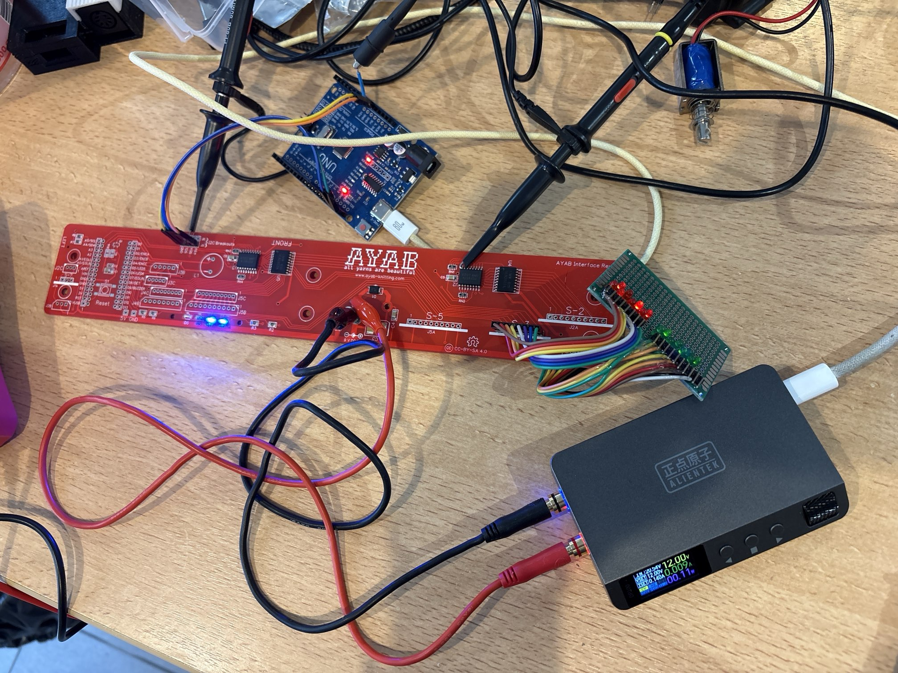

What the photo shows (my reading of it; details I could not make out are
marked):

- Only one bank of eight LEDs is connected, by ribbon from the eight-way
  connector on the right half of the board. The bench supply reads 12.00 V and
  0.009 A with several LEDs lit, so each LED draws about 1 mA.
- The bench supply is a small USB-C powered module. What it is powered from is
  not visible.
- The UNO is linked to the board's I2C breakout header by a four-wire ribbon
  about 15 cm long, with SDA and SCL side by side.
- One scope probe is on the I2C breakout header, the other on the right-hand
  PCF8574 (U2). The spare solenoid is on the desk, not connected.

Consequences:

- LED current is far too small to disturb anything. With all eight on, the
  total is under 10 mA. So when the crashes follow "outputs on", load current
  is not the mechanism. That leaves what is on the I2C bus (data bytes with
  ones in them) as the better candidate, which the batch now running tests.
- Half of the outputs (the other bank) have no load at all.

Scope side-notes from 14:20:

- Channel 2 is on SCL with the probe at x1: it reads a clean 0 to 4.84 V at
  that setting. A x1 probe adds about 100 pF to SCL.
- No gross overshoot or undershoot on SCL, but this probe and scope would
  hide anything faster than a few tens of nanoseconds.
- With two channels the scope is only continuous up to 24 MS/s. At 30 and
  48 MS/s it silently drops samples (the SCL period came out as 8.7 and
  5.3 µs instead of 10).

## 2026-11-20 14:20 — 13. Write style matters for the UNO crashes too

*Run with: [tools/variants.sh](tools/variants.sh). Firmware: mcp-readback [variants.sh variants DATA_THEN_ZERO; ZERO_THEN_DATA; NATIVE1] on usbmodem (flashed 14:17).*

AREF bit at its default (the crashing configuration). One run of 45 s each.
Restart times are seconds after the test starts.

| What is sent per chip | Outputs end up | Restarts in 45 s | At |
|---|---|---|---|
| `[0x09][data]` through the Adafruit library (entry 9 baseline, 55 s) | on | 9 | about every 5 s |
| `[data][0x00]` | off | 1 | 34 s |
| `[0x00][data]` | on | 2 | 35 s, 37 s |
| `[data]` (native single byte) | on | 2 | 3 s, 31 s |
| `[0x09][0x00]` (entry 11, "always zero") | off | 1 | 36 s |
| no traffic, all outputs held on (entry 11) | on | 1 | 38 s |

- Every variant except the first is at one or two restarts per run, and
  almost all of those fall between 31 and 38 s, during the "random single
  toggles" phase.
- Only the MCP-style write with real data crashes every few seconds, and it
  does so in the "cumulative" phase, when many outputs are on.
- `[0x00][data]` puts the same data on the bus and leaves the same outputs
  on as the MCP-style write, with the same transaction length. The only
  difference is the first byte, `0x00` instead of `0x09`. So neither "ones
  on the bus" (my idea in entry 11) nor "outputs staying on" explains the
  difference.

What `0x09` does that `0x00` does not: for about 90 µs it turns outputs 0
and 3 of each chip on, where `0x00` turns everything off. Either way all the
other outputs that were on drop out and come back.

Caution: these are single 45 s runs. Before reading more into it, the next
batch repeats the baseline and tries several prefix values (`0x00`, `0x09`,
`0x11`, `0xFF`, `0xF6`) through the same code path, so the library is
no longer a variable.

This is the same asymmetry as on the machine (MCP-style bad, native fine),
but here the thing that falls over is the UNO, not a PCF8574.

## 2026-11-20 14:29 — 14. Prefix-value batch: the bytes on the wire are not what matters

*Run with: [tools/variants.sh](tools/variants.sh). Firmware: mcp-readback [variants.sh variants OLD; PREFIX=0; PREFIX=9; PREFIX=0x11; PREFIX=0xFF; PREFIX=0xF6] on usbmodem (flashed 14:20).*

Nine runs of 45 s, AREF bit at default. "Adafruit" is the original code path
(`mcp.writeGPIO`); the others send `[prefix][data]` through Wire directly.

| Run | Variant | Restarts | At (s) |
|---|---|---|---|
| 1 | Adafruit `[0x09][data]` | 4, then ran to the end | 7, 11, 17, 22 |
| 2 | Wire `[0x00][data]` | 2 | 34, 40 |
| 3 | Wire `[0x09][data]` | 1 | 37 |
| 4 | Wire `[0x11][data]` | 1 | 8 |
| 5 | Wire `[0xFF][data]` | 1 | 34 |
| 6 | Wire `[0xF6][data]` | 0 | |
| 7 | Adafruit `[0x09][data]` | 7 | 7, 11, 16, 21, 27, 32, 38 |
| 8 | Wire `[0x09][data]` | 3 | 8, 40, 44 |
| 9 | Wire `[0x00][data]` | 1 | 30 |

- Runs 3 and 8 put exactly the same bytes on the bus as runs 1 and 7, and
  crash far less (1 and 3 restarts against 4 and 7). So the prefix value is
  not the cause, and entry 13's "same asymmetry as on the machine" was
  premature.
- What differs between "Adafruit" and "Wire `0x09`" is only the code that
  issues the same two transactions: a few instructions and a few microseconds
  of timing.
- The Wire variants show no clear dependence on the prefix value. All sit at
  0 to 3 restarts per run.

Interpretation: the crash rate depends on small details of the program
itself (code layout or microsecond timing), as well as on the AREF setting.
That is the signature of a marginal controller, not of a clean cause and
effect from the bus. The numbers are small, so the Adafruit-versus-Wire gap
could still shrink with more runs.

Next: instead of varying inputs, look at where the program actually goes.
A 2 kHz timer interrupt records the program counter into a 64-entry ring
kept across restarts, giving the last 32 ms of execution before each restart,
including the 19 ms of silence seen on the scope.

## 2026-11-20 14:32 — 15. Program-counter trace: the UNO's program counter is being corrupted

*Run with: [tools/readserial_ts.py](tools/readserial_ts.py). Firmware: mcp-readback [-DOLD -DNOREAD] on usbmodem (flashed 14:29).*

(Channel 2 probe on SCL was switched from x1 to x10 by the user at about
14:29.)

Crash-prone variant (Adafruit path, AREF bit at default) with a 2 kHz timer
interrupt recording the interrupted address into a 64-entry ring that
survives a restart. Seven traces from one 25 s run:

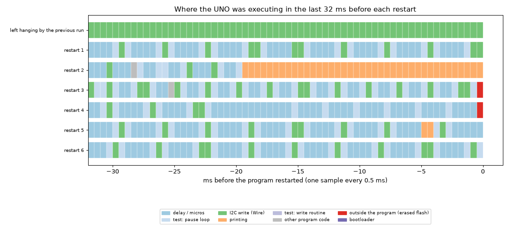

- **Up to the last sample, execution is normal.** Every trace shows the
  ordinary cycle: pause loop, delay, I2C write, repeat.
- **In two of six restarts the final sample is far outside the program**
  (addresses 0x6E86 and 0x5FC6; the program ends at 0x1E2C). That region of
  flash is erased. An AVR executes erased flash as harmless skips and slides
  upward until it reaches the bootloader at 0x7E00, which, seeing no reset
  flag, jumps straight to the start of the program. That is exactly a
  "restart without a reset", and explains why peripherals were still
  configured (entry 7).
- **In one restart the last 20 ms are spent inside the number-printing code**,
  which this variant never calls at that point. The program had jumped into
  the middle of other code. That matches the stray status lines in entry 8.
- **The trace left by the previous run** shows the other failure: stuck
  forever in the Wire library's wait for a STOP condition to complete. That
  is the "silent" mode seen in entries 5 and 9.
- **The 19 ms of silence on the scope (entry 7) is explained:** it is the
  restarted program printing its start-up lines over serial before it touches
  I2C again. So the crash itself happens right at the start of that silence,
  immediately after a normal write.

So each crash is a single wild jump: at some instant the program counter
takes a wrong value, most likely from a corrupted return address on the
stack. Together with the corrupted variables seen in entries 5 and 7, this
says memory inside the UNO's microcontroller is being disturbed. It is not a
logic error that shows up at a fixed place in the code.

### Why the AREF setting could matter (interpretation, not verified)

With the reference bit set, the AVR connects the AREF pin, and the 100 nF
capacitor the UNO has on it, to its analog supply pin (AVCC). That pin also
powers the port that carries SDA and SCL. If this clone's AVCC is poorly
decoupled, the bit effectively lends it a capacitor:

| Setting | AREF capacitor connected to AVCC? | Crashes |
|---|---|---|
| Reference bit set (AVCC reference) | yes | no |
| Default (external reference) | no | yes |
| Internal 1.1 V reference | no (it sits on the 1.1 V source) | yes |
| ADC switched off | no | yes |

All four rows fit. My earlier AVCC measurement (entry 5, "rock steady") was
an average of slow readings and would not see glitches of microseconds or
less, and taking it requires setting the very bit that cures the problem.

A check for the user: with the reference bit at default, link the UNO's AREF
header pin to its 5 V pin with a jumper. If that does not stop the crashes
while setting the bit does, the internal connection to AVCC is what matters.
(Never combine that jumper with the internal 1.1 V reference setting; it
would short the two.)

### What this means for the PCF8574 question

- The UNO crashes are most likely a weakness of this particular UNO clone,
  exposed by I2C activity, and not evidence about the PCF8574s.
- The AYAB firmware reads analog inputs, which sets the reference bit, so the
  real firmware on this UNO should not be affected. The glitch-filter test of
  entry 4 did not set it, which may explain its restarts in the first two
  runs; its two clean runs stand.
- For all further bench tests the reference bit should be set at start-up.
  In that configuration the board has taken about 175,000 MCP-style writes
  with read-back and zero errors (entry 5).
- Nothing here explains the machine's problem. The Metro Mini is a different
  board.

## 2026-11-20 14:33 — 16. Correction to entry 12 (from the user)

- Both LED banks are connected. The second one (the S-2 connector) is plugged
  in on the back of the board, which is why it is not visible in the photo.
  So "half of the outputs have no load" in entry 12 is wrong.
- Every LED has a 3.3 kΩ series resistor. At 12 V that is about 3 mA per LED
  (not the 1 mA I inferred from the supply display), so about 50 mA with all
  16 on.

The conclusion drawn in entry 12 still holds: these are small, purely
resistive loads, and the scope showed board ground moving by no more than
about 30 mV (entry 6).

## 2026-11-20 14:38 — 17. Soak batch confirms the AREF setting

*Run with: [tools/variants.sh](tools/variants.sh). Firmware: mcp-readback [variants.sh variants REF_ONLY; OLD] on usbmodem (flashed 14:33).*

Same program each time (Adafruit path, writes only, program-counter trace
included), differing only in the reference bit. 48 s per run, back to back.

| Run | Reference bit | Restarts | Finished |
|---|---|---|---|
| 1 | set | 0 | yes, at 42.8 s |
| 2 | set | 0 | yes |
| 3 | set | 0 | yes |
| 4 | set | 0 | yes |
| 5 | default | 7 (first at 5 s, then every 2 to 4 s) | no |
| 6 | set | 0 | yes |

Totals so far for this program family: reference bit set, 17 runs, 0
restarts; default, well over 20 runs, restarts in nearly all.

The UNO is left flashed with the stable build (reference bit set).

## 2026-11-20 14:42 — 18. AREF-to-5 V jumper test: the jumper does not cure it

*Run with: [tools/variants.sh](tools/variants.sh). Firmware: mcp-readback [variants.sh variants OLD; flags -DOLD -DNOREAD -DREF_ONLY] on usbmodem (flashed 14:39, 14:42).*

The user fitted a jumper from the UNO's AREF header pin to its 5 V pin.
Crash-prone build (reference bit at default, so the AREF pin is a plain
input), three runs of 48 s.

| Run | Restarts | Finished |
|---|---|---|
| 1 | 0 | no, went silent |
| 2 | 2 (at 4 s and 7 s) | no, went silent |
| 3 | 3 (at 10, 12 and 15 s) | no, went silent |

No run completed. Holding the AREF pin at 5 V from outside leaves the UNO as
unreliable as before. The reference bit, which makes the same connection
inside the chip, gave 17 clean runs out of 17 (entry 17).

Interpretation: what helps is the AVR joining AREF, and its capacitor, to
its analog supply pin internally. The voltage on the AREF pin is not what
matters. This supports the explanation in entry 15 (poor decoupling of the
analog supply on this clone), without proving it. A direct proof would be a
capacitor soldered across the chip's AVCC and ground pins.

Safety: the variant that selected the internal 1.1 V reference has been
removed from the test source, since it must never run with this jumper
fitted. The UNO is left flashed with the stable build (reference bit set),
which is safe with or without the jumper.

## 2026-11-20 14:48 — 19. Bench supply off: the UNO still crashes, slightly sooner

*Run with: [tools/variants.sh](tools/variants.sh). Firmware: mcp-readback [variants.sh variants OLD] on usbmodem (flashed 14:45).*

The user switched the 12 V bench supply's output off, everything left wired.
AREF jumper removed or not is unknown to me at this point; the reference bit
is at default (crash-prone build), which the jumper did not affect anyway
(entry 18). Three runs of 48 s.

| Run | Restarts | Interval | Finished |
|---|---|---|---|
| 1 | 3 | about 2.5 s | no, went silent after 10 s |
| 2 | 16 | 2.4 to 2.9 s, very regular | no, still restarting at 48 s |
| 3 | 4 | about 2.5 s | no, went silent after 12 s |

For comparison, with the supply on the same build restarted about every 5 s
(entries 9, 14, 17).

- The 12 V side is not needed for the crashes. No LED current, nothing
  switching on the solenoid rail, and the UNO still falls over.
- If anything it fails sooner: about 2.5 s after each start instead of about
  5 s. In the test's timeline that is right at the end of the first phase
  (one output at a time) and the start of the second (outputs accumulating),
  where with the supply on it usually survived a second or two into the
  second phase. Three runs is too few to make much of that difference.

So the trigger is on the 5 V / I2C side only: I2C traffic with several
PCF8574 outputs high, acting on this UNO's weakness. The "outputs on"
dependence from entry 11 is real but has nothing to do with load current.

## 2026-11-20 14:50 — 20. Note on entry 19, and board naming

- The user confirms the AREF-to-5 V jumper was still fitted during the
  supply-off test of entry 19. It is now removed.
- The three identical UNO clones are named A, B and C. Everything up to here
  was done on A. The user is now swapping in B.

## 2026-11-20 14:55 — 21. STARTED: A/B test on UNO B

*Run with: [tools/variants.sh](tools/variants.sh). Firmware: mcp-readback [variants.sh variants OLD; REF_ONLY] on usbmodem (flashed 14:52).*

(Run started a minute or two before this entry was written.)

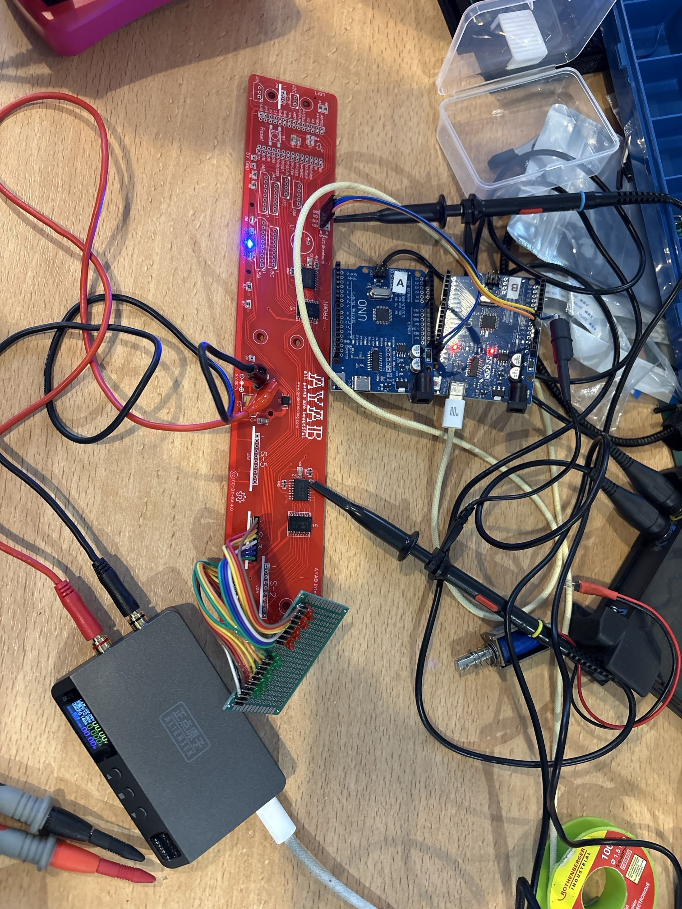

Conditions, as stated by the user: UNO B in place of A, same four wires, no
AREF jumper, bench supply off.

Running in the background, 48 s each, same builds as entry 17:

1. Crash-prone build (reference bit at default), twice.
2. Stable build (reference bit set), twice.

Expected to finish about four minutes after the start. On A the crash-prone
build restarted every 2.5 to 5 s or went silent; the stable build never
failed.

Notes:

- B reports the same USB identity as A (port name and "serial number"
  FX2348N), so the computer cannot tell the boards apart. Which board is
  connected is known only from the user.
- In the photo B appears to rest against or partly over the edge of A. If
  its underside touches metal on A that could cause trouble of its own.
  Flagged to the user; not changed during this run.

## 2026-11-20 14:56 — 22. RESULT: UNO B does not crash

Run of entry 21, UNO B, bench supply off, no AREF jumper.

| Run | Build | Restarts | Finished |
|---|---|---|---|
| 1 | crash-prone (reference bit default) | 0 | yes, at 42.8 s |
| 2 | crash-prone | 0 | yes, at 42.8 s |
| 3 | stable (reference bit set) | 0 | yes |
| 4 | stable | 0 | yes |

On UNO A, in the same conditions an hour earlier (entry 19), the same
crash-prone build restarted every 2.5 s or went silent in all three runs,
and it had failed in nearly every run all afternoon.

Interpretation: the crashes belong to UNO A as a unit, not to the board
design, the firmware, the wiring or the PCF8574 board. Two clean runs is a
small sample, so a longer soak on B follows.

## 2026-11-20 14:56 — 23. STARTED: longer soak of the crash-prone build on UNO B

*Run with: [tools/variants.sh](tools/variants.sh). Firmware: mcp-readback [variants.sh variants OLD] on usbmodem (flashed 14:56).*

Same conditions (UNO B, supply off, no jumper). Crash-prone build, four more
runs of 48 s in the background, about four minutes.

## 2026-11-20 14:59 — 24. RESULT: soak on UNO B

Run of entry 23. Raw summary lines (variant OLD is the crash-prone build):

```
14:56 variant [OLD]: banners=1 (restarts=0) at: 1.82  |   42.74  DONE
14:57 variant [OLD]: banners=1 (restarts=0) at: 1.82  |   42.79  DONE
14:58 variant [OLD]: banners=1 (restarts=0) at: 1.81  |   42.76  DONE
14:59 variant [OLD]: banners=1 (restarts=0) at: 1.81  |   42.79  DONE

[exited with code 0]
```

All four runs completed with no restart. Together with entry 22 that is six
clean runs out of six for the crash-prone build on UNO B, against failures in
nearly every run on UNO A.

Conclusion: UNO A is a faulty unit. Its failures (entries 5 to 19) say
nothing about the PCF8574 board. What still stands from the work done on A:

- The glitch-filter results of entry 4, from the two runs in which read-back
  was verified first. Worth repeating once on B.
- The scope measurement of board ground (entry 6).
- The clean MCP-style soak with the reference bit set (entries 5 and 17).

## 2026-11-20 15:07 — 25. Focus moves to the faulty UNO; chip identity read

*Run with: [tools/readserial_ts.py](tools/readserial_ts.py). Firmware: ident on usbmodem (flashed 15:07).*

The user wants to stay on the faulty Arduino for now and return to the
PCF8574 question later.

Possibility I have to record: UNO A may have been damaged during this
session, not faulty beforehand. Two moments could have stressed its SDA/SCL
pins: the very first test run, when the board's 5 V was disconnected while
the UNO drove the bus, and the glitch-filter test (entry 4), which briefly
drives both pins hard high. The first restarts were seen during that test.
Equally, A may always have been like this.

The user pointed out these boards carry ATmega328PB chips, not 328P. A
sketch ([ident/src/main.cpp](ident/src/main.cpp)) reads the chip's own
signature row. UNO A, nothing connected but USB:

| Item | UNO A |
|---|---|
| Device signature | 1E 95 16 = ATmega328PB |
| Serial bytes (0x0E to 0x17) | 48 31 51 41 30 39 69 13 27 4D |
| Factory oscillator calibration | 0x88 |
| Fuses low / high / extended | FF / DE / FD |

- Correction to the Setup section and entry 4: "ATmega328P signature
  confirmed" was wrong. That signature came from the bootloader, which
  reports a value compiled into it. The chip is a 328PB.
- The boards cannot be told apart over USB, but they can by this serial.
- Fuses: external crystal, low-power oscillator; brown-out detection at
  2.7 V; clock-failure detection off.
- Why the PB matters (interpretation): it has only the low-power crystal
  oscillator, where the 328P that UNO designs were made for also has a
  full-swing one. Low-power oscillators are more sensitive to noise and to
  the crystal's load capacitors, and a clock glitch produces exactly the
  random wild jumps and memory corruption seen in entry 15. That would make
  this a marginal-design problem that varies from board to board.

## 2026-11-20 15:07 — 26. STARTED: UNO A alone, nothing connected

*Run with: [tools/variants.sh](tools/variants.sh). Firmware: mcp-readback [variants.sh variants OLD; NO_I2C] on usbmodem (flashed 15:07).*

Conditions: UNO A on USB only, no wires on its headers (as stated by the
user). Reference bit at default. Background, 48 s per run, about 4 minutes:

1. Crash-prone build twice. With no board the I2C writes are simply not
   acknowledged, so this exercises the same code with a dead bus.
2. The same program with all I2C calls removed, twice (pure delay loops,
   timers and serial).

Question: does A fail by itself, or only with a live I2C bus?

## 2026-11-20 15:08 — 27. Close-up of UNO A (photo from the user)

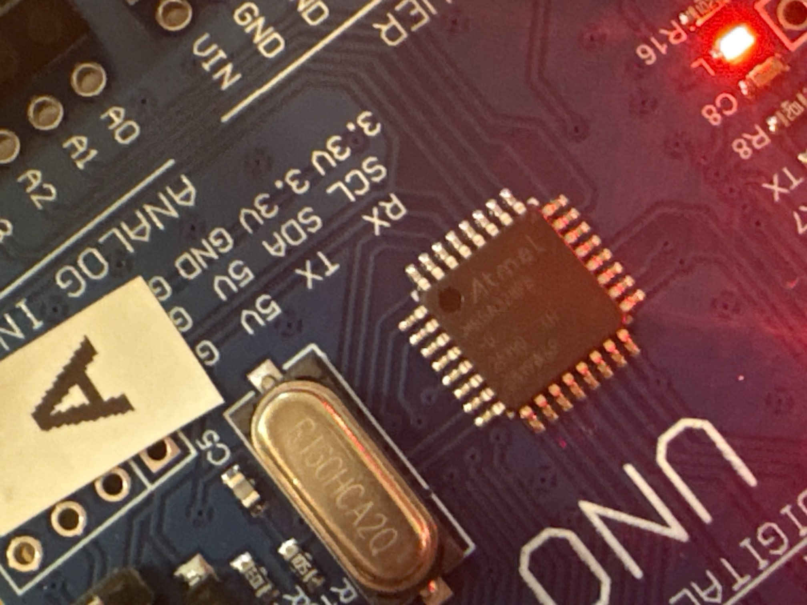

What I can and cannot read from it:

- The microcontroller is a 32-pin TQFP with an Atmel logo. The part number
  on it is too blurred to read here; the signature row (entry 25) says
  ATmega328PB.
- The crystal is a full-size HC-49S can. Its marking is partly legible
  ("...160HCA2Q" or similar), consistent with 16 MHz but I cannot confirm
  the value from the photo.
- Small surface-mount parts sit beside the crystal, presumably its load
  capacitors (one is labelled C5). Their values cannot be read from a photo.
- The "L" LED is lit. The test program does not drive pin 13, so that is
  probably the usual glow from a floating pin through the LED's buffer.
- No obvious solder bridge or missing part at this resolution, which is not
  enough to rule one out.

A matching close-up of B would allow a side-by-side comparison.

## 2026-11-20 15:11 — 28. RESULT: UNO A alone (run of entry 26)

Raw summary lines (OLD = crash-prone build with a dead bus, NO_I2C = same
program with all I2C calls removed):

```
15:08 variant [OLD]: banners=20 (restarts=19) at: 1.81 4.00 6.13 8.25 10.97 13.32 16.99 19.46 21.81 24.52 27.08 29.25 31.43 31.43 33.61 37.83 40.84 43.19 45.38 47.96  | 
15:09 variant [OLD]: banners=17 (restarts=16) at: 1.83 3.97 6.33 8.52 11.50 13.88 16.03 18.17 24.53 26.67 29.08 33.26 35.43 39.73 42.19 45.12 47.56  | 
15:10 variant [NO_I2C]: banners=1 (restarts=0) at: 1.82  | 
15:11 variant [NO_I2C]: banners=1 (restarts=0) at: 1.81  | 

[exited with code 0]
```

- With a dead bus and nothing connected, A restarted 19 and 16 times in
  48 s, about every 2.2 s. The fault is inside UNO A; it needs no board, no
  wiring and no working I2C bus.
- With all I2C calls removed there were no restarts in either run, but
  neither run printed its final "DONE" line within 48 s, although the program
  should finish in about 43 s. So either it also went wrong in a quieter way
  (hung, or jumped somewhere and stalled), or this variant simply takes
  longer than I assumed. Not yet known.

## 2026-11-20 15:11 — 29. STARTED: no-I2C variant on UNO A, full output, 70 s

*Run with: [tools/readserial_ts.py](tools/readserial_ts.py). Firmware: mcp-readback [variants.sh variants NO_I2C] on usbmodem (flashed earlier, 11-20 15:07).*

Same conditions (A alone on USB). One run of the no-I2C variant with every
line captured, to see whether it progresses through its phases and finishes,
or stalls.

## 2026-11-20 15:13 — 30. RESULT of entry 29, and a bug in my no-I2C variant

The full-output run printed its start banner and the "init" line, then
nothing for 70 s. The program-counter trace left by the previous run shows
where it was stuck: inside the Wire library's wait for a transmission to
complete.

That is my bug, not a symptom. The "no-I2C" variant skipped the I2C set-up
but, through a mistake in how I disabled the write, still called the
Adafruit write routine. With the I2C hardware never switched on, that call
waits forever. So the variant hangs at its first write on any board.

Consequences:

- Rows 3 and 4 of the table in entry 28, and the "ADC off and no I2C"
  row of entry 9, are invalid. They do not show that removing I2C stops
  the crashes. That question is still open.
- Entry 28's main result is unaffected: A crashes about every 2.2 s with
  nothing connected.

## 2026-11-20 15:13 — 31. STARTED: corrected no-I2C variant on UNO A

*Run with: [tools/variants.sh](tools/variants.sh). Firmware: mcp-readback [variants.sh variants NO_I2C] on usbmodem (flashed 15:13).*

Variant fixed so that no Wire or Adafruit call is made at all. UNO A alone on
USB, reference bit at default. Two runs of 55 s in the background. The
program should finish in about 43 s and print DONE.

## 2026-11-20 15:14 — 32. RESULT: corrected no-I2C variant on UNO A (run of entry 31)

```
15:13 variant [NO_I2C]: banners=2 (restarts=1) at: 1.81 2.45  |   42.84  DONE
15:14 variant [NO_I2C]: banners=1 (restarts=0) at: 1.82  |   45.46  DONE

[exited with code 0]
```

Also noted: the user reports the L LED is solidly on while A runs a program
that started from a genuine reset and has not restarted. With pin 13 an
input, that points to the board lighting L from a floating pin (a buffered
LED), not to the bootloader having left the pin driven. To be confirmed with
a pin-13 sketch and by looking at B.

Reading of entry 32: without any I2C activity A is far more stable. One
restart 0.6 s into the first run, then both runs went on to finish (about
43 s each). With the I2C code running against a dead bus it restarted every
2.2 s (entry 28). So I2C activity on A's own pins is a strong trigger, even
with nothing attached, but A is not perfectly stable without it either.

## 2026-11-20 15:15 — 33. STARTED: pin-13 / L LED check on UNO A

*Run with: [tools/readserial_ts.py](tools/readserial_ts.py). Firmware: scratch sketch ledtest (not kept) on usbmodem (flashed 15:15).*

A small sketch prints pin 13's registers as found at start-up, then cycles
forever: driven low 4 s, driven high 4 s, floating 4 s. The user watches the
L LED. Left running on A.

## 2026-11-20 15:16 — 34. Whole-board photo of UNO A (from the user)

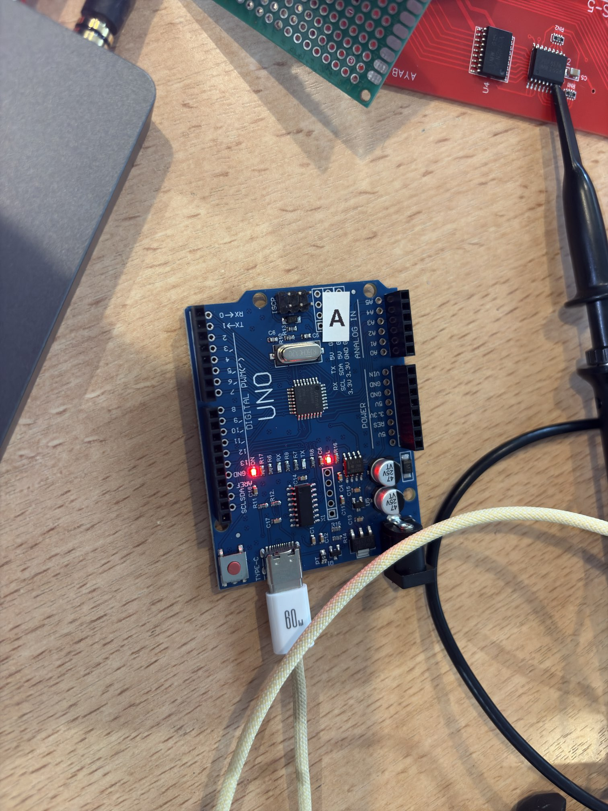

- Chip marking: enlarging the photo shows the Atmel logo and several lines of
  text beneath it, but they are not legible. The signature row read in entry
  25 (1E 95 16, ATmega328PB) remains the evidence for the part.
- There is an 8-pin chip immediately beside the L LED. That is where UNO
  designs put the buffer amplifier that drives L from pin 13, which fits the
  LED lighting from a floating pin (entries 32 and 33).
- The board was running the pin-13 cycle sketch when photographed, so L
  being lit here says nothing by itself.

## 2026-11-20 15:17 — 35. Chip marking on UNO A (macro photo from the user)

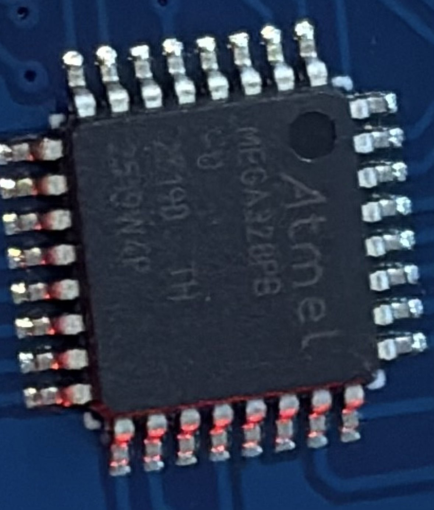

My reading, line by line, with confidence:

| Line | Reads as | Confidence |
|---|---|---|
| 1 | Atmel (logo) | certain |
| 2 | MEGA328PB | clear |
| 3 | a short suffix, probably "-U" | fair |
| 4 | four characters then "TH"; looks like 2219 followed by a letter | digits uncertain |
| 5 | about seven characters, something like 2559NGP | uncertain |

- The marking agrees with the signature row (entry 25): ATmega328PB.
- If line 4 is a date code it would be 2022, week 19, assembled in Thailand
  ("TH"). I am not sure of the digits.
- The serial bytes read from the chip (entry 25) begin with printable
  characters "H1QA09", the form a genuine part's lot number takes. That is
  mild evidence the chip is genuine, not proof.

## 2026-11-20 15:19 — 36. STARTED: pin health check on UNO A

*Run with: [tools/readserial_ts.py](tools/readserial_ts.py). Firmware: pinhealth on usbmodem (flashed 15:19).*

Conditions: UNO A on USB only, nothing on its headers (as last stated by the
user). Sketch: [pinhealth/src/main.cpp](pinhealth/src/main.cpp). Background,
about half a minute.

What it measures:

1. The chip's serial, so the result is tied to a board.
2. Hold test: every pin is driven to a level, released to a plain input and
   watched for 3 s using digital reads. A pin with leakage towards the
   opposite rail flips quickly; a healthy one keeps its charge for a while.
   Run once from low and once from high.
3. Analog levels on A0 to A5: driven low, driven high, and as an input with
   the internal pull-up. Leakage to ground comparable to the pull-up shows
   as a pull-up level well below the supply.

Three passes. The interest is in A4 and A5 (SDA and SCL) against the other
pins, and later in A against B. Floating-pin behaviour varies a lot between
healthy boards, so only clear outliers mean anything.

## 2026-11-20 15:20 — 37. RESULT: pin health check on UNO A (run of entry 36)

Board identified by its serial as A (4831514130396913274D). Raw output:

```
PINHEALTH signature 1E9516 serial 4831514130396913274D
As found at start-up: PINB=3F PINC=3E PIND=FF PINE=05  (PE0 is the old GND pin, PE1 the old VCC pin on a 328P layout)
--- pass 1
HOLD after driven LOW, then floating.  Per pin: time (ms) at which it was first seen flipped, or 'held'
  D8-D13 (PB0-5): 3000ms 3000ms 3000ms 3000ms 3000ms 3ms
  A0-A5  (PC0-5): held 3000ms 3000ms 3000ms 100ms 30ms
  D2-D7  (PD2-7): 1000ms 3000ms 3000ms 3000ms 3000ms 3000ms
  PE2-PE3       : 1000ms held
HOLD after driven HIGH, then floating. Per pin: time (ms) at which it was first seen flipped, or 'held'
  D8-D13 (PB0-5): held held held held held held
  A0-A5  (PC0-5): held held held held 10ms 10ms
  D2-D7  (PD2-7): held held held held held held
  PE2-PE3       : held held
ANALOG levels on A0-A5, mV (supply taken as 5000): driven low / driven high / input with pull-up
  A0: 0 / 5000 / 5000
  A1: 0 / 5000 / 5000
  A2: 0 / 5000 / 5000
  A3: 0 / 5000 / 5000
  A4: 0 / 5000 / 5000
  A5: 0 / 5000 / 5000
  internal 1.1 V reference reads raw 212 -> supply about 5308 mV
--- pass 2
HOLD after driven LOW, then floating.  Per pin: time (ms) at which it was first seen flipped, or 'held'
  D8-D13 (PB0-5): 3000ms 1000ms 1000ms 3000ms 3000ms 3ms
  A0-A5  (PC0-5): 3000ms 3000ms 3000ms 3000ms held 3000ms
  D2-D7  (PD2-7): 3000ms 3000ms 3000ms 3000ms 3000ms 3000ms
  PE2-PE3       : 1000ms held
HOLD after driven HIGH, then floating. Per pin: time (ms) at which it was first seen flipped, or 'held'
  D8-D13 (PB0-5): held held held held held held
  A0-A5  (PC0-5): held held held held held held
  D2-D7  (PD2-7): held held held held held held
  PE2-PE3       : held held
ANALOG levels on A0-A5, mV (supply taken as 5000): driven low / driven high / input with pull-up
  A0: 0 / 5000 / 5000
  A1: 0 / 5000 / 5000
  A2: 0 / 5000 / 5000
  A3: 0 / 5000 / 5000
  A4: 0 / 5000 / 5000
  A5: 0 / 5000 / 5000
  internal 1.1 V reference reads raw 212 -> supply about 5308 mV
--- pass 3
HOLD after driven LOW, then floating.  Per pin: time (ms) at which it was first seen flipped, or 'held'
  D8-D13 (PB0-5): 3000ms 1000ms 300ms 1000ms 1000ms 3ms
  A0-A5  (PC0-5): 3000ms 3000ms 3000ms 3000ms 3000ms 3000ms
  D2-D7  (PD2-7): 3000ms 3000ms 3000ms 3000ms 3000ms 3000ms
  PE2-PE3       : 1000ms held
HOLD after driven HIGH, then floating. Per pin: time (ms) at which it was first seen flipped, or 'held'
  D8-D13 (PB0-5): held held held held held held
  A0-A5  (PC0-5): held held held held held held
  D2-D7  (PD2-7): held held held held held held
  PE2-PE3       : held held
ANALOG levels on A0-A5, mV (supply taken as 5000): driven low / driven high / input with pull-up
  A0: 0 / 5000 / 5000
  A1: 0 / 5000 / 5000
  A2: 0 / 5000 / 5000
  A3: 0 / 5000 / 5000
  A4: 0 / 5000 / 5000
  A5: 0 / 5000 / 5000
  internal 1.1 V reference reads raw 212 -> supply about 5308 mV
DONE
```

Reading:

- **Analog levels are clean on all six pins**, including A4 and A5: 0 mV
  driven low, full supply driven high, full supply on the pull-up. No gross
  leakage to ground and no weak driver, as far as an unloaded test can show.
- **General floating behaviour:** released from low, most pins drift high
  within 1 to 3 s; released from high, they stay high. That is ordinary
  behaviour for unconnected CMOS pins.
- **D13 flips in 3 ms**, expected: it feeds the L LED buffer.
- **A4 and A5 misbehaved in pass 1 only.** Released from low they flipped at
  100 ms and 30 ms (other pins: seconds). Released from high they flipped
  low at 10 ms, which no other pin did in any pass. In passes 2 and 3 they
  behaved like the rest. One odd pass out of three is not enough to call;
  a disturbance at that moment (the board being handled, for instance) could
  do the same. Needs repeating.
- **Port E reads PE0 high and PE1 low at start-up.** On a board laid out for
  the 328P those two pins would be wired to ground and to the supply, giving
  the opposite. So either this board's layout leaves them unconnected, or my
  assumption about the layout is wrong. Noted, not understood.

## 2026-11-20 15:20 — 38. STARTED: pin health check on UNO A, three more runs

*Run with: [tools/readserial_ts.py](tools/readserial_ts.py). Firmware: pinhealth on usbmodem (flashed earlier, 11-20 15:19).*

Same conditions. Three more runs of the same sketch (nine passes) in the
background, about two minutes, to see whether the A4/A5 oddity of pass 1
recurs. The user is asked not to touch the board meanwhile.

## 2026-11-20 15:20 — 39. Sharp photo of the chip marking; correction to entry 35

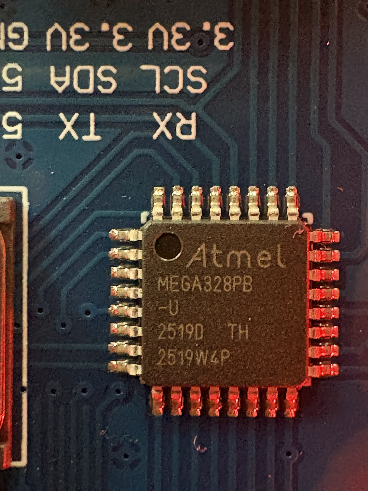

(Assumed to be UNO A; the user did not say which board.)

| Line | Marking |
|---|---|
| 1 | Atmel (logo) |
| 2 | MEGA328PB |
| 3 | -U |
| 4 | 2519D TH |
| 5 | 2519W4P |

Corrections to my reading in entry 35: line 4 is 2519D, not 2219; line 5 is
2519W4P, not "2559NGP".

- If 2519 is a date code in the usual year-week form, the part was made in
  week 19 of 2025, in Thailand.
- The package still carries the Atmel logo. I do not know whether current
  genuine production does, so I draw no conclusion about authenticity from
  the marking.

This photo arrived while the run of entry 38 was in progress. If the board
was handled to take it, that run's floating-pin results may be disturbed.

## 2026-11-20 15:21 — 40. RESULT: pin health check repeats on UNO A (run of entry 38)

Nine more passes in three runs. A0 to A5 lines only:

- Released from low: all six pins held for the full 3 s, in all nine passes.
- Released from high: all six held, in all nine passes.
- Start-up snapshot each time: PINB=3F PINC=3F PIND=FF PINE=0D.

The A4/A5 oddity of the first run did not recur once in nine passes. In this
batch the pins did not even show the slow upward drift of the first run,
which shows how much floating-pin behaviour depends on surroundings (a hand
or a phone near the board, most likely). The user may have handled the
board for a photo during part of this batch; even so nothing odd appeared.

Conclusion: the pin check finds nothing wrong with A's pins. Drive levels
and pull-ups are normal and A4/A5 behave like the other pins. This does not
support "A's I2C pins were damaged today", though an unloaded test cannot
exclude subtle damage.

## 2026-11-20 15:21 — 41. STARTED: what kind of activity triggers A's crashes?

*Run with: [tools/variants.sh](tools/variants.sh). Firmware: mcp-readback [variants.sh variants OLD; NO_I2C,TP=PORTC,TD=DDRC,TB=5; NO_I2C,TP=PORTC,TD=DDRC,TB=4; NO_I2C,TP=PORTC,TD=DDRC,TB=0; NO_I2C,TP=PORTD,TD=DDRD,TB=2; NO_I2C,TP=PORTB,TD=DDRB,TB=1; NO_I2C] on usbmodem (flashed 15:21).*

Known so far on A with nothing connected: the I2C hardware running against a
dead bus crashes it every 2.2 s (entry 28); no I2C activity at all gives
about one restart in 90 s (entry 32).

Question: is it the I2C peripheral itself, or just a pin toggling at
100 kHz, and does it matter which pin? Each variant below replaces the I2C
writes with 54 pulses on one ordinary output pin, no I2C hardware in use.
Reference bit at default. 48 s per run, in the background, about 7 minutes:

1. Crash-prone build, dead bus (baseline).
2. Toggle A5, the SCL pin (chip pin 28, next to the reset pin).
3. Toggle A4, the SDA pin.
4. Toggle A0, same port, far from reset.
5. Toggle D2, a different port.
6. Toggle D9, a different port, on the crystal side of the chip.
7. No toggling, no I2C (control).
8. Crash-prone build again (baseline).

## 2026-11-20 15:23 — 42. Was the layout updated for the 328PB? (question from the user)

The two chips differ on two pins of the left-hand side (pin 1 is at the dot):

| Pin | ATmega328P | ATmega328PB |
|---|---|---|
| 3 | GND | PE0 (an ordinary I/O pin) |
| 6 | VCC | PE1 (an ordinary I/O pin) |

So a board laid out for the 328P ties pin 3 to ground and pin 6 to the
supply; one adapted for the PB can leave them free.

Enlargement of pins 1 to 8 from the sharp photo of entry 39 (pin 1 at the
top):

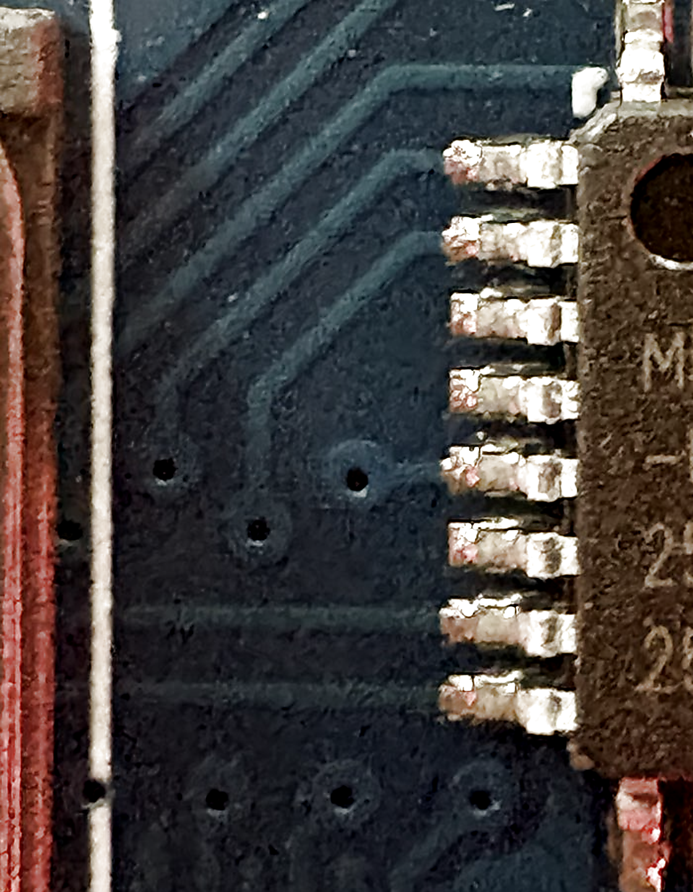

From the photo:

- Pins 1 and 2 have signal traces leaving up and to the left.
- Pin 3 has a trace that runs left, turns down and ends at a via.
- Pin 5 has a short stub to a via close to the chip.
- Pins 4 and 6 show no visible trace on this side.
- Pins 7 and 8 run left towards the crystal.

A photo cannot show where a via goes, so this does not settle it. Pin 3
ending at a via would fit a ground connection, which would be the 328P
wiring.

From the chip itself (entries 37 and 40): at every start-up PE0 reads high
and PE1 reads low. If pin 3 were tied to ground and pin 6 to the supply, PE0
would read low and PE1 high, every time. The readings are the opposite, in
five runs out of five.

Interpretation: the electrical evidence says pins 3 and 6 are not tied to
the rails the way a 328P layout would tie them, which points to a layout
that was at least adjusted for the PB. It conflicts with my reading of the
photo for pin 3, so one of the two is wrong. To be settled with a direct
test once the current batch finishes: switch on the internal pull-up on PE1
and see whether it rises (free pin) or stays low (tied to ground).

## 2026-11-20 15:26 — 43. Correction to entry 42: I misread the traces

The user asked me to show the pin 3 trace on the photo. Drawing it showed I
had assigned the traces to the wrong pins.

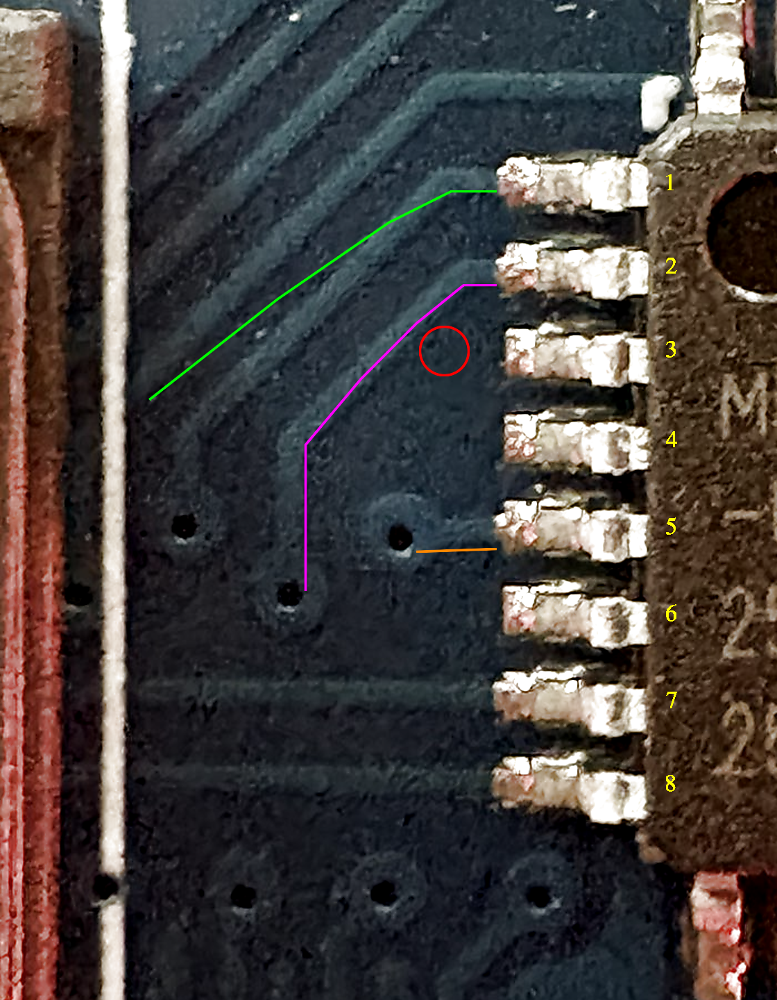

(Coloured guide lines are drawn just beside the traces they follow, so the
copper stays visible.)

- Green: the trace into pin 1.
- Magenta: the trace that bends and drops to a via. It enters **pin 2**, not
  pin 3 as I wrote in entry 42.
- Red circle: the area left of pin 3. No trace is visible there.
- Orange: the short stub from pin 5 (ground on both chips) to a via.
- Pins 4 and 6: no visible trace either.

Corrected reading: nothing visible connects pin 3 on this side of the board.
That removes the conflict noted in entry 42: the photo now agrees with the
electrical reading (PE0 high, PE1 low at every start-up) that pins 3 and 6
are not wired to ground and supply the way a 328P layout would wire them.

Limits: a pad can also connect underneath the chip or straight into a
copper pour, which a photo would not show. Pin 4 is the supply pin on both
chips and must connect somewhere, yet shows no visible trace, so "no visible
trace" is not proof of "not connected". The pull-up test on PE1 is still
worth doing.

## 2026-11-20 15:29 — 44. RESULT: which activity triggers A's crashes (run of entry 41)

UNO A alone on USB, reference bit at default, 48 s per run.

| Run | Activity in place of the I2C writes | Restarts |
|---|---|---|
| 1 | I2C hardware (Wire) against a dead bus | 13 |
| 2 | 54 pulses on A5 (the SCL pin) as a plain output | 0 |
| 3 | 54 pulses on A4 (the SDA pin) as a plain output | 0 |
| 4 | 54 pulses on A0 | 2 |
| 5 | 54 pulses on D2 | 1 |
| 6 | 54 pulses on D9 | 1 |
| 7 | nothing | 0 (ran to DONE) |
| 8 | I2C hardware (Wire) against a dead bus | 18 |

- Toggling the very same two pins as ordinary outputs does not crash A.
  Running the I2C peripheral on them does, about every 2.5 s.
- So the trigger is the I2C hardware being in use, or the Wire library's
  interrupt code that goes with it. It is not simply a 100 kHz signal on
  those pins, and not their position next to the reset pin.
- Without the I2C peripheral there is still a low background rate, 0 to 2
  restarts per run, on any pin or none.

The user has offered continuity checks. Requested, with A unpowered: chip
pin 3 to GND; pin 6 to 5 V; pin 4 to 5 V and pin 5 to GND as sanity checks;
pin 18 (analog supply) to 5 V as a resistance; pin 20 to the AREF header
pin; pin 21 to GND. Pin 18 on B too if possible.

Idea to test next (interpretation): a marginal memory cell. The I2C library
uses memory and stack depth that the other variants never touch. If a few
RAM bits on A are weak, programs that use them get corrupted return
addresses and variables, which is what entry 15 showed. A RAM soak test,
writing and re-reading patterns over all unused memory while the I2C
hardware runs, would show flipped bits directly and say where they are.

## 2026-11-20 15:38 — 45. Continuity checks by the user (UNO A unpowered)

Pin 1 is at the dot; pins 1 to 8 run down the left side, 17 to 24 up the
right side.

| Check | Reading | Meaning |
|---|---|---|
| Pin 3 to GND | 76 kΩ | not wired to ground |
| Pin 6 to 5 V | about 80 kΩ, drifting upward | not wired to the supply |
| Pin 4 to 5 V, pin 5 to GND | both connected | supply and ground as expected; confirms the pin counting |
| Pin 18 (analog supply) to 5 V | near 0 Ω | wired straight to 5 V, no series inductor or resistor |
| Pin 20 to the AREF header pin | connected | as expected |
| Pin 21 to GND | connected | as expected |
| UNO B, pin 18 to 5 V | near 0 Ω | same as A |

Conclusions:

- **The layout is adapted for the 328PB.** Pins 3 and 6, which a 328P board
  ties to ground and supply, are free here. This agrees with the chip's own
  reading (PE0 high, PE1 low) and with the corrected photo reading of entry
  43. The tens of kilo-ohms are what a meter sees through an unpowered
  chip's inputs, not a wired connection.
- **The analog supply pin is the same node as the 5 V rail**, on A and on B.
  That weakens my explanation from entry 15. I had supposed the analog
  supply was poorly decoupled and that the reference setting helped by
  lending it the AREF capacitor. With the pin tied directly to the board's
  5 V, it shares whatever decoupling the rail has, and an extra 100 nF
  reached through an internal switch should make little difference. The
  measured fact stands (17 clean runs with the setting, crashes without),
  but I no longer have a convincing reason for it.
- A and B are wired the same on the one point compared, so the difference
  between them is not this.

## 2026-11-20 15:40 — 46. STARTED: RAM soak on UNO A

*Run with: [tools/readserial_ts.py](tools/readserial_ts.py). Firmware: ramsoak [default; -DNOTWI; -DREFBIT] on usbmodem (flashed 15:40).*

Conditions: UNO A on USB only, nothing on its headers (stated by the user).
Sketch: [ramsoak/src/main.cpp](ramsoak/src/main.cpp).

Each cycle fills all RAM between the program's own variables and a margin
below the stack (about 1.5 kB) with an address-dependent pattern, runs eight
I2C transactions against the dead bus through Wire, then reads the area back
and reports every changed byte with its address. The pattern changes each
cycle and is inverted on alternate cycles.

Three runs of 60 s in the background, about 4 minutes:

1. Reference bit at default, I2C on (the crash-prone combination).
2. Reference bit at default, I2C off (same fill, wait and verify).
3. Reference bit set, I2C on.

What would support the weak-memory idea: changed bytes in run 1, at
repeating addresses or bit positions, and few or none in runs 2 and 3.

## 2026-11-20 15:41 — 47. Note from the user: test board now carries a Metro Mini

For use once the Arduino question is closed. The user has soldered sockets
onto the test board and plugged in a Metro Mini. It is still the bench test
board, not the faulty machine's board, and a different Metro Mini from the
machine's.

Consequences for later:

- The bench can run the real AYAB firmware on the same kind of controller
  as the machine, powered and grounded through the board as on the machine,
  instead of a UNO on jumper wires.
- No UNO should be connected to the board's I2C header while the Metro Mini
  is fitted and powered: two controllers on one bus, and two 5 V sources
  tied together.

## 2026-11-20 15:44 — 48. RESULT of entry 46 (RAM soak on A), with a bug in my test

Restart counts per 60 s run:

| Run | Reference bit | I2C | Restarts | Ran to the end of the minute |
|---|---|---|---|---|
| 1 | default | on | 4 (at 4, 14, 33 s) | yes |
| 2 | default | off | more than 45, sometimes several per second | restarting throughout |
| 3 | set | on | 0 | yes, 8,832 cycles |

Bug: no changed-byte report was ever printed, and the error counters show
nonsense values. My test area started too low and overlapped the three
variables that hold the test's own counters across a restart, so the fill
pattern overwrote them. The memory comparison itself was therefore not
reported, and this run says nothing yet about weak memory cells.

What the restart counts do show, independently of that bug:

- **Run 2 crashes far more than anything before, with no I2C at all.** This
  program spends its time in tight loops writing and reading memory. So the
  I2C hardware is not required after all. Entry 44's conclusion ("the trigger
  is the I2C hardware being in use") was too narrow: I2C was one kind of
  activity that provokes it, and heavy memory access is another, stronger
  one.
- **Run 3: with the reference bit set, the same program is clean again.**
  That is now 18 clean runs out of 18 with the bit set, across different
  programs.

Caution on run 2 against run 1: with I2C on, each cycle spends most of its
time waiting on the bus, so far fewer memory operations happen per second.
The difference in restart rate probably reflects that, not a protective
effect of I2C.

## 2026-11-20 15:44 — 49. STARTED: RAM soak on A, test area fixed

*Run with: [tools/readserial_ts.py](tools/readserial_ts.py). Firmware: ramsoak [-DNOTWI; default; -DREFBIT] on usbmodem (flashed 15:44).*

Test area now starts after the counters. Same three configurations, 45 s
each, in the background, about 3 minutes. UNO A alone on USB.

## 2026-11-20 15:47 — 50. RESULT of entry 49: memory is fine, a CPU register gets corrupted

UNO A alone on USB, 45 s per run.

| Run | Reference bit | I2C | Restarts | Memory errors reported |
|---|---|---|---|---|
| 1 | default | off | 72 | 3 bursts (see below) |
| 2 | default | on | 1 (at 42 s, after 6,523 cycles) | none |
| 3 | set | on | 0 (6,440 cycles) | none |

The three error bursts in run 1 each start at an arbitrary address in the
middle of the test area (0x2D2, 0x4FB, 0x6ED) and then continue on every
following address.

Checking the numbers shows what happened. Example, first error of one burst:
address 0x4FB, cycle counter 11, "expected" 0xDA, "read" 0x95.

- 0x95 is exactly the right pattern for address 0x4FB in cycle 11. The
  memory held the correct value.
- 0xDA is not the right pattern for that address in any cycle. The value
  the test *computed* as expected was wrong.
- The same holds down the burst: expected is always the true value plus
  0x45.

So no memory cell failed. Part-way through the read-back loop, a value the
CPU was holding in a register for the comparison changed, and stayed
changed for the rest of the loop. Across about 14,000 cycles in runs 2 and
3, each covering 1.5 kB, there was not one genuine memory error.

Interpretation: the weak-memory-cell idea (entry 44) is wrong for the bulk
of RAM. What gets corrupted is CPU state, at a moment unrelated to what the
loop is doing. That is how an interrupt behaves: it pauses the program at an
arbitrary instruction, saves registers on the stack, and restores them
afterwards. If that save and restore goes wrong (bad stack memory at the
top of RAM, or the interrupt mechanism itself), a register, a status flag
or a return address comes back altered. That one mechanism would account
for every symptom so far: wrong comparisons, loops ending early, garbage
variables, and wild jumps. The only interrupts in run 1 are the millisecond
timer and serial transmission.

## 2026-11-20 15:47 — 51. STARTED: is it interrupts, and is it the stack's memory?

*Run with: [tools/readserial_ts.py](tools/readserial_ts.py). Firmware: ramsoak [-DNOTWI; -DNOTWI -DNOIRQ; -DNOTWI -DSTACKMID] on usbmodem (flashed 15:47).*

UNO A alone on USB, reference bit at default, no I2C. Three variants of the
RAM soak, 45 s each, in the background, about 3 minutes:

1. As before (control).
2. Interrupts switched off during the fill, wait and read-back; on only
   briefly between cycles.
3. Stack moved to the middle of RAM, with the top of RAM, where the stack
   normally lives, added to the tested area.

If 2 is clean, interrupts are involved. If 3 is clean, or reports errors at
fixed addresses near the top of RAM, the stack's usual memory is the weak
spot.

## 2026-11-20 15:51 — 52. RESULT of entry 51: inconclusive, the control went quiet

| Run | Variant | Restarts | Error bursts | Cycles |
|---|---|---|---|---|
| 1 | control | 1 | 1 (whole area in one cycle) | 4,535 |
| 2 | interrupts off during memory work | 0 | 0 | 5,000 |
| 3 | stack moved to mid-RAM, top of RAM tested | 0 | 0 | 3,335 |

Runs 2 and 3 are clean, but so, nearly, is the control: 1 restart, where
the previous build of the same test gave 72 (entry 50). The only change to
the control was restructuring the read-back into its own function. So this
batch cannot tell interrupts or stack location apart from chance.

- The one error burst in run 1 again shows correct memory and a wrong
  computation, this time for an entire cycle.
- Run 3 does add something: the top of RAM (0x600 to 0x8FF), where the
  stack normally lives, passed 3,335 cycles with no error. So the stack's
  memory cells are not obviously weak either.

A pattern worth naming: A's crash rate changes enormously with small
changes to the program. Same bytes on the I2C bus sent through two code
paths (entry 14), delay loops against memory loops (entry 48), and now the
same memory test before and after a small reshuffle. Whatever is wrong is
sensitive to exactly which instructions run, not just to what the program
does.

### New idea: floating port E pins (interpretation, to be tested)

The 328PB has four pins the 328P does not have as I/O: PE0, PE1, PE2, PE3,
on chip pins 3, 6, 19 and 22. Firmware built for the 328P knows nothing
about them and leaves them as inputs. Entry 45 showed pins 3 and 6 are not
connected to anything on this board, so they float. A floating logic input
sitting near mid-level draws current and switches erratically.

Where these pins sit:

- Pin 6 (PE1) is next to pin 7, the crystal input. The 328PB's low-power
  oscillator swings a small signal there. A floating neighbour picking it up
  and switching could disturb the clock, and a disturbed clock corrupts
  whatever instruction is executing: exactly the instruction-sensitive,
  random corruption seen.
- Pins 19 and 22 (PE2, PE3) are either side of the analog supply, AREF and
  analog ground (pins 18, 20, 21). Whether AREF sits at 0 V or 5 V changes
  what a floating neighbour drifts to. That would connect the reference
  setting to the fault, which nothing else so far has.

It would also explain board-to-board differences: where a floating pin
drifts depends on leakage, which varies between chips.

## 2026-11-20 15:51 — 53. STARTED: internal pull-ups on the port E pins

*Run with: [tools/variants.sh](tools/variants.sh). Firmware: mcp-readback [variants.sh variants OLD; PEPU=0x0F; PEPU=0x03; PEPU=0x0C] on usbmodem (flashed 15:51).*

UNO A alone on USB. The reliably crashing program (Adafruit path against a
dead bus, reference bit at default; 13 to 19 restarts per 48 s in entries
28 and 44), with one added line that switches on internal pull-ups on port
E pins so they no longer float. Five runs of 48 s in the background, about
5 minutes:

1. No pull-ups (control).
2. Pull-ups on all four (PE0 to PE3).
3. Pull-ups on PE0 and PE1 only (pins 3 and 6, by the supply and crystal).
4. Pull-ups on PE2 and PE3 only (pins 19 and 22, by AREF).
5. No pull-ups (control again).

## 2026-11-20 15:56 — 54. RESULT of entry 53: pull-ups on port E do not cure it

UNO A alone on USB, 48 s per run.

| Run | Pull-ups | Restarts | Note |
|---|---|---|---|
| 1 | none (control) | 15 | |
| 2 | PE0 to PE3 | 8 | then went silent at 26 s |
| 3 | PE0, PE1 | 14 | |
| 4 | PE2, PE3 | 8 | then went silent at 28 s |
| 5 | none (control) | 19 | |

With every port E pin pulled up, A still restarts every 2 to 3 s. The lower
counts in runs 2 and 4 are only because those runs ended early in the
"silent" failure. The floating-pin idea of entry 52 is wrong, or at least is
not the cause.

Ideas tried and ruled out for UNO A so far: bad wiring; the PCF8574 board;
the 12 V side; the read-back code; a floating analog supply; something on
the AREF pin; poor decoupling of the analog supply (weakened by entry 45);
damaged I2C pins; the I2C peripheral as such; weak RAM cells in the bulk of
memory and at the top; floating port E pins.

Facts that have held throughout: it is specific to this board; it corrupts
CPU state at random moments; its rate depends strongly on exactly which
instructions run; and setting the ADC reference bit stops it (18 runs out
of 18).

## 2026-11-20 15:56 — 55. STARTED: does a slower CPU clock stop it?

*Run with: [tools/variants.sh](tools/variants.sh). Firmware: mcp-readback [variants.sh variants OLD; CLKDIV=1; CLKDIV=2] on usbmodem (flashed 15:56).*

The clock prescaler can be changed by the program. Same crashing program,
UNO A alone on USB, reference bit at default. Four runs of 48 s in the
background, about 4 minutes:

1. Full speed, 16 MHz (control).
2. Half speed, 8 MHz.
3. Quarter speed, 4 MHz.
4. Full speed (control).

The crystal still runs at 16 MHz in all of them; only the divided clock
that reaches the CPU changes. If the slower runs are clean, something inside
the chip is too slow for 16 MHz on this unit (a timing margin). If they
still crash at about the same rate per instruction executed, timing margin
is not the issue. At half speed the program does half as much per second,
so half the restarts would mean "no change".

## 2026-11-20 16:00 — 56. RESULT of entry 55: no usable data from the slow-clock runs (my mistake)

| Run | CPU clock | Result |
|---|---|---|
| 1 | 16 MHz | 17 restarts |
| 2 | 8 MHz | nothing readable received |
| 3 | 4 MHz | nothing readable received |
| 4 | 16 MHz | 4 restarts, then silent from 12 s |

The slow-clock runs printed nothing I could read. Cause: I doubled and
quadrupled the requested baud rate to compensate for the slower clock, but
115200 does not divide accurately enough at those settings (3.5 % and 8.5 %
off), so the serial output was garbled. Nothing can be concluded about the
clock from this batch.

## 2026-11-20 16:00 — 57. STARTED: slow-clock runs again, at 38400 baud

*Run with: [tools/variants.sh](tools/variants.sh). Firmware: mcp-readback [variants.sh variants CLKDIV=1; CLKDIV=2] on usbmodem (flashed 16:00).*

38400 baud divides almost exactly at 8 MHz and 4 MHz. UNO A alone on USB,
reference bit at default, same crashing program. Two runs of 60 s in the
background: 8 MHz, then 4 MHz. About 2.5 minutes.

## 2026-11-20 16:02 — 58. RESULT of entry 57: at 8 MHz and 4 MHz there are no restarts

UNO A alone on USB, reference bit at default, same crashing program, 60 s
per run, serial at 38400 baud.

| Run | CPU clock | Restarts in 60 s |
|---|---|---|
| 1 | 8 MHz | 0 |
| 2 | 4 MHz | 0 |

At 16 MHz the same program restarts every 2.5 s or so (15 to 19 times in
48 s). If slowing the clock made no difference per instruction, 8 MHz would
show about ten restarts in a minute and 4 MHz about five. Both show none.

Caveat: this summary only counts start-up banners. It does not yet prove
the program was progressing normally and not simply stuck. The next batch
also counts the phase lines the program prints as it goes.

## 2026-11-20 16:02 — 59. STARTED: confirm the clock-speed effect

*Run with: [tools/variants.sh](tools/variants.sh). Firmware: mcp-readback [variants.sh variants CLKDIV=1; CLKDIV=0; CLKDIV=2] on usbmodem (flashed 16:02).*

UNO A alone on USB, reference bit at default. Five runs of 60 s at 38400
baud in the background, about 6 minutes, now also counting progress lines:

1. 8 MHz
2. 16 MHz (control, same baud rate and build options otherwise)
3. 8 MHz
4. 16 MHz
5. 4 MHz

## 2026-11-20 16:08 — 60. RESULT of entry 59: confirmed, UNO A only fails at full clock speed

UNO A alone on USB, reference bit at default, same program, 60 s per run,
38400 baud throughout. "Progress lines" are the status lines the program
prints as it completes each phase.

| Run | CPU clock | Restarts | Progress lines |
|---|---|---|---|
| 1 | 8 MHz | 0 | 5, steady progress |
| 2 | 16 MHz | 6, then silent from 20 s | 8, across 7 starts |
| 3 | 8 MHz | 0 | 5, steady progress |
| 4 | 16 MHz | 8, then silent from 28 s | 11, across 9 starts |
| 5 | 4 MHz | 0 | 3, steady progress (slower) |

Alternating runs, same build options otherwise, same baud rate. With entry
58 that is five runs at reduced clock with no restart, against failure in
every 16 MHz run.

Conclusion: on UNO A the processor does not run reliably at 16 MHz, and
runs correctly at 8 MHz and below. This is a timing-margin fault. It fits
what was seen all along:

- corruption of CPU state at random moments (entries 15, 50);
- strong dependence on exactly which instructions run (entries 14, 48, 52),
  since different instructions use paths of different speed inside the chip;
- one board affected and another identical one not (entries 22 to 24).

Two places the margin could be lost, which this test cannot separate:

1. The chip itself is slow (a weak or out-of-specification part).
2. The 16 MHz clock arriving from the crystal circuit is poor on this board
   (uneven high and low times, or jitter). Dividing the clock by two always
   produces even high and low times, so it would hide such a defect.

Why setting the ADC reference bit also cures it at 16 MHz is still not
explained. It evidently buys back a little margin inside the chip.

Practical outcome: UNO A is not fit for use at 16 MHz. UNO B is. The hours
of crashes on the bench came from this instrument and say nothing about the
PCF8574 board.

## 2026-11-20 16:11 — 61. UNO A labelled; UNO B identified; STARTED: A's failing tests on B

*Run with: [tools/readserial_ts.py](tools/readserial_ts.py), [tools/variants.sh](tools/variants.sh). Firmware: ident on usbmodem (flashed 16:10); mcp-readback [variants.sh variants OLD] on usbmodem (flashed 16:11); ramsoak [-DNOTWI; default] on usbmodem (flashed 16:11).*

- A label reading "BAD AT 16 MHz" was printed for UNO A at the user's
  request.
- The user plugged B back in and asked for it to be tested. What is on B's
  headers was not stated; assumed nothing, as for A's recent tests.

Chip identity read from the board now connected:

| Item | UNO A | UNO B |
|---|---|---|
| Device signature | 1E 95 16 (ATmega328PB) | 1E 95 16 (ATmega328PB) |
| Serial bytes | 48 31 51 41 30 39 69 13 27 4D | 30 31 47 32 55 37 69 0A 21 32 |
| Lot, as text in the serial | H1QA09 | 01G2U7 |
| Factory oscillator calibration | 0x88 | 0x91 |
| Fuses low / high / extended | FF / DE / FD | FF / DE / FD |

The two chips come from different production lots. Fuses are identical.

Running on B in the background, reference bit at default throughout, about
6 minutes. These are the programs that fail hardest on A:

1. The crashing program (Adafruit path, dead bus) at 16 MHz, three runs of
   48 s. On A: 13 to 19 restarts per run.
2. RAM soak without I2C, 45 s. On A: up to 72 restarts.
3. RAM soak with I2C, 45 s.

## 2026-11-20 16:14 — 62. RESULT of entry 61: A's failing tests on UNO B

Conditions confirmed by the user: nothing on B's headers. Raw summary:

```
16:11 variant [OLD]: banners=1 (restarts=0) phase-lines=6 at: 1.78  |   36.41  DONE
16:12 variant [OLD]: banners=1 (restarts=0) phase-lines=6 at: 1.82  |   36.40  DONE
16:13 variant [OLD]: banners=1 (restarts=0) phase-lines=6 at: 1.78  |   36.40  DONE
=== ramsoak flags [-DNOTWI]
banners: 1  RAMERR lines: 0
   1.82  RAMSOAK serial 303147325537690A2132 refbit=default twi=off
  41.83  progress: cycles 4544 errors 0 area 0x1CF-0x895
=== ramsoak flags []
banners: 1  RAMERR lines: 0
   1.81  RAMSOAK serial 303147325537690A2132 refbit=default twi=on
  41.83  progress: cycles 5686 errors 0 area 0x2A7-0x894

[exited with code 0]
```

Reading of entry 62: B is clean on everything that breaks A. The crashing
program ran to DONE three times at 16 MHz with no restart (A: 13 to 19
restarts per run). The RAM soak ran 4,544 cycles without I2C and 5,686 with
it, no restart and no error (A: up to 72 restarts). The serial printed by
the test confirms the board was B.

## 2026-11-20 16:15 — 63. A fourth UNO

The user found a fourth UNO clone and asked for a label "D" for it, which
was printed. Boards are now A (bad at 16 MHz), B (good), C and D (untested).

## 2026-11-20 16:17 — 64. STARTED: UNO C and UNO D tested in parallel

*Run with: [tools/battery.sh](tools/battery.sh). Firmware: ident on usbmodem (flashed 16:17); mcp-readback [-DOLD -DNOREAD] on usbmodem (flashed 16:17); ramsoak [-DNOTWI; default] on usbmodem (flashed 16:17); ident on usbmodem4 (flashed 16:17); mcp-readback [-DOLD -DNOREAD] on usbmodem4 (flashed 16:17); ramsoak [-DNOTWI; default] on usbmodem4 (flashed 16:17).*

Conditions as stated by the user: C and D both on USB, nothing on their
headers; C is the one connected through a USB hub.

Ports as seen by the computer:

| Port | USB location | Board (from the user's description) |
|---|---|---|
| /dev/cu.usbmodemFX2348N1 | 1-1.1, behind a hub | C |
| /dev/cu.usbmodem4 | 0-1, direct | D |

The scope is no longer on USB.

Same battery as B (entry 61), run on both boards at once from separate
copies of the test projects ([tools/battery.sh](tools/battery.sh)), about
6 minutes, reference bit at default:

1. Read the chip's identity.
2. The crashing program at 16 MHz, three runs of 48 s.
3. RAM soak without I2C, 45 s.
4. RAM soak with I2C, 45 s.

## 2026-11-20 16:21 — 65. RESULT of entry 64: UNO C and UNO D both pass

*Firmware: scratch sketch blink (not kept) on usbmodem (flashed 16:21).*

Reference bit at default, nothing on the headers, both boards tested at the
same time.

| Test | UNO C (hub port) | UNO D (direct port) |
|---|---|---|
| Crashing program at 16 MHz, run 1 | 0 restarts, DONE | 0 restarts, DONE |
| run 2 | 0 restarts, DONE | 0 restarts, DONE |
| run 3 | 0 restarts, DONE | 0 restarts, DONE |
| RAM soak without I2C, 45 s | 0 restarts, 0 errors, 4,544 cycles | 0 restarts, 0 errors, 4,544 cycles |
| RAM soak with I2C, 45 s | 0 restarts, 0 errors, 5,686 cycles | 0 restarts, 0 errors, 5,687 cycles |

Chip identities, all four boards:

| Board | Serial bytes | Lot text | Oscillator calibration | Result at 16 MHz |
|---|---|---|---|---|
| A | 48 31 51 41 30 39 69 13 27 4D | H1QA09 | 0x88 | fails |
| B | 30 31 47 32 55 37 69 0A 21 32 | 01G2U7 | 0x91 | passes |
| C | 30 31 47 32 55 37 69 0A 22 48 | 01G2U7 | 0x88 | passes |
| D | 49 31 55 54 4F 41 69 03 22 21 | I1UTOA | 0x67 | passes |

- B and C carry chips from the same lot, and their serials differ only in
  the last two bytes. A and D are each from a different lot.
- Three boards of four pass. A is the only one that fails, and the only one
  from its lot, so nothing can be said about whether the lot matters.

All four are ATmega328PB (signature 1E 95 16).

An LED-flashing sketch (three quick flashes, a pause, repeating) was then
uploaded to the port behind the hub, which I take to be C, so the user can
check the board-to-port mapping. D is left running its last test program.

On port names (question from the user): macOS names these ports from the
USB serial-number string, which is the same on every board, so the first
board to appear gets usbmodemFX2348N1 and a second gets a fallback name
(usbmodem4 here). The names would swap if the boards were replugged in the
other order. Boards are therefore matched by USB location and confirmed by
the chip serial, not by port name.

## 2026-11-20 16:35 — 66. Board-to-port mapping confirmed

The user confirms the triple-flash sketch is running on the board labelled
C. So the port behind the hub was C and the direct port was D, as assumed in
entries 64 and 65, and the serials in entry 65 are attributed to the right
boards.

State of the Arduino question:

- UNO A: processor unreliable at 16 MHz, sound at 8 MHz and below, or at
  16 MHz with the ADC reference bit set. Labelled "BAD AT 16 MHz".
- UNO B, C, D: pass every test that breaks A.
- Cause on A narrowed to a timing margin (slow chip or poor 16 MHz clock on
  that board); not separated further. Why the reference bit helps is not
  explained.

## 2026-11-20 16:36 — 67. STARTED: the Metro Mini, alone on USB

*Run with: [tools/battery.sh](tools/battery.sh). Firmware: ident on usbserial (flashed 16:36); mcp-readback [-DOLD -DNOREAD] on usbserial (flashed 16:36); ramsoak [-DNOTWI; default] on usbserial (flashed 16:36).*

Conditions as stated by the user: the Metro Mini (the one intended for the
test board, not the machine's) is on USB and not plugged into the test
board.

Seen by the computer: /dev/cu.usbserial-10, a CP2102N USB-to-serial bridge
(USB id 10C4:EA60), connected directly to the Mac. UNO C is still on the
hub port.

Same battery as for the UNOs ([tools/battery.sh](tools/battery.sh)),
reference bit at default, about 6 minutes in the background:

1. Chip identity.
2. The program that crashes UNO A, at 16 MHz, three runs of 48 s.
3. RAM soak without I2C, 45 s.
4. RAM soak with I2C, 45 s.

## 2026-11-20 16:40 — 68. RESULT of entry 67: the Metro Mini passes; it is an ATmega328P

Metro Mini alone on USB, reference bit at default.

| Item | Metro Mini |
|---|---|
| Device signature | 1E 95 0F = ATmega328P (not the PB) |
| Serial bytes | 42 32 33 30 37 38 FF 19 18 04 (lot text "B23078") |
| Factory oscillator calibration | 0xAF |

| Test | Result |
|---|---|
| Crashing program at 16 MHz, three runs | 0 restarts, DONE each time |
| RAM soak without I2C, 45 s | 0 restarts, 0 errors, 4,544 cycles |
| RAM soak with I2C, 45 s | 0 restarts, 0 errors, 5,687 cycles |

The Metro Mini is a sound controller by every test that breaks UNO A, and
it carries the plain 328P, a different chip from the four UNO clones.

Summary of all controllers tested today:

| Board | Chip | Result at 16 MHz |
|---|---|---|
| UNO A | ATmega328PB | fails |
| UNO B | ATmega328PB | passes |
| UNO C | ATmega328PB | passes |
| UNO D | ATmega328PB | passes |
| Metro Mini (bench) | ATmega328P | passes |

## 2026-11-20 16:49 — 69. STARTED: Metro Mini on the test board, first check

*Run with: [tools/readserial_ts.py](tools/readserial_ts.py). Firmware: mcp-readback on usbserial (flashed 16:49); busdiag on usbserial (flashed 16:50).*

Back to the original problem. Conditions as stated by the user: the Metro
Mini is now plugged into the test board's sockets and is on USB. Not yet
stated: whether the bench supply is on, what is on the solenoid outputs,
and whether the scope is connected.

First check, in the background, about a minute: the self-checking test of
entry 5 in its full form (MCP-style and native writes, every write followed
by a read-back of both PCF8574s, UNO supply monitor on). This confirms the
controller can talk to both chips through the board's own wiring, before
anything else is attached.

## 2026-11-20 16:51 — 70. RESULT of entry 69: the Metro Mini cannot see the PCF8574s

Self-check through the Metro Mini on the test board: every read-back came
back as 0xFFFF (34,527 mismatches in 17,483 writes), and the run finished in
33 s instead of the usual 43 to 46 s. Both are what an unanswered bus looks
like: no chip acknowledges, so each transaction is cut short and each read
returns all ones. The controller itself ran normally, supply 5.07 to 5.12 V.

Follow-up diagnostic ([busdiag/src/main.cpp](busdiag/src/main.cpp)), which
drives each bus line low, releases it and looks at where it settles, then
scans every address:

| Line | 0.2 ms after release | 20 ms after release | Level |
|---|---|---|---|
| SDA (A4) | low | low | about 0.96 V |
| SCL (A5) | low | low | about 0.59 V |

No address acknowledges. Chip confirmed as the bench Metro Mini (serial
423233303738FF191804).

On this board SDA and SCL each have a 5 kΩ pull-up to the board's 5 V rail
(R7, R8). A released line should therefore snap to 5 V. Sitting below 1 V
means either the Metro Mini's A4/A5 pins are not reaching the board's bus,
or they are, and the board's 5 V rail is not powered, so the "pull-ups"
pull towards a dead rail. The levels (not 0 V, not 5 V) fit the second
better.

To check with the user: is the board's 5 V LED lit; is the Metro Mini
seated the right way round and not offset by a pin; what voltage is between
the board's 5 V and GND pads.

## 2026-11-20 16:51 — 71. Bench solenoid, as characterised by the user

- Coil resistance about 5 Ω (stated earlier).
- Starts moving at 4 V, drawing about 1 A.
- Once pulled in, holds until the voltage drops below 0.8 V.

Consequences for the test:

- A ULN2803 output is rated for 500 mA, so the board cannot pull this
  solenoid in. That does not matter: the test needs coil current being
  switched, not the plunger moving.
- With the bench supply at about 3 V, and about 1 V lost in the ULN2803,
  the coil carries about 0.4 A, inside the rating. LEDs on the other outputs
  will not light at 3 V.
- For comparison, a machine solenoid carries about 75 mA. One bench solenoid
  at 0.4 A switches roughly as much current as five machine solenoids
  dropping together, so it is a fair stand-in for the "several on" case.

## 2026-11-20 16:56 — 72. Cause of entry 70: the Metro Mini was plugged in the wrong way round

Found by the user. That explains the dead bus: reversed, its I2C and supply
pins land on other positions of the footprint, so the board's 5 V rail and
bus were not connected to them.

Whether anything was stressed while it was reversed is not known. In the
Metro Mini's favour: it ran the whole self-check and the diagnostic
normally in that state, with a steady 5.07 V supply. To be verified after
reseating: the bus diagnostic, then the read-back self-check.

## 2026-11-20 16:57 — 73. Metro Mini reseated; bus diagnostic passes; STARTED: read-back self-check

*Run with: [tools/readserial_ts.py](tools/readserial_ts.py). Firmware: busdiag on usbserial (flashed 16:57); mcp-readback on usbserial (flashed 16:57).*

Conditions as stated by the user: Metro Mini reseated the right way round,
on USB; the board's 5 V LED is on. Bench supply, loads and scope: not
stated.

Bus diagnostic through the Metro Mini:

| Line | After being driven low and released | Level |
|---|---|---|
| SDA (A4) | high within 0.2 ms | 5.0 V |
| SCL (A5) | high within 0.2 ms | 5.0 V |

Addresses that acknowledge: 0x20 and 0x21, and no others. The bus is
connected and both PCF8574s answer.

Now running in the background, about a minute: the full read-back
self-check (MCP-style and native writes, both chips read back after every
write). This is the first run of that test on the same kind of controller
and wiring as the machine.

## 2026-11-20 16:58 — 74. RESULT of entry 73: read-back self-check through the Metro Mini

```
========================= [SUCCESS] Took 4.81 seconds =========================
   1.56  MCP-style write / read-back test
   1.61  PREVIOUS RUN DID NOT FINISH: phase 1 step 5 writes 14 state 0x80 badISR 0x0
   1.66  init: writes 0, mismatches 0, UNO supply min 4957 mV, max 5023 mV
   4.01  walking single: writes 640, mismatches 0, UNO supply min 4979 mV, max 5001 mV
   6.31  cumulative: writes 640, mismatches 0, UNO supply min 4979 mV, max 5046 mV
   6.85  idle, all off: writes 0, mismatches 0, UNO supply min 4979 mV, max 5001 mV
   8.87  bank patterns NATIVE: writes 601, mismatches 0, UNO supply min 4957 mV, max 5068 mV
  11.06  bank patterns MCP: writes 600, mismatches 0, UNO supply min 4957 mV, max 5046 mV
  24.31  toggle 0 with 12 held on: writes 5001, mismatches 0, UNO supply min 4979 mV, max 5046 mV
  37.64  random single toggles: writes 5000, mismatches 0, UNO supply min 4979 mV, max 5046 mV
  45.81  random words, no delay: writes 5000, mismatches 0, UNO supply min 4979 mV, max 5046 mV
  45.81  TOTAL writes 17483, mismatches 0
  45.81  DONE

[exited with code 0]
```

Reading: clean. 17,483 writes, each followed by a read-back of both chips,
zero mismatches, MCP-style and native alike. The controller's supply stayed
between 4.96 and 5.07 V; it sits about 100 mV lower when all outputs are
off, which is the board's pull-up current (about 80 mA) loading the USB
supply. Nothing was harmed by the reversed fitting.

The bench is now in the machine's configuration except for the loads.

## 2026-11-20 17:01 — 75. Multimeter readings on the Metro Mini (from the user)

Metro Mini on the test board, on USB, test finished so all outputs off (the
board's pull-ups drawing about 80 mA):

| Pin | Meter |
|---|---|
| VUSB | 5.13 V |
| 5V | 4.92 V |
| 3V | 3.31 V |

- The chip's own estimate of its supply in the same state was 4.96 to
  4.98 V (entry 74), so it reads about 1 % high on this chip. Its internal
  reference is therefore about 1.09 V, not the nominal 1.10 V. Supply
  figures from this Metro Mini can be trusted to about 1 %.
- There is a drop of 0.21 V between VUSB and the 5 V pin at this load. That
  is the Metro Mini's own input protection. Under the board's full pull-up
  load the 5 V rail the PCF8574s see is therefore about 4.9 V, not 5.1 V.

## 2026-11-20 17:02 — 76. The Mac reports per-port USB current

*Run with: [tools/usbpower.sh](tools/usbpower.sh).*

Question from the user: can the Mac tell how much current is being drawn?
Yes. Its USB-C port controllers publish a measured current, voltage and
power for each port. Helper: [tools/usbpower.sh](tools/usbpower.sh).

Reading now, Metro Mini on the test board with all outputs off:

| Port | Current | Bus voltage | What is on it |
|---|---|---|---|
| 1 | 123 mA | 5.155 V | the Metro Mini and test board (direct port) |
| 2 | 633 mA | 5.149 V | the USB hub |

- 5.155 V agrees with the user's meter reading of 5.13 V at VUSB.
- 123 mA is consistent with about 80 mA of pull-up current on the board
  plus the Metro Mini itself and its LEDs.
- Which port index is the Metro Mini is inferred: the hub draws far more
  and has negotiated a higher limit, so the other is the direct port.
- The value did not change over three readings a second apart, so it is a
  filtered average. It will show steady load and its changes, not
  transients.

## 2026-11-20 17:04 — 77. Mac now on its charger

The MacBook battery was at 8 %; the user has plugged in the charger. From
here on the Mac, and through USB the Metro Mini, the test board ground and
the scope ground, may be connected to mains earth through the charger. On
the machine everything was floating (entry "Setup" and the user's earlier
statements). Not expected to matter for bench tests, but it is a difference
from the machine's conditions and from this morning's bench runs.

## 2026-11-20 17:06 — 78. Bench supply under computer control

*Run with: [tools/dp100.py](tools/dp100.py).*

The user connected the bench supply's data port to USB. It is an ALIENTEK
DP100 (reports as ATK-MDP100, USB id 2E3C:AF01). Controlled with
[tools/dp100.py](tools/dp100.py), written from the protocol published by the
open-source DP100 projects.

As found: output ON at 0.300 V, limit 1.000 A, 0.000 A flowing, input
20.55 V (so it is fed from a 20 V USB-C source). 0.3 V is presumably left
from the user's solenoid measurements.

Control check, in order:

| Step | Result read back |
|---|---|
| Rewrite the same set-points | unchanged: ON, 0.300 V, 1.000 A |
| Switch output off | off, 0.000 V measured |
| Set 3.000 V and 0.500 A limit, output still off | set-points read back as 3.000 V, 0.500 A; output off |

So reading and control both work. **The supply is now left with its output
OFF, set to 3.0 V with a 0.5 A limit**, ready for the solenoid test. The
0.5 A limit matches the ULN2803's rating per output, so the supply itself
now protects the driver if the solenoid ends up drawing more than planned.

Other conditions as stated by the user: the LED board is plugged in as
before. The scope is back on USB (seen by the computer; its firmware not yet
loaded), probe positions not yet stated.

Caution recorded for later: the supply's input is 20.5 V and its
over-voltage setting is 26.5 V, so it could deliver up to about 20 V. The
board's bulk capacitor is a 20 V tantalum (C3). The supply must not be set
above about 16 V on this board.

## 2026-11-20 17:07 — 79. Scope probe positions for the board test (as stated by the user)

- Probe 1: ground clip on the GND pin of the I2C header (the closest ground
  to the controller the user could reach); tip on "the farthest GND,
  rightmost ULN2803 pin 8".
- Probe 2: tip on S-3 pin 1.

Two points to resolve:

1. On a ULN2803, pin 8 is an input (the eighth), and ground is pin 9, the
   next pin along at the corner. Pin 8 is ground on the PCF8574, which is
   what I had asked for (U2 pin 8). If the tip is on the ULN2803's pin 8 it
   is on the line coming from the PCF8574's output P7, not on ground. To be
   checked with the user and, if needed, by toggling that output and
   watching channel 1.
2. From the netlist, the S-3 connector's pin 1 is the ULN2803 output driven
   by PCF8574 U3 (address 0x21) bit 7. In the firmware's numbering that is
   solenoid 15 (counting from 0). It is neither output 0 nor 3 of its bank,
   so it is a suitable place for the solenoid.

## 2026-11-20 17:12 — 80. Probe 1 moved to pin 9 of the rightmost ULN2803; but that is the wrong chip pair for S-3

The user moved probe 1's tip to pin 9 (ground) of the rightmost ULN2803.
That is U4, the driver for the other bank.

My earlier instruction (probe the far-end chip pair, U2/U4) was given before
it was known where the solenoid would go. With the solenoid on S-3 pin 1,
the current is switched by the *middle* ULN2803 (U5), and returns through
U5's own ground trace, the long one (about 80 mm of 50 mil track, entry 3)
that the PCF8574 at 0x21 (U3) also hangs on. No solenoid current flows in
the right-hand pair's ground branch, so a probe on U4 pin 9 would only see
the drop along the main ground bus, not the bounce at the chips that
matter.

Asked the user to move the tip to pin 9 of the middle ULN2803 (U5), or pin 8
of the PCF8574 beside it (U3).

## 2026-11-20 17:16 — 81. STARTED: checking probe 1's position electrically

*Run with: [tools/probe_check.py](tools/probe_check.py). Firmware: statecycle on usbserial (flashed 17:16).*

The user moved probe 1's tip to pin 9 of the middle ULN2803 (U5) and asked
for confirmation. Bench supply output is off.

Method: the board's own pull-up current is the test signal. When a
PCF8574's outputs are low it sinks about 40 mA through its ground pin, which
joins its ULN2803's ground pin and returns along that pair's ground trace.
A sketch ([statecycle/src/main.cpp](statecycle/src/main.cpp)) holds four
static states for 0.7 s each, and the scope averages channel 1 over about
2 million samples in each:

- both chips all low (both sinking 40 mA);
- middle chip (0x21) all high, so the middle pair's ground current stops;
- both low again;
- right-hand chip (0x20) all high, so the right pair's ground current stops.

Expected if the tip is on the middle pair's ground: a small step (of the
order of a millivolt) when the middle chip changes, and less when the right
one does. If the tip were on an input pin instead of ground, channel 1 would
swing by volts. Background, about 45 s.

## 2026-11-20 17:17 — 82. RESULT of entry 81: probe 1's tip is not on ground

Channel 1 at x1, most sensitive range (clips at about +300 mV here):

| State | Channel 1 |
|---|---|
| middle chip (0x21) all high | pinned at the clipping level, +299 mV or more, in all 13 captures |
| both chips all low | near 0 on average, but captures vary by hundreds of mV |
| right chip (0x20) all high | same as all low |

A ground pin cannot rise by 0.3 V or more because a chip's outputs went
high. A line that goes high exactly when the middle PCF8574's outputs go
high, and ignores the right-hand one, is one of the middle ULN2803's
*input* pins (pins 1 to 8), which carry those outputs. So the tip is on the
correct chip but on an input, most likely pin 8, which is next to pin 9, or
pin 1 if the pins were counted from the other end.

The large spread in the "all low" captures is partly an artefact of my
script (some captures were attributed to the wrong state); it does not
affect the conclusion, which rests on the 13 consistent captures in the
"middle chip high" state.

Channel 2 (S-3 pin 1) stays at 0 V throughout, as expected with the bench
supply off.

## 2026-11-20 17:21 — 83. Correction to entry 82: the probe was on ground; I had the scope channels the wrong way round

The user sent a photo showing the probe tip on the corner pin of U5:

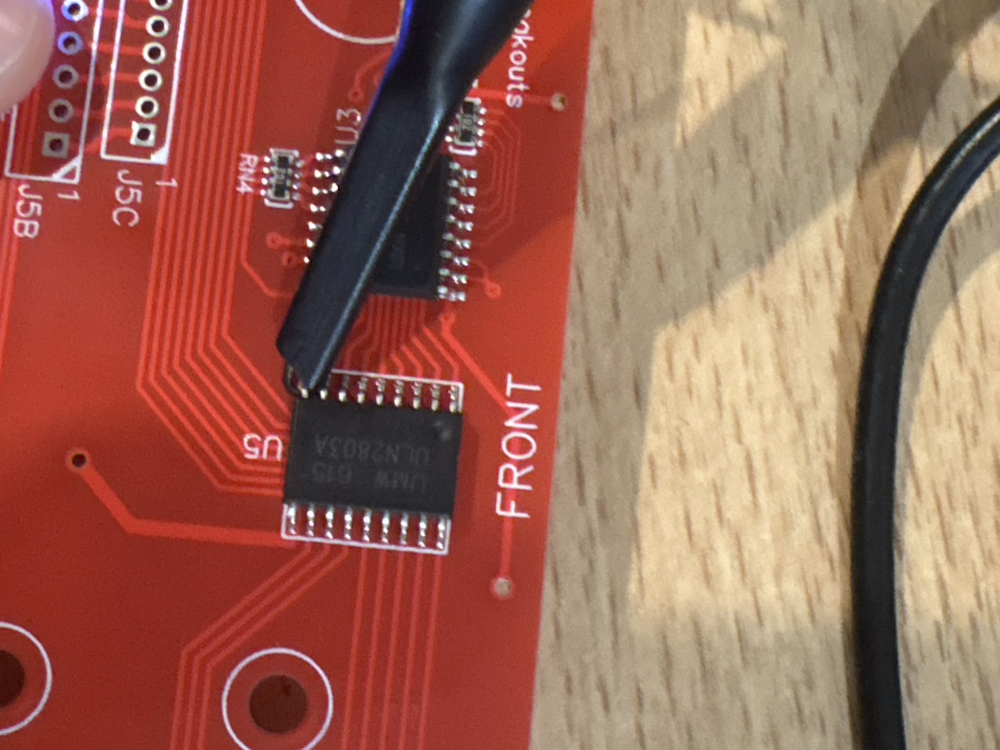

From the photo: the chip's marking is upside down in this view, so pin 1 is
at the top right and the input side (pins 1 to 8, facing U3) runs right to
left along the top. The tip is on the top-left corner pin, which is pin 9,
ground. The pin directly opposite it (bottom left) has the long fat trace
running to a via, which matches pin 10, the solenoid supply pin, in the
layout. The photo says the probe is where the user said.

To resolve the conflict with entry 82, both channels were captured
continuously for 3.5 s through a full cycle of the four states:

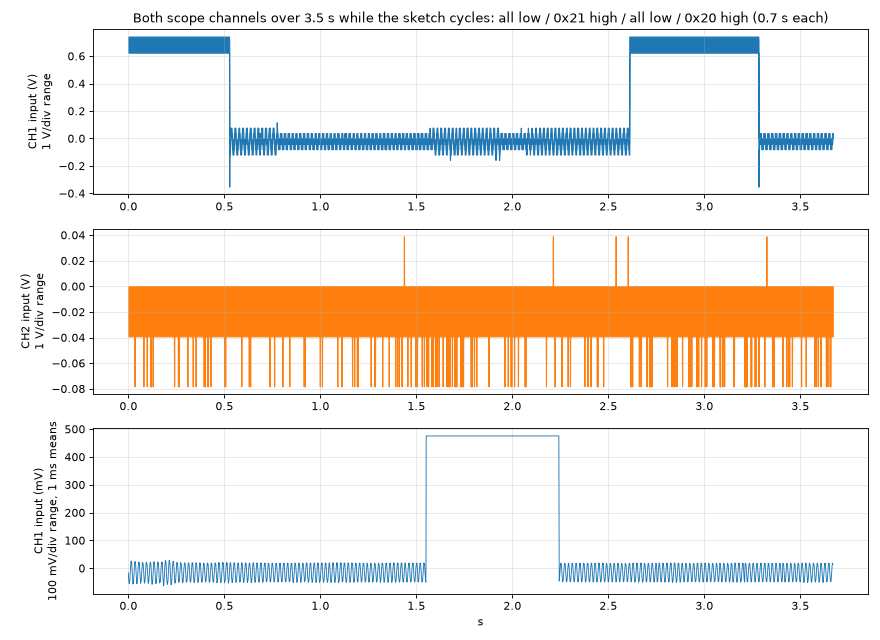

- **Scope channel 1** sits near 0 V with tens of millivolts of slow ripple
  (the look of a high-impedance node picking up mains hum), and steps to
  0.69 V for exactly one state in four.
- **Scope channel 2** is flat and quiet at 0 V throughout.

0.69 V on a node that is otherwise floating is what a ULN2803 *output* does
when its input is high and the solenoid supply is off: the driver's input
current leaks through to the unpowered output. A ground pin does neither of
those things. So scope channel 1 is the probe on S-3 pin 1, and scope
channel 2 is the probe on ground. The user's "probe 1" and "probe 2" are
plugged into the scope's inputs the other way round from what I assumed.

Consequences:

- Entry 82's conclusion ("the tip is not on ground") was wrong. The ground
  probe is correctly placed; I was looking at the other probe.
- Channel roles from here on: **scope CH1 = S-3 pin 1 (solenoid output 15);
  scope CH2 = ground at U5 pin 9.**
- The 0.69 V reading on CH1 means that probe is switched to x1. It should be
  x10 before the supply goes up. The ground probe should be x1; its setting
  is not yet known.
- The millivolt-level ground-step check of entry 81 has still not actually
  been done on the ground channel.

## 2026-11-20 17:28 — 84. Probe check repeated with the right channel roles: ground probe confirmed

The user confirms the probe numbers were mixed up on their side, left the
probes where they were, and set the attenuation: x1 on the ground probe
(scope CH2), x10 on the solenoid-output probe (scope CH1). Bench supply
still off.

Six seconds through the four-state cycle of entry 81:

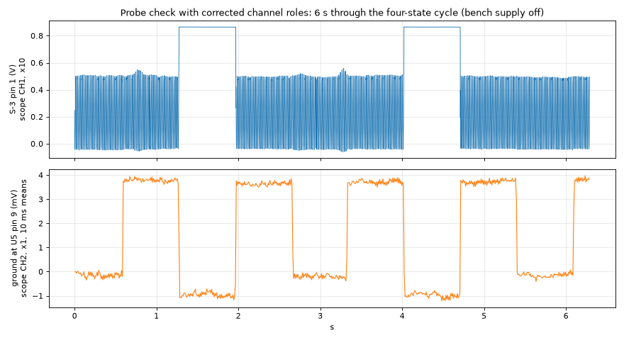

Ground channel (10 ms averages), relative to an arbitrary zero:

| State | Ground at U5 pin 9 |
|---|---|
| both chips all low (each sinking about 40 mA) | +3.7 to +3.8 mV |
| middle chip (0x21) all high | −1.0 mV |
| right-hand chip (0x20) all high | −0.2 mV |

- Stopping the middle chip's 40 mA moves this ground by 4.8 mV; stopping
  the right-hand chip's moves it by 3.9 mV. The middle chip has the larger
  effect, by about 0.9 mV, which is what its own ground trace should add
  (about 40 mA through roughly 20 to 30 mΩ). That is the signature
  predicted in entry 81 for a tip on the middle pair's ground. **The ground
  probe is confirmed.**
- The 3.9 mV common to both is resistance shared by both return paths,
  between the chips and the point where the scope's ground clip sits.
- Raw samples on the ground channel stayed within −14 to +21 mV over the
  whole capture, with only the board's own 5 V activity and no solenoid
  supply.

Solenoid-output channel: reads 0.87 V steadily while the middle chip is all
high (the driver leaking into its unpowered output, as in entry 83, now read
correctly at x10) and wanders between 0 and 0.5 V at mains frequency the
rest of the time, which is hum on a floating node. Both will disappear once
the supply is on.

The measuring set-up for the solenoid test is therefore: scope CH1 = S-3 pin
1 at x10; scope CH2 = ground at U5 pin 9 at x1; ground clip on the I2C
header's GND pin.

## 2026-11-20 17:32 — 85. Scope zero calibration

The user suspected an offset in the scope readings. Both probe tips were
put on the I2C header's GND pin (the same point as the ground clip), with
the probes as set for the test: scope CH1 at x10, scope CH2 at x1. Zero
level recorded at each range, 4 million samples per channel
([tools/scope_zero.json](tools/scope_zero.json)):

| Range | CH1 zero (x10 probe) | as volts at the tip | CH2 zero (x1 probe) | as volts at the tip |
|---|---|---|---|---|
| 100 mV/div | 130.81 counts | +0.11 V | 141.75 counts | +54 mV |
| 250 mV/div | 130.87 | +0.28 V | 136.69 | +85 mV |
| 500 mV/div | 130.89 | +0.57 V | 132.98 | +97 mV |
| 1 V/div | 130.82 | +1.10 V | 131.60 | +141 mV |

An ideal scope would read 128 counts at zero. Offsets are relative to that.

- The offset is real and not small: up to 1.1 V on the x10 channel at its
  coarsest range, and 54 to 141 mV on the x1 channel.
- CH1's zero is the same count at every range; CH2's changes with range.
  The two probes present very different source resistances to the scope
  (x10 against x1), which is the likely reason. So this table is valid for
  these probe settings only.
- Everything reported from the scope so far was measured as a difference
  from a resting level, so those results stand. Absolute levels quoted
  earlier were off: the unpowered driver output reported as 0.69 V (entry
  83) and 0.87 V (entry 84) is one voltage, about 0.67 V after correction.
- Noise on the ground channel at its most sensitive range is about 1.2
  counts RMS (about 4.6 mV), which sets the floor for single-sample spikes;
  averages resolve far below that, as entry 84 showed.

From here on the analysis subtracts these zeros.

## 2026-11-20 17:34 — 86. Scope calibration in EEPROM? (question from the user)

The user recalled that the 6022BE can hold its offsets in its EEPROM. From
what I know of this scope: it has a small EEPROM, and the OpenHantek6022
project stores per-channel, per-range offset and gain corrections there and
applies them when it starts. Its tools can measure and write them.

Checked on this unit: with the sigrok firmware that my capture script
loads, the EEPROM read request is rejected (USB "pipe error"). So I can
neither read nor write the EEPROM in the present set-up, and whether this
unit holds any calibration there is unknown.

Decision: not pursued. The zero table of entry 85, kept in a file and
subtracted by the analysis, does the same job for this work, and it is
specific to the probes as actually set. Writing to the EEPROM also carries
a small risk, since the same chip holds the bytes the scope needs in order
to be recognised on USB.

## 2026-11-20 17:41 — 87. Probes re-checked; STARTED: first solenoid switch at 3 V

*Run with: [tools/dp100.py](tools/dp100.py), [tools/sync_states.py](tools/sync_states.py), [tools/cmd.py](tools/cmd.py), [tools/solenoid_step.py](tools/solenoid_step.py), [tools/usbpower.sh](tools/usbpower.sh). Firmware: statecycle on usbserial (flashed earlier, 11-20 17:16); setstate on usbserial (flashed 17:40).*

The user reports the probes are back in place and the solenoid is wired to
S-3 pin 1, and asked for the probe positions to be checked.

Ground probe (scope CH2, x1), measured per state in step with the sketch's
own state announcements, bench supply off, zeros of entry 85 subtracted:

| State | Ground at U5 pin 9 |
|---|---|
| both chips all low | +17.6 to +17.7 mV |
| middle chip (0x21) all high | +10.2 mV |
| right-hand chip (0x20) all high | +11.2 mV |

Spread within each state is under 0.1 mV. Stopping the middle chip's
current moves this ground 1.0 mV more than stopping the right-hand chip's,
the same signature as entry 84. **Ground probe confirmed.** The part common
to both is larger than in entry 84 (6.5 mV against 3.9 mV); the probes and
clip were handled in between, so contact resistance at the clip is the
likely reason.

Solenoid-output probe (scope CH1, x10): reads a steady 0.63 to 0.65 V in
every state. With the solenoid fitted, that pin is tied through 5 Ω to the
solenoid rail and its capacitors, which the driver's leakage has charged to
about 0.65 V. So this probe cannot be checked with the supply off; it will
be checked as the supply comes up, when it should read the supply voltage.

New tools: a command-driven sketch
([setstate/src/main.cpp](setstate/src/main.cpp)) that sets all outputs off
at start-up and then switches outputs on request, native or MCP-style; and
[tools/solenoid_step.py](tools/solenoid_step.py), which runs one controlled
on/off with the supply and scope.

Now running, a few seconds: supply to 3.0 V with a 0.5 A limit, all outputs
off; then output 15 on for 0.6 s by a native write; then off; supply output
off again at the end. Expected: about 0 A with outputs off (LEDs do not
conduct at 3 V), about 0.4 A with the solenoid on.

## 2026-11-20 17:43 — 88. RESULT of entry 87: first solenoid switch at 3 V

Native write, output 15 on for 0.6 s, then off. Supply 3.0 V, 0.5 A limit.

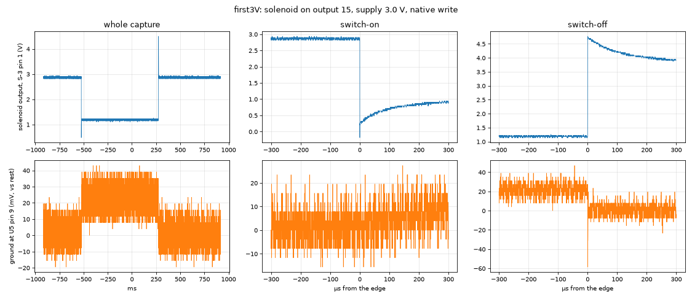

| Quantity | Value |
|---|---|
| Supply current, all outputs off | 0.11 A (unexpected, see below) |
| Supply current, solenoid on | 0.43 A, so about 0.32 A through the coil |
| Solenoid output, off | 2.87 V (the supply rail, as it should be: this confirms the x10 probe is on the solenoid output) |
| Solenoid output, on | about 0 V at the instant of switch-on, rising to 1.2 V within 0.3 ms as the coil current builds |
| Solenoid output at switch-off | kicks to 4.7 V, about 1.7 V above the rail (the ULN2803's clamp diode), decaying over 0.3 ms |
| Ground at U5 pin 9, steady shift while on | +23 mV |
| Ground, within 0.5 ms of switch-on | −16 to +31 mV, indistinguishable from the noise |
| Ground, within 0.5 ms of switch-off | one sample at −59 mV, otherwise within the noise |

- The read-back after each write was correct (8000, then 0000).
- The coil current settles in a few tenths of a millisecond, so this
  solenoid's inductance is small (of the order of a millihenry with the
  plunger out). It stores much less energy than a machine solenoid even
  though it carries four times the current.
- **Ground at the chips moves very little:** 23 mV steady for 0.32 A, which
  is about 70 mΩ of shared path, and a single-sample spike of 59 mV at
  switch-off. At 8 MS/s anything shorter than about 100 ns is missed or
  flattened, so the true spike may be taller and narrower.

### Unexplained: 0.11 A drawn from the solenoid supply with all outputs off

Measured afterwards, outputs off:

| Supply setting | Current |
|---|---|
| 0.5 V | 0.105 A |
| 1.0 V | 0.109 A |
| 2.0 V | 0.109 A |
| 3.0 V | 0.102 A |

The current is the same from 0.5 V to 3 V, so it is not a resistance and
not the LEDs. When the supply was first read (entry 78), before the
solenoid was wired, it showed 0.000 A with its output on. The reading moves
by about 10 mA when the board's 5 V load changes by about 30 mA, which
suggests part of it is the board's own 5 V return current finding a second
way home through the supply's negative lead and its USB cable, and being
counted by the supply's current sensor. That would not account for all of
it. Not resolved; to be checked with the user (what the supply's own
display shows, and whether the reading changes with the solenoid lead
lifted).

## 2026-11-20 17:43 — 89. STARTED: MCP-style writes with the solenoid held on

This is the configuration of the original fault: an energised coil, and
MCP-style writes, each of which drops every energised output except 0 and 3
for about 90 µs. Supply 3.0 V, 0.5 A limit.

2,000 MCP-style writes alternating between "solenoid on" (8000) and
"solenoid on plus output 0" (8001), 5 ms apart, each followed by a
read-back of both chips. So the solenoid stays commanded on throughout and
gets a 90 µs dropout, with its inductive kick, on every write. About 20 s.
Supply output off at the end.

## 2026-11-20 17:44 — 90. RESULT of entry 89: 2,000 MCP-style writes with the solenoid on, no errors

| Quantity | Value |
|---|---|
| Supply current with the solenoid held on | 0.429 A |
| MCP-style writes | 2,000 in 12.4 s |
| Read-back mismatches | 0 |
| I2C errors (missing acknowledge) | 0 |

Each of those writes dropped the energised solenoid for about 90 µs and let
it kick. Neither PCF8574 lost its state once.

No scope capture was taken during that burst, so there is no picture for
it. The user has asked for a picture of every scope reading in the journal,
as the work happens; from here each scope capture is saved and shown.
Scope readings earlier today that went into the journal as numbers only:
the zero calibration (entry 85) and the per-state ground check (entry 87).

## 2026-11-20 17:44 — 91. STARTED: the same burst again, with the scope capturing

*Run with: [tools/burst_scope.py](tools/burst_scope.py). Firmware: setstate on usbserial (flashed earlier, 11-20 17:40).*

Same conditions: supply 3.0 V, 0.5 A limit, solenoid held on, MCP-style
writes alternating 8000 / 8001, 5 ms apart, read-back after each. 1,000
writes. The scope captures 0.75 s at 16 MS/s part-way through.

## 2026-11-20 17:44 — 92. RESULT of entry 91: MCP-style burst with the scope watching

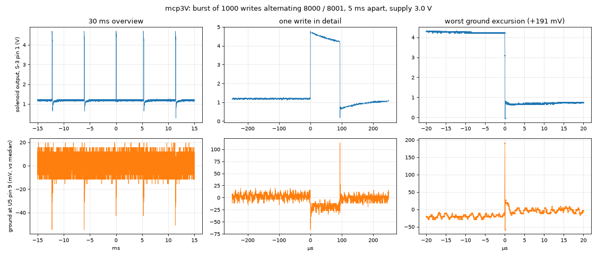

Top row: the solenoid output (S-3 pin 1). Bottom row: ground at U5 pin 9,
relative to its median. Left: 30 ms, showing one write every 6 ms or so.
Middle: one write. Right: the largest ground excursion in the capture.

| Quantity | Value |
|---|---|
| MCP-style writes in the burst | 1,000, read-back mismatches 0, I2C errors 0 |
| Dropouts seen in the 0.79 s capture | 130 |
| Length of each dropout | about 94 µs |
| Solenoid output during a dropout | 4.7 to 4.8 V, the rail plus the clamp diode |
| Ground during the dropout | about 20 mV below its level with the coil conducting |
| Ground spike at the start of a dropout (coil current leaves the ground path) | down to about −60 to −74 mV |
| Ground spike at the end of a dropout (current returns) | typically +100 mV, largest +191 mV |
| Samples beyond ±100 mV | 124 of 12.6 million; none beyond ±200 mV |

- This is the first direct picture of what an MCP-style write does to an
  energised coil: the output is released for the length of one I2C byte,
  the coil kicks to the clamp level, and the output is taken back.
- **The larger ground disturbance is at the end of the dropout,** when the
  driver turns back on and the coil current snaps back into the ground
  trace: up to about 0.2 V at the chips for 0.32 A. Each spike is one sample
  wide at 16 MS/s (62 ns), so the real spike is probably narrower and taller
  than the scope shows.
- With all of that happening on every write, neither PCF8574 lost its state
  in 3,000 writes (entries 90 and 91).

For scale: on these chips a disturbance on SDA or SCL has to last about
125 ns to be taken as an edge (entry 4), and has to reach roughly 1.5 V to
cross a logic threshold. What is seen here is short of both, but by a
factor of a few, not by orders of magnitude, and this is one coil.

## 2026-11-20 17:46 — 93. STARTED: understanding the 0.11 A idle reading on the bench supply

*Run with: [tools/usbpower.sh](tools/usbpower.sh).*

The user reports the supply's own display shows 0.000 A (its output is off
at the moment) and wants this understood before going on.

Idea being tested: the 0.11 A is not drawn from the solenoid rail at all.
It is the board's own 5 V return current. The board's ground now has more
than one way back to the Mac: through the Metro Mini's USB cable, and
through the bench supply's negative lead, the supply's internal ground and
its USB cable. If the supply measures current in its negative lead, any
return current taking that route is counted as "output current", whatever
the output voltage. That would explain a reading that does not change
between 0.5 V and 3 V and is about the size of the board's 5 V consumption.
It would also explain 0.000 A in entry 78, if the supply's leads were on the
solenoid alone at that time and not on the board (to be confirmed with the
user).

Test, about 40 s: supply on at 0.5 V, too low for any driver to pass
current into the solenoid or LEDs, so nothing can be drawn from the rail.
Then switch all 16 outputs high and low four times, 4 s per state. That
swings the board's 5 V current by about 64 mA (80 mA of pull-up current with
outputs low, 16 mA with outputs high). If the supply's reading follows, it
is measuring the board's 5 V return current.

## 2026-11-20 17:47 — 94. RESULT of entry 93: the idle reading partly follows the board's 5 V load

Supply on at 0.5 V, where nothing can draw from the rail. All 16 outputs
switched low and high four times, 4 s per state.

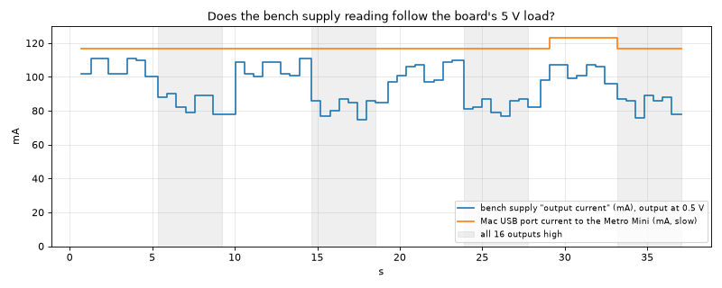

| State | Board's 5 V current (estimated) | Supply's "output current" reading |
|---|---|---|
| all outputs low | about 100 mA | 104 mA (96 to 111) |
| all outputs high | about 36 mA | 83 mA (75 to 89) |

- The reading follows the board's 5 V load, repeatably, four times out of
  four. So at least part of what the supply reports is the board's 5 V
  return current, not current from the solenoid rail. That confirms the
  idea of entry 93 in kind.
- It does not confirm it in amount. A 64 mA change in 5 V load moves the
  reading by only 21 mA, about a third. Extrapolating, roughly 70 mA of the
  reading does not depend on the 5 V load at all.
- The Mac's own USB current reading is too slow and too coarse to help here
  (it showed 117 to 118 mA in both states).

The user suggests the board's "9V" LED, which is fed permanently from the
solenoid supply. It cannot be the cause: it has a 320 Ω series resistor, so
it could draw at most a few milliamps at 3 V, and at 0.5 V a blue LED does
not conduct at all, yet the reading is the same at 0.5 V as at 3 V.

Working picture: with the supply's negative lead on the board, its data
cable on the Mac, the Metro Mini on the Mac and the scope's ground clip on
the board, the grounds form several loops. A supply that senses current in
its negative lead counts any current circulating in those loops. One third
of the board's 5 V return current plainly goes that way. The remaining
70 mA or so must be another loop current, most likely involving how the
supply itself is powered; not yet identified.

What is safe to rely on meanwhile: *changes* in the supply's reading when
the solenoid switches (0.32 A, entries 88 to 91), which the scope's view of
the coil confirms. The absolute idle figure is not a real load on the rail.

Next, with the user: the supply's output is being switched on at 3.0 V with
all outputs off, so the user can read its own display, then unplug the
supply's data cable and read it again. Also asked: what powers the supply.

## 2026-11-20 17:49 — 95. The idle reading is a ground loop through the supply's data cable (confirmed by the user)

Supply output on at 3.0 V, all outputs off, solenoid not energised:

| Condition | Supply's own display |
|---|---|
| data cable connected to the Mac | 0.100 A (the same as read over USB) |
| data cable unplugged | 0.000 A |

The supply is powered from an Apple 85 W USB-C wall charger, not from the
Mac or the hub.

So the 0.10 A was never drawn from the solenoid rail. It is current that
enters the supply's negative terminal from the board's ground and leaves
through the data cable to the Mac, passing through the supply's current
sensor on the way. With the cable out there is no second path and the
reading is zero.

Not fully accounted for: entry 94 found that only about a third of the
reading follows the board's 5 V load, leaving about 70 mA that does not. I
do not have a complete account of that part. It is still loop current,
since it vanishes with the cable.

Consequences:

1. While its data cable is connected, the supply's absolute current reading
   is not to be trusted. Differences still are (the solenoid's 0.32 A).
2. More important for the experiment: the loop is a second ground
   connection to the board that the machine does not have. On the machine
   the solenoid supply is a floating wall adapter and the only ground link
   to the computer is the controller's USB cable. Part of the solenoid's
   return current, and of its switching transients, can therefore take a
   route on the bench that does not exist on the machine. The ground
   measurements of entries 88 and 92 were taken with the loop present.
3. The scope's ground clip is a similar extra path, but one that cannot be
   avoided while measuring.

Plan: for captures that matter, set the supply over USB and switch its
output on, then have the user unplug its data cable for the measurement, so
the supply floats as on the machine.

## 2026-11-20 17:51 — 96. STARTED: MCP-style burst with the supply floating

*Run with: [tools/burst_scope.py](tools/burst_scope.py). Firmware: setstate on usbserial (flashed earlier, 11-20 17:40).*

Conditions: bench supply output on at 3.0 V, 0.5 A limit, **its data cable
unplugged** (stated by the user), so the supply floats as the machine's
adapter does. Everything else as in entry 91: solenoid on output 15 held
on, 1,000 MCP-style writes alternating 8000 / 8001, 5 ms apart, read-back
after each, scope capturing 0.75 s at 16 MS/s. The supply is not under
computer control during this run and stays on afterwards with all outputs
off.

## 2026-11-20 17:51 — 97. RESULT of entry 96: MCP-style burst with the supply floating

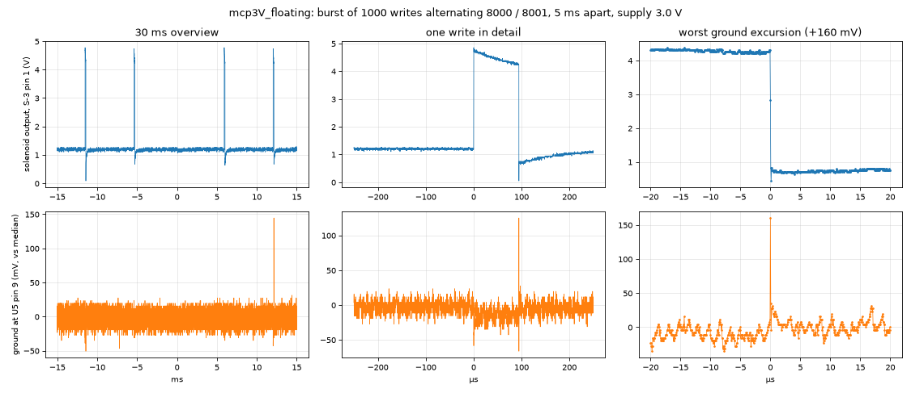

| Quantity | Loop present (entry 92) | Supply floating (this run) |
|---|---|---|
| MCP-style writes, read-back mismatches, I2C errors | 1,000 / 0 / 0 | 1,000 / 0 / 0 |
| Dropout length | about 94 µs | about 94 µs |
| Solenoid output during the dropout | 4.7 to 4.8 V | 4.7 to 4.85 V |
| Ground during the dropout, against coil-on level | about −20 mV | about −15 to −20 mV |
| Ground spike at the start of a dropout | −60 to −74 mV | down to −70 mV |
| Ground spike at the end of a dropout | typically +100 mV, largest +191 mV | typically +100 to +130 mV, largest +160 mV |
| Samples beyond ±100 mV, of 12.6 million | 124 | 116 |

- Removing the ground loop changes very little. The disturbance at the
  chips is the same within the scatter from one capture to the next. So the
  measurements of entries 88 and 92 stand, and the loop is not hiding a
  larger effect.
- Still no error: 4,000 MCP-style writes in total now, each dropping and
  re-energising a coil carrying 0.32 A, and neither PCF8574 has lost its
  state.

State left: supply on at 3.0 V with its data cable unplugged, all outputs
off, solenoid not energised.

## 2026-11-20 17:53 — 98. Bench supply now controlled through a separate computer

*Run with: [tools/dp100_hidraw.py](tools/dp100_hidraw.py), [tools/psu](tools/psu).*

To keep computer control of the supply without the ground loop of entry 95,
the user moved its data cable to a Raspberry Pi (a Pi 500, Debian 12)
reachable from the Mac over the network as raspberrypi.local.

- The Pi sees the supply (USB 2E3C:AF01, /dev/hidraw2).
- A version of the controller with no dependencies,
  [tools/dp100_hidraw.py](tools/dp100_hidraw.py), was copied to ~/dp100 on
  the Pi. Nothing was installed there. It is run with sudo because the
  device node is root-only. [tools/psu](tools/psu) wraps the SSH call.
- Read through the Pi: output ON, 3.000 V set, 0.5 A limit, 3.005 V and
  **0.001 A** measured, with all board outputs off. The 0.10 A phantom of
  entries 88 to 95 is gone, as the user also sees on the display.

Open point: whether the Pi shares a ground with the Mac by some other route
(a common monitor, hub or earthed peripherals). The near-zero idle reading
says there is no low-resistance loop now.

## 2026-11-20 17:56 — 99. STARTED: MCP-style burst at 3.5 V, supply floating and under remote control

*Run with: [tools/psu](tools/psu), [tools/cmd.py](tools/cmd.py), [tools/burst_scope.py](tools/burst_scope.py). Firmware: setstate on usbserial (flashed earlier, 11-20 17:40).*

The user asked whether the scope should move to the Pi as well. Answer: no.
Its ground clip would then tie the board to the Pi alongside the supply's
negative lead, closing a loop through the supply's current sensor and the
solenoid's return path. The scope stays on the Mac with the Metro Mini.

Now, with the user's go-ahead: supply raised to 3.5 V (0.5 A limit) through
the Pi. Expected coil current about 0.40 A. Then the same scoped burst as
before: solenoid held on, 1,000 MCP-style writes alternating 8000 / 8001,
5 ms apart, read-back after each, scope capturing 0.75 s at 16 MS/s. The
solenoid-output channel is on the next range up (250 mV/div) so that the
kick, expected near 5.3 V, is not clipped.

## 2026-11-20 17:57 — 100. RESULT of entry 99: MCP-style burst at 3.5 V, about 0.45 A in the coil

The run was done twice. The first pass showed a 7.0 V kick, which was a
scale error of mine: the scope range that sigrok labels "250 mV" spans
±1.0 V at the input, not ±1.25 V as I had assumed. Corrected and re-run;
the figures below are from the second pass. The same error means the
250 mV row of the zero table in entry 85 should read +0.22 V and +68 mV,
not +0.28 V and +85 mV. No earlier conclusion used that range.

At the user's request the supply's reported current is now tracked through
each run and charted.

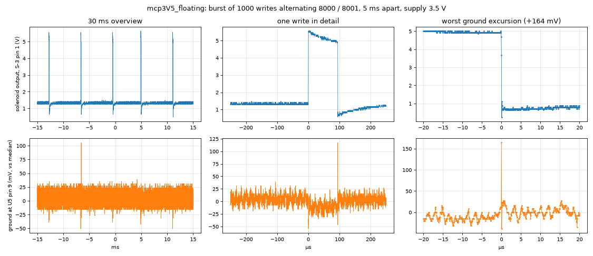

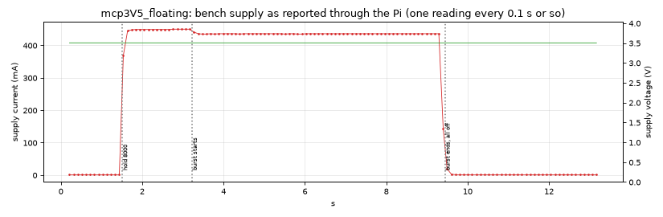

| Quantity | Value |
|---|---|
| Supply voltage through the run | 3.502 to 3.506 V |
| Supply current, all outputs off | 1 mA |
| Supply current, coil held on | 449 mA |
| Supply current during the burst | 436 mA (435 to 436) |
| MCP-style writes / mismatches / I2C errors | 1,000 / 0 / 0 (both passes) |
| Solenoid output, coil on | 1.26 V |
| Solenoid output during the dropout | up to 5.63 V, about 2.1 V above the rail |
| Ground spike at the start of a dropout | down to −82 mV |
| Ground spike at the end of a dropout | up to +164 mV |
| Samples beyond ±100 mV, of 12.6 million | 140; none beyond ±200 mV |

- The coil now carries 0.45 A, 40 % more than at 3 V, close to the
  ULN2803's 0.5 A limit and about six times a machine solenoid's current.
- The average current during the burst is 13 mA lower than with the coil
  held on. That is the dropouts: the coil is disconnected for about 94 µs in
  every 6 ms or so, and its current takes a while to recover each time.
- The supply voltage does not sag: 4 mV of variation in the whole run.
- Ground spikes at the chips are no larger than at 3 V (−82 / +164 mV
  against −70 / +160 mV). They do not scale with the coil current, which
  suggests they are set by how fast the driver switches and by the scope's
  resolution, not by the size of the current step.
- Still no error. 6,000 MCP-style writes in total with an energised coil.

## 2026-11-20 17:59 — 101. Next: the bus and the supply at the chip

*Run with: [tools/psu](tools/psu).*

Decided with the user: with the ground measurement in hand, look instead at
what the PCF8574 that drives the solenoid (U3, address 0x21) sees on its
own pins during an MCP-style write: its 5 V supply, SCL and SDA.

Bench supply output switched off (through the Pi) while the probes are
moved.

Plan for the probes:

- Both probes at x10. A 5 V signal would clip on the x1 probe, and a x1
  probe loads the bus with about 100 pF.
- Ground clip stays on the I2C header's GND pin. The lines are then seen
  relative to the controller's ground; what the chip sees differs from that
  by the ground movement already measured (0.2 V at most).
- First capture: scope CH1 on the chip's 5 V, at the capacitor beside U3
  (C6) or U3 pin 16; scope CH2 on SCL at the I2C header.
- Second capture: scope CH2 moved to SDA at the I2C header.
- The zero must be re-measured first, because one probe changes from x1 to
  x10 (entry 85).

Resolution to expect: at x10 on a range that does not clip at 5 V, one
count is about 78 mV. That is enough to see the things that could upset the
chip, which are of the order of a volt: a supply dip towards its reset
level (2.4 V at most), or a glitch on a bus line approaching a logic
threshold (about 1.5 V and 3.5 V). It is not enough to see millivolt
ripple.

## 2026-11-20 18:01 — 102. Scope zero with both probes at x10

Both tips on the I2C header's GND pin, both probes at x10 (stated by the
user). Bench supply output off.

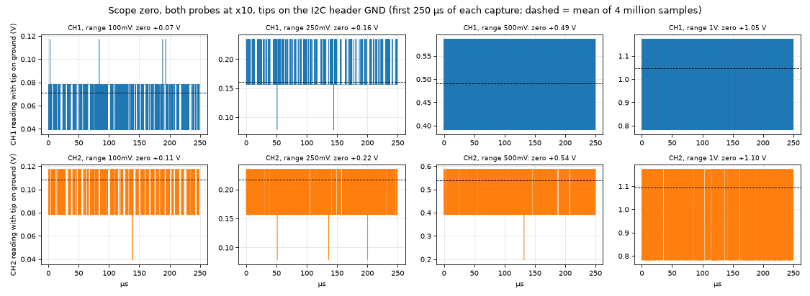

| Range | One count, at the tip | CH1 zero | CH2 zero |
|---|---|---|---|
| 100 mV | 39 mV | 129.81 counts, +0.07 V | 130.78 counts, +0.11 V |
| 250 mV | 78 mV | 130.06, +0.16 V | 130.78, +0.22 V |
| 500 mV | 195 mV | 130.51, +0.49 V | 130.76, +0.54 V |
| 1 V | 391 mV | 130.68, +1.05 V | 130.80, +1.10 V |

- CH2's zero is now the same count on every range, as CH1's was when it was
  the only x10 probe (entry 85). That supports the reading that the
  range-dependent zero belongs to a x1 probe's low source resistance.
- CH1's zero has moved by up to one count since entry 85. So zeros drift a
  little over an hour and are worth re-taking when absolute levels matter.
- Noise is 0.25 to 0.5 counts RMS on both channels.

Saved as the current zero table ([tools/scope_zero.json](tools/scope_zero.json));
the previous one is kept as tools/scope_zero_ch1x10_ch2x1.json. The 250 mV
range is the one to use for 5 V signals at x10: it spans about ±10 V at the
tip.

## 2026-11-20 18:01 — 103. Naming the scope channels by colour

Agreed with the user, to avoid a repeat of the mix-up of entries 82 to 84:
scope CH1 is "yellow" and scope CH2 is "blue". Instructions, journal entries
and plots use those names and colours from here on.

Positions asked for, for the first capture: yellow on the chip's 5 V (at
C6 beside U3, or U3 pin 16); blue on SCL at the I2C header; ground clip on
the I2C header's GND pin.

## 2026-11-20 18:05 — 104. Probe check: yellow on the chip's 5 V, blue on SCL

*Run with: [tools/psu](tools/psu), [tools/chipcap.py](tools/chipcap.py). Firmware: setstate on usbserial (flashed earlier, 11-20 17:40).*

Positions as stated by the user: yellow on C6 (beside U3), blue on SCL at
the I2C header. Bench supply output off. Six MCP-style writes of zero, with
read-backs, sent during the capture.

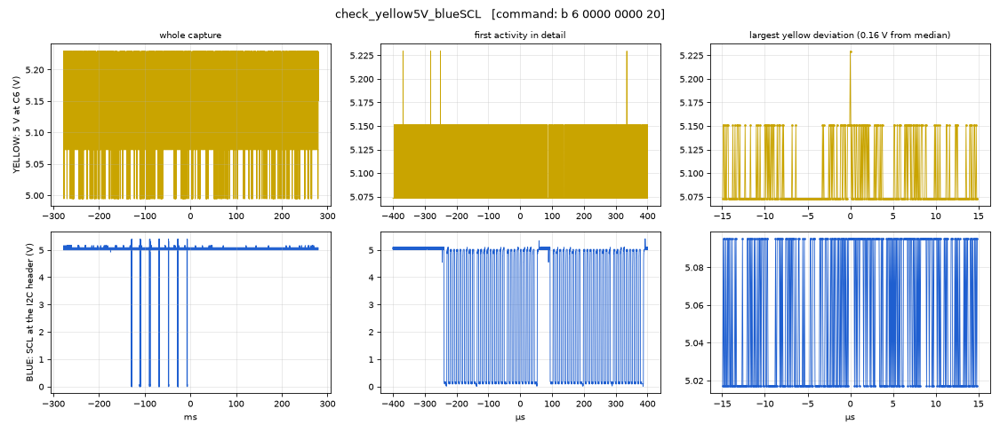

- **Yellow** reads a steady 5.07 V (5.00 to 5.23 V, which is two or three
  steps of the scope at this range). So it is on the 5 V end of C6, not the
  ground end. The user's meter read 4.92 V on this rail (entry 75); the
  3 % difference is within the scope's scale accuracy.
- **Blue** idles at 5.02 V and, for each write, shows two groups of evenly
  spaced pulses at 100 kHz, 27 in each: one three-byte transaction per chip.
  Evenly spaced pulses in nines are the clock, so it is SCL and not SDA.
- Low level of SCL is 0.10 V, high level 5.02 V, with brief overshoot to
  5.4 V on rising edges.

Both probes confirmed.

## 2026-11-20 18:05 — 105. STARTED: 5 V at the chip and SCL during MCP-style writes with the coil energised

*Run with: [tools/psu](tools/psu), [tools/chipcap.py](tools/chipcap.py). Firmware: setstate on usbserial (flashed earlier, 11-20 17:40).*

Supply on at 3.5 V (0.5 A limit) through the Pi, supply current tracked.
Solenoid held on (state 8000) for a second, then 40 MCP-style writes
alternating 8000 / 8001, 5 ms apart, with read-backs. Scope at 16 MS/s for
0.5 s: yellow = the chip's 5 V at C6, blue = SCL at the I2C header. Supply
output switched off again afterwards.

## 2026-11-20 18:05 — 106. RESULT of entry 105: the chip's 5 V and SCL during MCP-style writes, coil energised

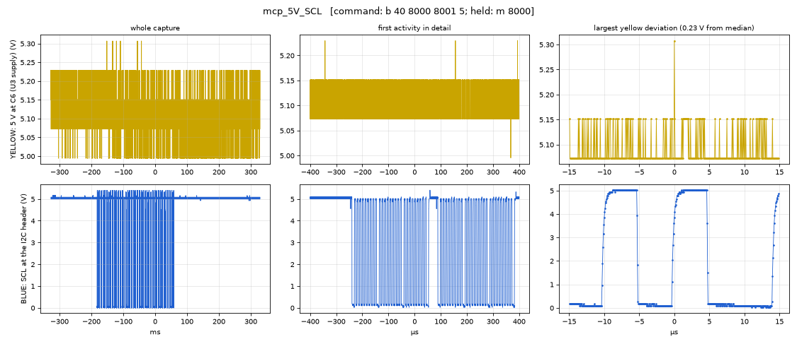

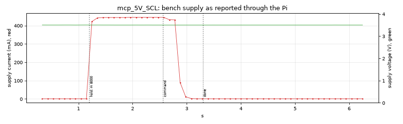

Yellow: the chip's 5 V at C6. Blue: SCL at the I2C header. Left: whole
capture. Middle: one MCP-style write (two transactions). Right: the largest
departure of the 5 V rail from its median.

| Quantity | Value |
|---|---|
| Bench supply | 3.502 to 3.507 V; 1 mA idle, up to 445 mA with the coil on |
| MCP-style writes / mismatches / I2C errors | 40 / 0 / 0 |
| Chip's 5 V: median | 5.07 V |
| Chip's 5 V: lowest sample | 5.00 V (one step below the median) |
| Chip's 5 V: highest sample | 5.31 V (a single sample, three steps up) |
| Chip's 5 V: samples below 4.9 V, of 4 million analysed | 0 |
| SCL: edges analysed | 3,114 in 0.25 s |
| SCL: shortest low period / median | 4.00 µs / 5.06 µs |
| SCL: shortest high period inside a transaction / median | 4.88 µs / 4.94 µs |
| SCL: periods shorter than 2 µs | none |

- **The chip's supply does not dip.** With a coil carrying 0.45 A being
  dropped and re-energised on every write, the 5 V rail at the chip stays
  within one step (78 mV) below its median. The only excursions are
  isolated single samples upward, coinciding with SCL edges. The chip's
  reset level is 2.4 V at most; nothing here comes within 2.5 V of it.
- **SCL is clean.** Every low and high period is a full clock half-period;
  there are no short pulses or extra edges, and the line spends 0.17 % of
  the time between the logic thresholds, which is just its normal edges.
  Rising edges take about 1.5 µs, as expected with 5 kΩ pull-ups.

Limits: one step is 78 mV and one sample is 62 ns, so a dip narrower than
that, or shallower, would not show.

## 2026-11-20 18:09 — 107. Probe check: blue moved to SDA

*Run with: [tools/psu](tools/psu), [tools/chipcap.py](tools/chipcap.py). Firmware: setstate on usbserial (flashed earlier, 11-20 17:40).*

Blue moved from SCL to SDA on the I2C header (stated by the user); yellow
still on C6. Bench supply output off. Six MCP-style writes of zero with
read-backs.

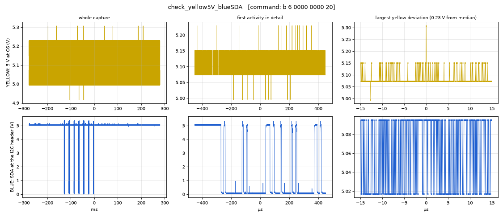

- **Blue** now shows irregular pulses that follow the data being sent, and
  214 edges where SCL showed 1,074 for the same command. So it is SDA.
- Small bumps of up to about 1 V appear on SDA while it is low, at fixed
  places in each transaction. These are the hand-overs around each
  acknowledge bit, where one side lets go of the line a moment before the
  other takes it. They are present with the bench supply off, so they have
  nothing to do with the solenoid.
- **Yellow** is unchanged: 5.07 V, lowest 4.92 V, highest 5.31 V.

## 2026-11-20 18:09 — 108. STARTED: 5 V at the chip and SDA during MCP-style writes with the coil energised

*Run with: [tools/psu](tools/psu), [tools/chipcap.py](tools/chipcap.py). Firmware: setstate on usbserial (flashed earlier, 11-20 17:40).*

Same run as entry 105 with blue on SDA: supply on at 3.5 V through the Pi,
current tracked; solenoid held on, then 40 MCP-style writes alternating
8000 / 8001, 5 ms apart, with read-backs; scope 0.5 s at 16 MS/s. Supply
output off afterwards. For comparison the same capture is then repeated
with the supply left off, so that whatever SDA does with the coil switching
can be set against what it does anyway.

## 2026-11-20 18:10 — 109. RESULT of entry 108: the chip's 5 V and SDA, coil energised against supply off

Capture with the coil energised (supply 3.5 V, up to 447 mA):

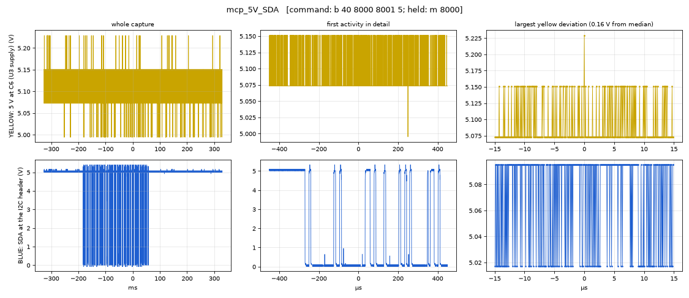

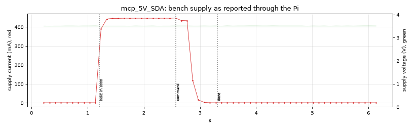

The same capture with the bench supply off:

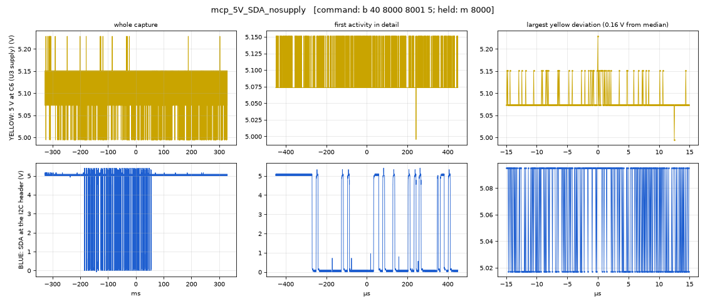

One MCP-style write from each, aligned on its START condition:

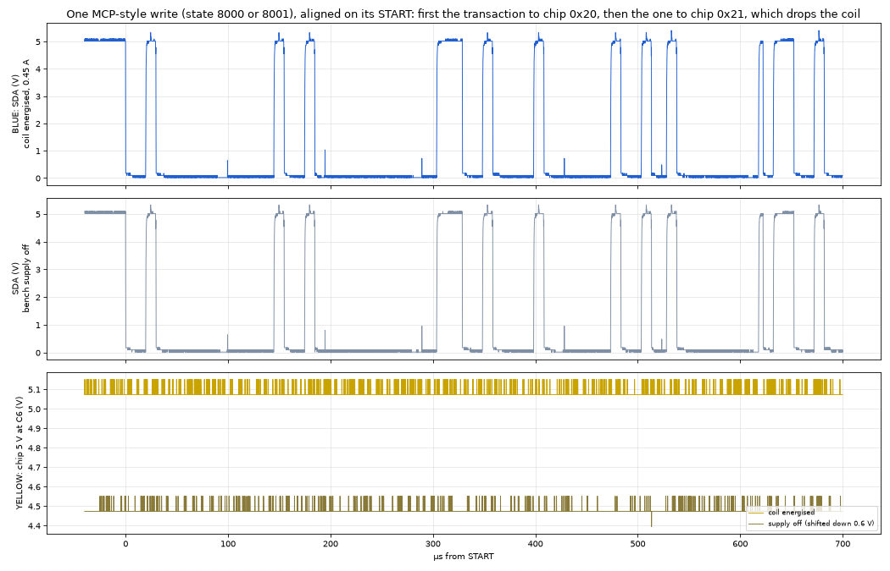

Both runs: 40 MCP-style writes, 0 mismatches, 0 I2C errors.

SDA, measured over 0.25 s of each capture, ignoring the 2 µs either side of
every edge:

| Quantity | Coil energised | Supply off |
|---|---|---|
| Low periods examined | 337 | 354 |
| Highest bump while low | 1.03 V | 1.03 V |
| Bumps above 0.6 V / 1.0 V / 1.5 V | 53 / 3 / 0 | 55 / 2 / 0 |
| High periods examined | 319 | 337 |
| Deepest dip while high | 4.47 V | 4.47 V |
| Dips below 4.5 V / 3.5 V | 15 / 0 | 16 / 0 |

Chip's 5 V: 5.00 to 5.23 V in both runs.

- **SDA looks the same whether or not the coil is switching.** The bumps of
  up to 1 V while the line is low are the acknowledge hand-overs noted in
  entry 107; they are the same size and number with the bench supply off.
- **Nothing on SDA reaches a logic threshold.** The highest bump is 1.03 V
  against a threshold of about 1.5 V; the deepest dip is 4.47 V against
  about 3.5 V.
- In the comparison picture the two writes are indistinguishable by eye,
  including the stretch of the second transaction (to chip 0x21, from about
  330 µs) during which the coil is dropped and re-energised.
- The chip's 5 V is equally unmoved.

So at this bench's resolution, switching a coil at 0.45 A with MCP-style
writes puts nothing extra on SDA, SCL or the chip's supply. The only
measurable effect is on ground (entries 92, 97, 100), and that is under
0.2 V.

Bench supply output off at the end.

## 2026-11-20 18:21 — 110. The scope is not going to the machine: a laptop-only session instead

The user will probably not take the scope to the machine. So the machine
session has to get its evidence from the controller itself. Built for that:

- [machine/src/main.cpp](machine/src/main.cpp): one sketch. At start-up it
  checks the I2C pull-ups, scans the bus, switches all outputs off and
  prints the chip's identity, a boot counter (so that a controller restart
  is noticed, as UNO A taught us), and its own supply voltage. It then
  takes commands: native writes, two-byte writes with any first byte,
  read-back, and bursts that read both ports back after every write and
  report mismatches, how many of them were a whole port at FF (the look of
  a PCF8574 reset), whether the wrong value was still there on a second
  read, missing acknowledges, and the controller's supply range.
- [tools/machine_session.py](tools/machine_session.py): runs a fixed
  session and prints a table: number of solenoids energised (1 to 16)
  against write style (native; two-byte with first byte 00, 09, 11, FF),
  each cell being the number of wrong read-backs in 300 writes. Then a soak
  of 3,000 AYAB-style writes with 12 solenoids on. It needs only Python
  with pyserial, and saves a log.

What the table can tell without a scope: whether the fault needs the 09
byte specifically or any two-byte write; whether it needs several
solenoids on; whether a failure is a whole port going to FF; and whether
the controller itself restarts.

## 2026-11-20 18:21 — 111. STARTED: trying the machine session on the bench

*Run with: [tools/psu](tools/psu), [tools/machine_session.py](tools/machine_session.py). Firmware: machine on usbserial (flashed 18:21).*

Metro Mini on the test board, solenoid on output 15, LED boards on the
rest, bench supply on at 3.5 V through the Pi (so the solenoid is energised
in every pattern and the LEDs barely light). About two minutes. Supply
output off afterwards.

## 2026-11-20 18:23 — 112. RESULT of entry 111: the machine session runs cleanly on the bench

Bench supply at 3.5 V, solenoid on output 15 (energised in every pattern),
LED boards on the other outputs. Full log:
[journal/bench-trial-machine-session.log](journal/bench-trial-machine-session.log).

Start-up line: ATmega328P, serial 423233303738FF191804 (the bench Metro
Mini), supply 5.00 V, both I2C lines pulled up, addresses 20 and 21
answering and no others.

Wrong read-backs out of 300 writes per cell (in brackets, whole port at FF):

| Outputs on | native | [00][data] | [09][data] AYAB | [11][data] | [FF][data] |
|---|---|---|---|---|---|
| 1 (8000) | 0 (0) | 0 (0) | 0 (0) | 0 (0) | 0 (0) |
| 2 (8002) | 0 (0) | 0 (0) | 0 (0) | 0 (0) | 0 (0) |
| 5 (8606) | 0 (0) | 0 (0) | 0 (0) | 0 (0) | 0 (0) |
| 9 (B636) | 0 (0) | 0 (0) | 0 (0) | 0 (0) | 0 (0) |
| 11 (F676) | 0 (0) | 0 (0) | 0 (0) | 0 (0) | 0 (0) |
| 16 (FFFF) | 0 (0) | 0 (0) | 0 (0) | 0 (0) | 0 (0) |

Soak: 3,000 writes of [09][data] with 11 outputs on: 0 mismatches, 0
missing acknowledges, controller supply 5.00 to 5.02 V. No controller
restart during the session.

- The tool works end to end: 12,000 writes with read-back in about two
  minutes, and a table that would show at a glance where a fault appears.
- On the bench it finds nothing, in any write style, which agrees with
  everything else measured here today.
- Corrected a label in the script: the soak pattern has 11 outputs on, not
  12.

Bench supply output off at the end.

## 2026-11-20 18:49 — 113. Hands-off version: the probe inside the AYAB firmware's test mode

The user's idea: instead of a separate sketch and a laptop script, put the
test in the AYAB firmware itself, in `Tester::setUp()`, which runs when the
desktop app's hardware test window opens. The machine's user then only has
to flash a custom firmware (from the user's web flasher) and copy the text
that appears in the test window.

Checked in the desktop app's source: it sends the test request once and
then waits for the confirmation with no timeout, showing any text messages
that arrive in the meantime. So a set-up that takes ten seconds is
acceptable; the window simply appears once it has finished.

Added to the firmware working tree (which already holds the user's
native-write change to solenoids.cpp):

- `src/ayab/pcfprobe.cpp` and `.h`: the probe. It talks to the two
  expanders directly through Wire, independently of the firmware's solenoid
  driver.
- `src/ayab/tester.cpp`: one call at the end of `setUp()`, compiled out of
  the unit-test build.

What it reports, as short text lines: the controller's chip signature and
serial, a boot counter, its supply voltage, whether SDA and SCL have
pull-ups, which I2C addresses answer, then a table of wrong read-backs
(and how many were a whole port at FF) for six numbers of energised
solenoids against five write styles, 100 writes per cell; a soak of 2,000
writes in the MCP23008 style; missing acknowledges; supply range; the least
free RAM seen; and details of the first four wrong read-backs.

Two problems found and fixed while building:

- The first build used 2,037 of 2,048 bytes of RAM, leaving 11 for the
  stack. The report's text was being held in RAM. Moved to flash: now 1,687
  bytes (82 %).
- Because that margin is still tighter than the stock firmware's, the probe
  now measures and reports the least free RAM during its run.

[tools/ayab_testmode.py](tools/ayab_testmode.py) stands in for the desktop
app's test window: it sends the test request and prints the text messages.

## 2026-11-20 18:49 — 114. STARTED: the firmware probe on the bench

*Run with: [tools/psu](tools/psu), [tools/ayab_testmode.py](tools/ayab_testmode.py). Firmware: AYAB firmware (branch build) on usbserial (flashed 18:49).*

Firmware built from the working tree and flashed to the bench Metro Mini on
the test board. Bench supply on at 3.5 V through the Pi, solenoid on output
15, LED boards on the rest. Test mode requested with the stand-in script.
About 20 s. Supply output off afterwards.

## 2026-11-20 18:49 — 115. RESULT of entry 114: the firmware probe works on the bench

Text received, exactly as the desktop app's test window would show it,
after the usual welcome and help lines:

```
PCF probe 1 start, takes 10 s
chip 1E950F 423233303738FF191804 boot 1
vcc 4979 sda 1 scl 1 ack 20 21
all off reads 0000
bad/portFF of 100: nat p00 p09 p11 pFF
 1 on 0/0 0/0 0/0 0/0 0/0
 2 on 0/0 0/0 0/0 0/0 0/0
 5 on 0/0 0/0 0/0 0/0 0/0
 9 on 0/0 0/0 0/0 0/0 0/0
11 on 0/0 0/0 0/0 0/0 0/0
16 on 0/0 0/0 0/0 0/0 0/0
soak p09 11 on n 2000 bad 0 ff 0
stuck 0 nak w 0 r 0
vcc min 4979 max 5023 ram 106
PCF probe 1 end, total bad 0
```

Test mode was confirmed 15.5 s after the request, with no error.

- The probe runs inside the real firmware, reports through the app's
  normal text channel, and leaves the firmware in a working test mode.
- On the bench it finds nothing wrong, as with every other test today:
  5,000 writes with read-back, no mismatch, no missing acknowledge, supply
  4.98 to 5.02 V.
- **Free RAM bottomed out at 106 bytes.** That is enough, but it is not
  generous, and it is less than the stock firmware has. Anything added to
  the probe should be checked against this figure.
- It takes 15 s, not 10; the start line has been corrected.

Firmware image: `.pio/build/uno/firmware.hex` in the firmware repository.

To be decided by the user before publishing it: the working tree this was
built from also contains the user's native-write change to solenoids.cpp,
whose `init()` no longer writes anything to the expanders. A PCF8574
powers up with all outputs high, so with that change every solenoid is
energised from power-on until the first write, which with this build is
the end of the probe.

## 2026-11-20 19:04 — 116. Final check of the firmware to be published

*Run with: [tools/psu](tools/psu). Firmware: AYAB firmware (branch build) on usbserial (flashed 19:03).*

Decisions from the user: solenoids being on by default at power-up is not a
problem, since they are built for continuous duty; and the published build
should use native writes so that it works normally. That is the working
tree as it stands, so nothing in solenoids.cpp was changed.

The final build (with the corrected "takes 15 s" text) was flashed to the
bench Metro Mini and checked through the firmware's own test commands, with
the bench supply's current as the witness (supply at 3.5 V, solenoid on
output 15):

| Step | Supply current |
|---|---|
| after a reset, before the probe | 0.001 A |
| test mode requested; probe ran, "total bad 0"; all off | 0.001 A |
| `setSingle 15 1` | 0.446 A |
| `setSingle 15 0` | 0.001 A |
| `setAll 8000` | 0.446 A |
| `setAll 0000` | 0.001 A |

- Test mode is confirmed after the probe, and the firmware's normal
  solenoid commands work through its native-write driver.
- The solenoid was not energised after the reset because a reset of the
  controller does not reset the PCF8574s, which kept their last state (all
  off). Only a power-up puts them all high.

Image: `.pio/build/uno/firmware.hex`. Not done: the firmware's unit-test
suite was not run, and the build was not tried with the real desktop app.
Bench supply output off.

## 2026-11-20 19:12 — 117. Firmware work committed on a branch

At the user's request the firmware changes are committed on a new branch,
`pcf8574-probe`, in the firmware repository (not pushed):

| Commit | Content |
|---|---|
| 7ec247a | Write to the PCF8574 port expanders natively (the user's change to solenoids.cpp and .h) |
| 4cfcfb2 | Add a port expander probe to hardware test mode (pcfprobe.cpp, pcfprobe.h, and the call in tester.cpp) |

Left out on purpose:

- The user's separate, earlier edit to the end-of-line sensor test in
  tester.cpp (the "OPEN / SHORT" wording and a 100 ms delay). It is
  unrelated to this work and stays as an uncommitted change in the working
  tree. A firmware image built from the working tree includes it; one built
  from the branch alone does not.
- This `pcf8574-probe/` folder (journal, pictures, test sketches and
  tools), which remains untracked.

The firmware image was rebuilt after the commits so that its version string
names the new commit.

## 2026-11-20 19:17 — 118. The probe now runs after the test window opens

*Run with: [tools/psu](tools/psu), [tools/ayab_testmode.py](tools/ayab_testmode.py). Firmware: AYAB firmware (branch build) on usbserial (flashed 19:16, 19:17).*

Observed by the user with the real desktop app: the hardware test window
only opens once `Tester::setUp()` returns. With the probe inside
`setUp()`, the user of the machine would wait 15 s looking at nothing.
(Entry 113 had this from the app's source, and I judged the wait
acceptable; in practice it is not a good experience.)

Changed: `setUp()` only arms the probe. `Tester::loop()`, which the
firmware calls continuously in test mode, advances it one stage per call:
header, each of the 30 table cells, the soak in chunks of 200 writes, then
the summary. The report starts "PCF probe 2".

Bench run with the stand-in script (supply 3.5 V, solenoid on output 15),
seconds after the test request:

```
  0.02  AYAB Hardware Test, Firmware v1.0.0-7-g4cfcfb2 API v6
  0.07  [test mode confirmed, error code 0: the app opens its test window here]
  0.07  PCF probe 2 start, wait 15 s
  0.07  chip 1E950F 423233303738FF191804 boot 1
  0.07  vcc 4957 sda 1 scl 1 ack 20 21
  0.07  all off reads 0000
  0.07  bad/portFF of 100: nat p00 p09 p11 pFF
  1.29   1 on 0/0 0/0 0/0 0/0 0/0
  2.57   2 on 0/0 0/0 0/0 0/0 0/0
  3.80   5 on 0/0 0/0 0/0 0/0 0/0
  5.03   9 on 0/0 0/0 0/0 0/0 0/0
  6.27  11 on 0/0 0/0 0/0 0/0 0/0
  7.49  16 on 0/0 0/0 0/0 0/0 0/0
 12.48  soak p09 11 on n 2000 bad 0 ff 0
 12.48  stuck 0 nak w 0 r 0
 12.48  vcc min 4957 max 5001 ram 160
 12.48  PCF probe 2 end, total bad 0
```

- Test mode is confirmed 0.07 s after the request, where it took 15.5 s
  before. The report then arrives a row at a time and is complete after
  12.5 s.
- Least free RAM is now 160 bytes, up from 106, because the probe no
  longer runs from deep inside the message handler.
- The user of the machine should not use the test window's own commands
  until the "end" line has appeared, since those commands and the probe
  would be writing to the same outputs.

Committed on the `pcf8574-probe` branch as 61bbeaa. The image was rebuilt
(version string 1.0.0-8-g61bbeaa) and is on the bench Metro Mini. As
before, the working tree's unrelated end-of-line sensor edit is not in the
commit but is in the image. Not tried with the real desktop app by me.

## 2026-11-20 19:25 — 119. Probe version 3 built (progress steps, clear finish); flashing collided with the user's app session

*Run with: [tools/psu](tools/psu), [tools/ayab_testmode.py](tools/ayab_testmode.py). Firmware: AYAB firmware (branch build) on usbserial (flashed earlier, 11-20 19:17).*

Asked by the user: make it clearer how many steps remain and when the test
is done. Changes, built but **not yet flashed or committed**:

- Opening lines: "=== PCF probe 3: 8 steps, about 15 seconds ===" and
  "Please wait for TEST FINISHED before doing anything."
- Each result line is numbered: [1/8] to [6/8] for the table rows, [7/8]
  for the soak, [8/8] for the summary.
- Closing line: "=== TEST FINISHED: copy all the text above and send it ==="
- The firmware's end-of-work beep sounds when it finishes.

What went wrong when I tried to flash it: the user had the AYAB desktop app
open on the Metro Mini's serial port. The upload could not get the port and
hung for five minutes until it was stopped. My command then carried on
regardless, switching the bench supply on and opening the same port with my
stand-in script while the app still had it. I stopped the script and
switched the supply off. The board therefore still runs probe version 2
(61bbeaa). My script opening the port may have reset the controller under
the app.

Lesson: check that the serial port is free before flashing, and do not
chain the supply and the test onto an upload that may fail.

## 2026-11-20 19:41 — 120. Probe version 3 flashed, run on the bench and committed

*Run with: [tools/psu](tools/psu), [tools/ayab_testmode.py](tools/ayab_testmode.py). Firmware: AYAB firmware (branch build) on usbserial (flashed 19:40, 19:41).*

The user quit the AYAB app (closing its window had left it running and
holding the port; the port check added after entry 119 caught that before
any upload started).

A scare of my own making: the first two runs showed only the header and
then nothing. The firmware was fine. My stand-in script stops listening
when it sees "TEST FINISHED", and the new opening line "Please wait for
TEST FINISHED before doing anything." contains those words. Script
corrected to wait for the closing line.

Bench run (supply 3.5 V, solenoid on output 15), seconds after the test
request:

```
  0.08  [test mode confirmed, error code 0: the app opens its test window here]
  0.08  === PCF probe 3: 8 steps, about 15 seconds ===
  0.08  Please wait for TEST FINISHED before doing anything.
  0.08  chip 1E950F 423233303738FF191804 boot 3
  0.08  vcc 4979 sda 1 scl 1 ack 20 21
  0.08  all off reads 0000
  0.08  step, bad/portFF of 100: nat p00 p09 p11 pFF
  1.31  [1/8]  1 on 0/0 0/0 0/0 0/0 0/0
  2.55  [2/8]  2 on 0/0 0/0 0/0 0/0 0/0
  3.77  [3/8]  5 on 0/0 0/0 0/0 0/0 0/0
  5.00  [4/8]  9 on 0/0 0/0 0/0 0/0 0/0
  6.27  [5/8] 11 on 0/0 0/0 0/0 0/0 0/0
  7.48  [6/8] 16 on 0/0 0/0 0/0 0/0 0/0
 12.47  [7/8] soak p09 11 on n 2000 bad 0 ff 0
 12.47  [8/8] stuck 0 nak w 0 r 0
 12.47  vcc min 4979 max 5023 ram 148
 12.52  PCF probe 3 end, total bad 0
 12.52  === TEST FINISHED: copy all the text above and send it ===
```

Least free RAM 148 bytes. Whether the beep sounded is for the user to say;
I cannot hear the bench.

Committed on the `pcf8574-probe` branch (the third commit of the probe);
image rebuilt so its version string names that commit, and flashed to the
bench Metro Mini. Bench supply output off.

## 2026-11-20 20:31 — 121. STARTED: probe version 4, with its static RAM cut from 136 to 43 bytes

*Run with: [tools/psu](tools/psu), [tools/ayab_testmode.py](tools/ayab_testmode.py). Firmware: AYAB firmware (branch build) [-DPCFPROBE_INJECT_FAULT; default] on usbserial (flashed 20:31, 20:32).*

Question from the user: does the probe cost free RAM when it is not
running? Yes. Measured from the built image, version 3 keeps 136 bytes of
static variables at all times, during knitting too: a 62-byte line buffer,
40 bytes of stored wrong read-backs, 20 bytes of totals and 14 of counters.
That left 364 bytes for the stack, against 500 without the probe.

Version 4, agreed with the user, changes the storage and not the report:

- each line is built in a buffer on the stack and sent at once;
- a row's five results are kept as ten single bytes until the row is sent;
- a wrong read-back is reported in full the moment it happens, instead of
  four being stored for the end. Those lines therefore now appear just
  before the row they belong to.

Measured from the new image: 43 bytes of static RAM for the probe; 1,591
of 2,048 bytes used in all, so 457 bytes left for the stack.

Since the detail lines are what matters most on the machine and a healthy
board never produces any, the bench run is done twice: first with a build
option that fakes one wrong read-back in every burst, to exercise that
path, then with the real build. Bench supply at 3.5 V, solenoid on output
15.

## 2026-11-20 20:33 — 122. RESULT of entry 121: probe version 4 works, reporting path included

The Raspberry Pi that controls the bench supply stopped answering on the
network during this step (its name no longer resolves), so the supply
could not be switched on. Both runs below were therefore made with the
solenoid supply off. That does not affect what is being checked here, which
is the firmware's behaviour and its report. The supply's output was last
switched off in entry 120 and I have not been able to change it since.

**Run 1, with one wrong read-back faked in every burst** (bench-only build
option, to exercise the reporting path):

```
  0.08  === PCF probe 4: 8 steps, about 15 seconds ===
  0.08  Please wait for TEST FINISHED before doing anything.
  0.08  chip 1E950F 423233303738FF191804 boot 1
  0.08  vcc 5023 sda 1 scl 1 ack 20 21
  0.08  all off reads 0000
  0.08  step, bad/portFF of 100: nat p00 p09 p11 pFF
  0.13  bad nat 1 on #7 want 8001 got FF01 re 8001
  0.35  bad p00 1 on #7 want 8001 got FF01 re 8001
  0.62  bad p09 1 on #7 want 8001 got FF01 re 8001
  0.83  bad p11 1 on #7 want 8001 got FF01 re 8001
  1.31  [1/8]  1 on 1/1 1/1 1/1 1/1 1/1
  2.54  [2/8]  2 on 1/1 1/1 1/1 1/1 1/1
  3.78  [3/8]  5 on 1/1 1/1 1/1 1/1 1/1
  5.03  [4/8]  9 on 1/1 1/1 1/1 1/1 1/1
  6.26  [5/8] 11 on 1/1 1/1 1/1 1/1 1/1
  7.48  [6/8] 16 on 0/0 0/0 0/0 0/0 0/0
 12.48  [7/8] soak p09 11 on n 2000 bad 1 ff 1
 12.54  [8/8] stuck 0 nak w 0 r 0
 12.54  vcc min 4979 max 5023 ram 127
 12.54  PCF probe 4 end, total bad 26
 12.54  === TEST FINISHED: copy all the text above and send it ===
```

Every part of the fault reporting behaves as designed: the first four wrong
read-backs are described in full as they occur and no more after that; each
cell counts its one wrong read-back and one port at FF; "re 8001" and
"stuck 0" show the second read came back right, as it should for a faked
fault; the total is 26, which is 25 cells plus the soak. The 16-on row
shows 0/0 because the fake sets a port to FF that is already FF there.
Least free RAM on this path: 127 bytes.

**Run 2, the real build**, committed as 1b85a63 and identified in the
report's first line as v1.0.0-10-g1b85a63:

```
  0.06  [test mode confirmed, error code 0: the app opens its test window here]
  0.06  === PCF probe 4: 8 steps, about 15 seconds ===
  0.06  Please wait for TEST FINISHED before doing anything.
  0.06  chip 1E950F 423233303738FF191804 boot 1
  0.06  vcc 4979 sda 1 scl 1 ack 20 21
  0.06  all off reads 0000
  0.06  step, bad/portFF of 100: nat p00 p09 p11 pFF
  1.34  [1/8]  1 on 0/0 0/0 0/0 0/0 0/0
  2.58  [2/8]  2 on 0/0 0/0 0/0 0/0 0/0
  3.76  [3/8]  5 on 0/0 0/0 0/0 0/0 0/0
  5.00  [4/8]  9 on 0/0 0/0 0/0 0/0 0/0
  6.23  [5/8] 11 on 0/0 0/0 0/0 0/0 0/0
  7.51  [6/8] 16 on 0/0 0/0 0/0 0/0 0/0
 12.51  [7/8] soak p09 11 on n 2000 bad 0 ff 0
 12.51  [8/8] stuck 0 nak w 0 r 0
 12.51  vcc min 4979 max 5023 ram 174
 12.51  PCF probe 4 end, total bad 0
 12.51  === TEST FINISHED: copy all the text above and send it ===
```

RAM, from the built images:

| | Version 3 | Version 4 |
|---|---|---|
| Static RAM held by the probe at all times | 136 bytes | 43 bytes |
| Static RAM used by the whole firmware | 1,684 bytes | 1,593 bytes |
| Left for the stack, e.g. during knitting | 364 bytes | 455 bytes |
| Least free RAM during a probe run, healthy board | 148 bytes | 174 bytes |
| Least free RAM during a probe run, faults being reported | not measured | 127 bytes |

The image now on the bench Metro Mini is the real build; I confirmed it
contains no trace of the fault-faking option.

## 2026-11-20 20:39 — 123. Draft pull request opened on the user's fork

The user asked whether the probe could use only dynamic memory. It could
(by allocating its state at start, or by running in a single call so the
state lives on the stack), but the user decided to leave version 4 as it
is. Nothing was changed.

At the user's request the `pcf8574-probe` branch was pushed to the user's
fork and a draft pull request opened there, against the fork's own main
branch and not the upstream project:
https://github.com/jonathanperret/ayab-firmware/pull/3

It carries the five commits (native writes, then the four probe commits).
This `pcf8574-probe/` folder is still untracked and is not part of it.

## 2026-11-20 20:51 — 124. The fault was around solenoids 12 to 15; STARTED: a replay of that in the probe

*Run with: [tools/ayab_testmode.py](tools/ayab_testmode.py). Firmware: AYAB firmware (branch build) [-DPCFPROBE_INJECT_FAULT; default] on usbserial (flashed 20:51).*

Checks on the pull request: the build action passed and produced an
artifact, which is what the user's web flasher picks up. The test action
failed while configuring (the `arduino_mock` dependency asks for a CMake
version the runners no longer accept), before compiling anything.

New information from the user about the original fault on the machine:
there was no problem with solenoid 0; the trouble was around solenoids 12
to 15. As far as they recall, they were enabling solenoids one by one in
test mode, either leaving the previous ones on or switching them back off,
and things "went haywire" on reaching the last four.

What that means for the probe as it stood (version 4): the only solenoid it
switched from write to write was 0. Solenoids 12 to 15 were only ever held
on for a whole burst, and each was turned on from off just a handful of
times in the run. It could easily miss a fault tied to enabling them.

The recollection allows two readings, which need different tests:

- the fault belongs to those four outputs (the upper half of the expander
  at 0x21);
- the fault appears when many solenoids are on at once, which is the case
  on reaching 12 to 15 if the earlier ones were left on.

Probe version 5, built locally, adds four steps that replay the by-hand
sequence, 0 to 15, ten times each:

- "one": each solenoid switched on, checked, switched off, checked;
- "add": each solenoid switched on in addition to those before, checked;
- each with the native write and with the two-byte write starting 0x09.

4 ms is allowed after every write so that coil current builds up before
the next one. Each of the four report lines carries 16 digits, one per
solenoid 0 to 15: the number of wrong read-backs at that solenoid. Faults
clustered at the last four digits of an "one" line point at those outputs;
clustered at the end of an "add" line only, at the number energised.

The report grows to 12 steps and about 20 seconds. Static RAM is unchanged
at 1,593 bytes. Not committed or pushed yet.

Bench runs started in the background: a build with a faked fault at
solenoid 13 to check the new lines, then the real build.

## 2026-11-20 20:52 — 125. RESULT of entry 124: the replay works on the bench

*Firmware: AYAB firmware (branch build) on usbserial (flashed 20:52).*

The Pi is still unreachable, so both runs were made with the solenoid
supply as it was left (off).

**With a fault faked at solenoid 13** (bench-only build option), the new
lines:

```
  7.54  one by one / adding up: bad per solenoid 0..15
  9.08  [7/12] one nat 0000000000000100
 10.72  [8/12] one p09 0000000000000100
 11.57  [9/12] add nat 0000000000000100
 12.39  [10/12] add p09 0000000000000100
 17.39  [11/12] soak p09 11 on n 2000 bad 1 ff 1
 17.39  [12/12] stuck 0 nak w 0 r 0
 17.39  vcc min 4979 max 5023 ram 107
 17.39  PCF probe 5 end, total bad 30
```

The faked fault shows as a 1 in the fourteenth digit, which is solenoid 13,
in each of the four lines, and the total rises from 26 to 30 accordingly.
Least free RAM on this path: 107 bytes.

**The real build:**

```
  0.06  === PCF probe 5: 12 steps, about 20 seconds ===
  0.06  Please wait for TEST FINISHED before doing anything.
  0.06  chip 1E950F 423233303738FF191804 boot 5
  0.06  vcc 4979 sda 1 scl 1 ack 20 21
  0.06  all off reads 0000
  0.12  step, bad/portFF of 100: nat p00 p09 p11 pFF
  1.32  [1/12]  1 on 0/0 0/0 0/0 0/0 0/0
  2.53  [2/12]  2 on 0/0 0/0 0/0 0/0 0/0
  3.81  [3/12]  5 on 0/0 0/0 0/0 0/0 0/0
  5.04  [4/12]  9 on 0/0 0/0 0/0 0/0 0/0
  6.28  [5/12] 11 on 0/0 0/0 0/0 0/0 0/0
  7.46  [6/12] 16 on 0/0 0/0 0/0 0/0 0/0
  7.52  one by one / adding up: bad per solenoid 0..15
  9.07  [7/12] one nat 0000000000000000
 10.74  [8/12] one p09 0000000000000000
 11.54  [9/12] add nat 0000000000000000
 12.36  [10/12] add p09 0000000000000000
 17.37  [11/12] soak p09 11 on n 2000 bad 0 ff 0
 17.37  [12/12] stuck 0 nak w 0 r 0
 17.37  vcc min 4979 max 5023 ram 166
 17.37  PCF probe 5 end, total bad 0
 17.37  === TEST FINISHED: copy all the text above and send it ===
```

17.4 s in all. Least free RAM 166 bytes.

A limit to keep in mind: only the first four wrong read-backs of a run are
described in full, and on a machine where the table steps already fail,
those four may be used up before the replay starts. The per-solenoid digits
do not depend on that.

Committed locally on the `pcf8574-probe` branch. **Not pushed**: pushing
updates the pull request and gives the web flasher a new build, so that
waits for the user's go-ahead. The image on the bench Metro Mini is the
real build of this commit.

## 2026-11-20 20:55 — 126. What was seen on the machine; per-bank count added; pushed

*Run with: [tools/ayab_testmode.py](tools/ayab_testmode.py). Firmware: AYAB firmware (branch build) [-DPCFPROBE_INJECT_FAULT; default] on usbserial (flashed 20:53, 20:54).*

The user's clearest memory of the fault: after enabling one of solenoids 12
to 15, all eight solenoids of that bank came on, and the other bank did
not. That is exactly what one PCF8574 looks like after a reset (all
outputs high), while the other carries on.

Probe version 6 adds one summary line counting, for each bank, how many
times its port was read back entirely on without having been written so:

```
whole bank on by itself: 0-7 0 times, 8-15 0 times
```

Bench runs, solenoid supply still off (Pi unreachable): with the fault
faked at solenoid 13, "0-7 0 times, 8-15 30 times", as expected (25 table
cells, 4 replays, 1 soak); with the real build, both 0. Least free RAM 155
bytes. Static RAM 1,597 bytes.

At the user's request both new commits were pushed to the fork:
ed85b35 (replay) and 81d7fc0 (per-bank count). The pull request
description was updated to show the version 6 report. The bench Metro Mini
runs the build of 81d7fc0 (v1.0.0-12-g81d7fc0).

## 2026-11-22 — 127. RESULT FROM THE MACHINE: the fault is reproduced and characterised

The user ran the PR build (probe 6) on the machine with the fault, twice.
Controller: ATmega328P, serial 423233303738FF161825.

With solenoid power off:

```
=== PCF probe 6: 12 steps, about 20 seconds ===
chip 1E950F 423233303738FF161825 boot 1
vcc 5001 sda 1 scl 1 ack 20 21
all off reads 0000
step, bad/portFF of 100: nat p00 p09 p11 pFF
[1/12]  1 on 0/0 0/0 0/0 0/0 0/0
[2/12]  2 on 0/0 0/0 0/0 0/0 0/0
[3/12]  5 on 0/0 0/0 0/0 0/0 0/0
[4/12]  9 on 0/0 0/0 0/0 0/0 0/0
[5/12] 11 on 0/0 0/0 0/0 0/0 0/0
[6/12] 16 on 0/0 0/0 0/0 0/0 0/0
one by one / adding up: bad per solenoid 0..15
[7/12] one nat 0000000000000000
[8/12] one p09 0000000000000000
[9/12] add nat 0000000000000000
[10/12] add p09 0000000000000000
[11/12] soak p09 11 on n 2000 bad 0 ff 0
[12/12] stuck 0 nak w 0 r 0
whole bank on by itself: 0-7 0 times, 8-15 0 times
vcc min 4957 max 5001 ram 162
PCF probe 6 end, total bad 0
```

With solenoid power on (12 V):

```
=== PCF probe 6: 12 steps, about 20 seconds ===
chip 1E950F 423233303738FF161825 boot 3
vcc 4788 sda 1 scl 1 ack 20 21
all off reads 0000
step, bad/portFF of 100: nat p00 p09 p11 pFF
[1/12]  1 on 0/0 0/0 0/0 0/0 0/0
[2/12]  2 on 0/0 0/0 0/0 0/0 0/0
bad p00 5 on #2 want 8606 got FF06 re FF06
bad p00 5 on #6 want 8606 got FF06 re FF06
bad p00 5 on #10 want 8606 got FF06 re FF06
bad p00 5 on #14 want 8606 got FF06 re FF06
[3/12]  5 on 0/0 25/25 33/33 33/33 0/0
[4/12]  9 on 1/1 100/100 100/100 99/99 1/1
[5/12] 11 on 1/1 100/100 100/100 100/100 1/1
[6/12] 16 on 0/0 0/0 0/0 0/0 0/0
one by one / adding up: bad per solenoid 0..15
[7/12] one nat 0000000000000000
[8/12] one p09 0000000000000000
[9/12] add nat 0000000000000000
[10/12] add p09 0000000000000990
[11/12] soak p09 11 on n 2000 bad 2000 ff 2000
[12/12] stuck 2714 nak w 3026 r 0
whole bank on by itself: 0-7 0 times, 8-15 2714 times
vcc min 4957 max 5001 ram 101
PCF probe 6 end, total bad 2714
```

### What the two runs establish

1. **It needs solenoid power.** Identical run, zero faults with the 12 V
   off, 2,714 with it on. Bus, pull-ups and addresses are fine in both.
2. **It is a reset of the expander for solenoids 8 to 15, and only that
   one.** Every one of the 2,714 wrong read-backs is that bank read as FF
   (all on); the bank for 0 to 7 never did it. The detail lines show the
   lower byte correct and the upper byte FF.
3. **The wrong state stays** until the next write (stuck 2,714 of 2,714).
4. **The chip stops acknowledging in the middle of the write** (3,026
   writes not acknowledged, no read ever refused). So the reset happens
   during the write itself, within the 90 µs or so between the first byte
   taking effect on the outputs and the second byte.
5. **The trigger is several energised solenoids of that bank being
   switched off in the same instant.** Counting, for each failing case,
   how many solenoids of bank 8 to 15 the first byte of the write drops:

   | Case | Dropped at once in bank 8 to 15 | Wrong read-backs |
   |---|---|---|
   | 1 or 2 on, any style | 1 | 0 of 100 |
   | "add p09" up to solenoid 12 | up to 2 | 0 of 10 |
   | 5 on (8606), first byte 00, 09 or 11 | 3 | 25 to 33 of 100 |
   | "add p09" at solenoid 13 | 3 | 9 or more of 10 |
   | "add p09" at solenoid 14 | 4 | 9 or more of 10 |
   | 9 or 11 on, first byte 00, 09 or 11 | 5 or 6 | 99 to 100 of 100 |
   | soak, 11 on, first byte 09 | 6 | 2,000 of 2,000 |

   One or two at once: never. Three: sometimes. Five or more: every time.
6. **Enabling solenoids one at a time never fails**, in either write style
   (the two "one" lines are all zeros, including at 12 to 15). So there is
   nothing wrong with those four outputs as such.
7. **This is exactly the original observation.** With the old firmware,
   every write began with 09, which drops every energised solenoid except 8
   and 11. Enabling solenoids one by one and leaving them on, the third
   droppable solenoid of that bank is in place on reaching 13: the "add
   p09" line shows faults at 13 and 14 and nowhere else.
8. **Native writes: 0, 1 and 1 wrong in 100** with 5, 9 and 11 on. The
   single faults are best explained by the probe itself: it ends every
   burst with one native write of "all off", which with 9 or 11 on drops 5
   or 6 solenoids of that bank at once, so the next burst starts from a
   reset chip. The first-byte-FF style shows the same 1 in 100.
9. **The other bank is given the same treatment and never resets**: its
   patterns drop up to 5 solenoids at once too. So the weakness belongs to
   the 8-to-15 expander or its surroundings. On the board that is the
   middle chip pair, the one whose ground returns along the long trace
   (entry 3). That fits, without proving it.

### Blind spots of the probe

- Where the value written is itself FF for that bank, a reset cannot be
  seen. That is why the "16 on" row and the last digit of the "add" lines
  read zero.
- The first line's supply reading is 4,788 mV with solenoid power on,
  against 5,001 mV with it off. At that moment the solenoids are still as
  the expanders powered up, which with this firmware is all sixteen on. It
  is a single reading, the first after the ADC is reconfigured, so it may
  be an artefact; during the bursts the supply stayed at 4,957 to 5,001 mV.
  Worth a second look.
- "boot 3" only means the probe had been started three times since the
  controller was powered. It does not show a restart.

### Consequences

- Why the bench never showed it: one coil, so one solenoid dropped at a
  time, below the threshold of three.
- The firmware's knitting code changes one solenoid per write, and its
  only whole-word writes switch everything on. With native writes it
  therefore never switches off more than one solenoid at once, and should
  stay clear of the fault. The firmware's own test commands (`setAll`) and
  any future code that clears several at once would not.
- Remaining question from the very start: why a TI PCF8574 tolerates this
  and the UMW one does not. Not answered; the probe would answer it if run
  on a machine fitted with TI chips.

## 2026-11-22 19:53 — 128. At the machine: same result with the bench supply in place of the wall adapter

The user is at the machine. Its Metro Mini is on this Mac's USB (a CP2102N
with a different serial from the bench one); the Mac is on battery.

The user replaced the machine's 12 V wall adapter with the bench supply
(the DP100 used on the bench), set to 12 V, and re-ran probe 6 through the
AYAB app:

```
=== PCF probe 6: 12 steps, about 20 seconds ===
chip 1E950F 423233303738FF161825 boot 2
vcc 4957 sda 1 scl 1 ack 20 21
all off reads 0000
step, bad/portFF of 100: nat p00 p09 p11 pFF
[1/12]  1 on 0/0 0/0 0/0 0/0 0/0
[2/12]  2 on 0/0 0/0 0/0 0/0 0/0
bad p09 5 on #1 want 8607 got FF07 re FF07
bad p09 5 on #4 want 8606 got FF06 re FF06
bad p09 5 on #7 want 8607 got FF07 re FF07
bad p09 5 on #10 want 8606 got FF06 re FF06
[3/12]  5 on 0/0 0/0 33/33 33/33 0/0
[4/12]  9 on 1/1 100/100 100/100 99/99 1/1
[5/12] 11 on 1/1 100/100 100/100 100/100 1/1
[6/12] 16 on 0/0 0/0 0/0 0/0 0/0
one by one / adding up: bad per solenoid 0..15
[7/12] one nat 0000000000000000
[8/12] one p09 0000000000000000
[9/12] add nat 0000000000000000
[10/12] add p09 0000000000000990
[11/12] soak p09 11 on n 2000 bad 2000 ff 2000
[12/12] stuck 2689 nak w 3001 r 0
whole bank on by itself: 0-7 0 times, 8-15 2689 times
vcc min 4957 max 5001 ram 101
PCF probe 6 end, total bad 2689
```

Compared with the wall-adapter run of entry 127:

| | Wall adapter | Bench supply |
|---|---|---|
| Total wrong read-backs | 2,714 | 2,689 |
| Bank 8 to 15 found all on | 2,714 | 2,689 |
| Bank 0 to 7 found all on | 0 | 0 |
| 5 on, first byte 00 / 09 / 11 | 25 / 33 / 33 | 0 / 33 / 33 |
| 9 on and 11 on rows | same | same |
| "add p09" line | 0000000000000990 | 0000000000000990 |
| First supply reading | 4,788 mV | 4,957 mV |

- **The solenoid supply is not the cause.** A different supply of a
  different kind gives the same fault at the same places, almost to the
  count.
- The fault is strikingly repeatable. At three solenoids switched off it
  fails on exactly every third write (#1, #4, #7, #10), which says the
  outcome depends on the state the previous write left, not on chance.
- The one cell that differs (5 on with first byte 00: 25 before, 0 now)
  sits right at the threshold of three, where small differences decide.
- The low first supply reading of entry 127 (4,788 mV) did not recur. It
  was either an artefact or particular to the wall adapter.

With the bench supply on the machine there is a new lever: its voltage,
and so the coil current, can be varied.

## 2026-11-22 19:56 — 129. At the machine: probe at 6 V; the threshold moves with the supply

Bench supply on the machine set to 6 V by the user, probe 6 re-run:

```
=== PCF probe 6: 12 steps, about 20 seconds ===
chip 1E950F 423233303738FF161825 boot 3
vcc 4935 sda 1 scl 1 ack 20 21
all off reads 0000
step, bad/portFF of 100: nat p00 p09 p11 pFF
[1/12]  1 on 0/0 0/0 0/0 0/0 0/0
[2/12]  2 on 0/0 0/0 0/0 0/0 0/0
[3/12]  5 on 0/0 0/0 0/0 0/0 0/0
bad p00 9 on #1 want B637 got FF37 re FF37
bad p00 9 on #3 want B637 got FF37 re FF37
bad p00 9 on #6 want B636 got FF36 re FF36
bad p00 9 on #9 want B637 got FF37 re FF37
[4/12]  9 on 0/0 49/49 50/50 0/0 0/0
[5/12] 11 on 0/0 50/50 100/100 50/50 1/1
[6/12] 16 on 0/0 0/0 0/0 0/0 0/0
one by one / adding up: bad per solenoid 0..15
[7/12] one nat 0000000000000000
[8/12] one p09 0000000000000000
[9/12] add nat 0000000000000000
[10/12] add p09 0000000000000000
[11/12] soak p09 11 on n 2000 bad 1999 ff 1999
[12/12] stuck 2299 nak w 2512 r 0
whole bank on by itself: 0-7 0 times, 8-15 2299 times
vcc min 4957 max 5001 ram 103
PCF probe 6 end, total bad 2299
```

For each cell, the number of bank 8-to-15 solenoids that the first byte of
the write switches off (the first bytes 09 and 11 each leave some on), and
the outcome at each supply voltage:

| Switched off at once | At 12 V | At 6 V |
|---|---|---|
| 1 | never | never |
| 2 | never | never |
| 3 | 25 to 33 %, and 9 in 10 in the replay | never |
| 4 | 9 in 10 in the replay | never (0 of 100, and 0 in the replay) |
| 5 | 99 to 100 % | about 50 % |
| 6 | 100 % | 50 to 100 % (soak: 1,999 of 2,000) |

Taking each solenoid as 150 Ω with about 1 V lost in the driver, a coil
carries about 73 mA at 12 V and about 33 mA at 6 V. The current cut at the
edge of failure is then:

| Supply | Last safe | First failing |
|---|---|---|
| 12 V | 2 coils, about 145 mA | 3 coils, about 220 mA |
| 6 V | 4 coils, about 130 mA | 5 coils, about 165 mA |

- **Halving the supply roughly doubles the number of solenoids it takes.**
  The two voltages agree on a threshold of roughly 150 to 200 mA of coil
  current cut in one instant, in bank 8 to 15.
- Still only that bank, still a reset (FF, persistent, with the write left
  unacknowledged).
- This cannot separate "total current cut" from "number of outputs times
  size of the voltage jump", because both scale with the supply voltage.

A conflict to keep in view: on the bench board, cutting 450 mA in a single
coil did nothing (entries 92 to 100). If total current were all that
mattered, the bench board should have failed. So either something other
than total current is at work (several outputs at once; the larger voltage
jump; the much larger coil inductance), or this machine's board is more
sensitive than the bench board.

Prediction to test at 9 V (about 53 mA per coil): 3 switched off (160 mA)
at the edge, 4 (213 mA) failing. So the "5 on" row should show few or no
faults, the "add p09" line should fail at solenoid 14 and probably not at
13, and the 9-on and 11-on rows should fail almost every time.

## 2026-11-22 20:00 — 130. At the machine: probe at 9 V; prediction mostly right, and two things I had glossed over

Bench supply on the machine at 9 V:

```
=== PCF probe 6: 12 steps, about 20 seconds ===
chip 1E950F 423233303738FF161825 boot 6
vcc 4979 sda 1 scl 1 ack 20 21
all off reads 0000
step, bad/portFF of 100: nat p00 p09 p11 pFF
[1/12]  1 on 0/0 0/0 0/0 0/0 0/0
[2/12]  2 on 0/0 0/0 0/0 0/0 0/0
bad p09 5 on #2 want 8606 got FF06 re FF06
bad p09 5 on #5 want 8607 got FF07 re FF07
bad p09 5 on #8 want 8606 got FF06 re FF06
bad p09 5 on #11 want 8607 got FF07 re FF07
[3/12]  5 on 0/0 0/0 33/33 33/33 0/0
[4/12]  9 on 1/1 100/100 99/99 50/50 1/1
[5/12] 11 on 1/1 100/100 100/100 100/100 1/1
[6/12] 16 on 0/0 0/0 0/0 0/0 0/0
one by one / adding up: bad per solenoid 0..15
[7/12] one nat 0000000000000000
[8/12] one p09 0000000000000000
[9/12] add nat 0000000000000000
[10/12] add p09 0000000000000090
[11/12] soak p09 11 on n 2000 bad 2000 ff 2000
[12/12] stuck 2629 nak w 2941 r 0
whole bank on by itself: 0-7 0 times, 8-15 2629 times
vcc min 4957 max 5001 ram 101
PCF probe 6 end, total bad 2629
```

Against the prediction of entry 129:

| Predicted for 9 V | Observed |
|---|---|
| "add p09" fails at solenoid 14, probably not at 13 | exactly that: 0000000000000090 |
| 9-on and 11-on rows fail almost every time | yes (99 to 100 %); the one cell that switches off 4 gives 50 % |
| "5 on" row: few or no faults | partly: 0 with first byte 00, but 33 % with 09 and 11 |

All three voltages, by number of bank 8-to-15 solenoids switched off by the
first byte:

| Switched off | 6 V | 9 V | 12 V |
|---|---|---|---|
| 1 or 2 | never | never | never |
| 3 | never | 0 to 33 %; never in the replay | 25 to 33 %; 9 in 10 in the replay |
| 4 | never | 50 %; 9 in 10 in the replay | 9 in 10 in the replay |
| 5 | about 50 % | 99 to 100 % | 99 to 100 % |
| 6 | 50 to 100 % | 100 % | 100 % |

The threshold rises steadily as the voltage falls. That part holds.

Two things the simple "threshold" picture does not explain, which I had
passed over:

1. **The failures are periodic.** Near the threshold the fault comes on
   exactly every third write (33 %) or every second (50 %), not at random.
   So one write's outcome depends on what the previous ones left behind.
   Something carries over for at least the 2.5 ms between writes: the
   currents still circulating in the coils, or something inside the chip
   that takes a few such disturbances to tip and then starts again after a
   reset.
2. **The same switch-off does not always give the same result.** After a
   reset the bank is all on. The next two-byte write therefore begins by
   switching off six solenoids, more than enough by the table above, yet
   in the 33 % rows that write succeeds. What differs from the writes that
   fail is the second byte: how many coils are switched back on 90 µs
   later, while their current is still circulating.

So the data no longer tell me which edge resets the chip: the switch-off,
or the switch back on 90 µs later. On the bench the larger ground spike was
at the switch back on (entry 92). The unacknowledged writes fit either. The
single faults in the native column fit "switched back on while current is
still circulating" too: the probe switches everything off at the end of a
burst and the next burst switches the pattern on a few milliseconds later.

Consequence: the "shortest sequence" I gave the user (switch five on, then
all off) is not established. It may need the switch back on. To be
measured directly.

## 2026-11-22 20:02 — 131. STARTED on the machine: which edge resets the chip? (9 V)

*Run with: [tools/edge_session.py](tools/edge_session.py). Firmware: edgetest on usbserial (flashed 20:02).*

The user quit the AYAB app and agreed to a test sketch being flashed on the
machine's Metro Mini (the PR build goes back on afterwards). Bench supply
on the machine at 9 V, as stated by the user.

New sketch [edgetest/src/main.cpp](edgetest/src/main.cpp), driven by
[tools/edge_session.py](tools/edge_session.py). Unlike the probe, each
trial is isolated: it starts from everything off, switches a pattern on in
one bank, waits 5 ms for the coil currents to build, performs ONE event,
reads the port back 2 ms later, then switches everything off and rests
30 ms so that nothing carries over to the next trial.

First experiment, "edge": for 3, 5 and 6 solenoids, in each bank, 20
trials each of:

- switch off and stay off;
- switch off and back on about 90 µs later (one two-byte write, as the old
  firmware did);
- switch off and back on after about 0.3, 1, 3, 10 and 30 ms.

About a minute.

## 2026-11-22 20:03 — 132. RESULT of entry 131: it is the switch back ON that resets the chip

Machine, bench supply at 9 V, controller supply 4.98 V. Resets out of 20
isolated trials:

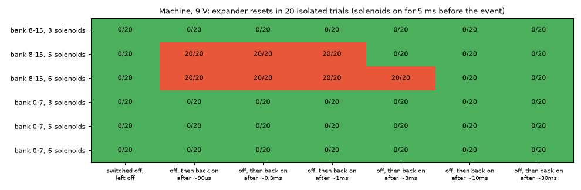

| | off, left off | back on after 90 µs | 0.3 ms | 1 ms | 3 ms | 10 ms | 30 ms |
|---|---|---|---|---|---|---|---|
| Bank 8-15, 3 solenoids | 0 | 0 | 0 | 0 | 0 | 0 | 0 |
| Bank 8-15, 5 solenoids | 0 | 20 | 20 | 20 | 0 | 0 | 0 |
| Bank 8-15, 6 solenoids | 0 | 20 | 20 | 20 | 20 | 0 | 0 |
| Bank 0-7, 3, 5 or 6 solenoids | 0 | 0 | 0 | 0 | 0 | 0 | 0 |

No odd read-backs, no trial starting from a dirty state.

- **Switching solenoids off never resets the chip**, even six at once, in
  20 trials out of 20. My statement in entry 127, and to the user, that the
  trigger is "several solenoids switched off in the same instant" was
  wrong, as was the "shortest sequence" that followed from it.
- **The reset comes when they are switched back on soon after.** With 5 or
  6 solenoids it happens every time if they come back on within about a
  millisecond, and never if they have been off for 10 ms or more. With 6
  solenoids it still happens at 3 ms; with 5 it no longer does.
- That window is the time the coil current takes to die away after
  switch-off. While it lasts, the current circulates through the
  ULN2803's clamp diodes. So the dangerous event is: **the driver is
  switched on while its clamp diode is still carrying coil current.** More
  coils, or a higher voltage, means more current still circulating and a
  longer window.
- All or nothing: every cell is 0 or 20 out of 20. With trials isolated
  from each other the behaviour is deterministic, which accounts for the
  periodic 33 % and 50 % seen in the probe (entry 130): there, writes
  followed each other closely enough to interact.
- **Bank 0-7 never resets** under identical treatment. Either its expander
  and driver pair tolerates the same event, or its solenoids are not
  carrying the same current. To be checked by reading the supply current
  with each bank on.

This fits the old firmware's fault exactly: every write switched most
energised solenoids off and back on 90 µs later. It fits the single faults
in the probe's native column (all off, then a pattern on a few milliseconds
later). And it fits the bench: there the larger disturbance was at the
switch back on (entry 92), but with only one coil.

The shortest sequence that resets the chip, now measured: five solenoids
of bank 8 to 15 on for a few milliseconds, then off and back on within
about a millisecond.

## 2026-11-22 20:03 — 133. STARTED on the machine: threshold per bank, and time-on needed (9 V)

*Run with: [tools/edge_session.py](tools/edge_session.py). Firmware: edgetest on usbserial (flashed earlier, 11-22 20:02).*

Same conditions (machine, 9 V, edge test sketch). Two more experiments in
the background, about two minutes:

- "threshold": 1 to 7 solenoids of each bank, switched off only, and
  switched off and back on after 90 µs; 20 trials each.
- "ontime": 5 and 6 solenoids of bank 8 to 15, left on for 0.1 ms to 100 ms
  before the event.

## 2026-11-22 20:06 — 134. RESULT of entry 133: threshold of four at 9 V; time on does not matter at all

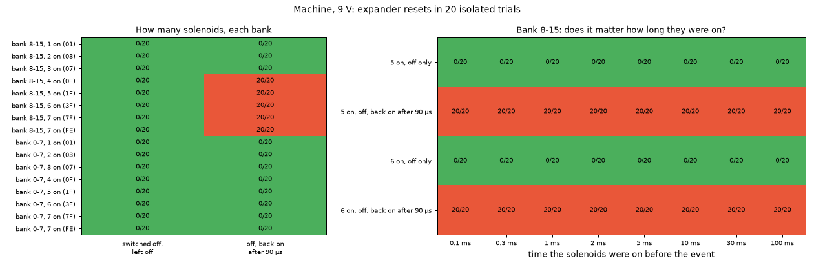

**Threshold**, resets out of 20, solenoids on for 5 ms first:

| Solenoids | Bank 8-15, off only | Bank 8-15, off and back on after 90 µs | Bank 0-7, either |
|---|---|---|---|
| 1, 2, 3 | 0 | 0 | 0 |
| 4, 5, 6, 7 | 0 | 20 | 0 |

A clean step at four solenoids for bank 8 to 15 at 9 V. Bank 0 to 7 never
resets, with up to seven.

**Time on**, bank 8 to 15, 5 and 6 solenoids, off and back on after 90 µs:
20 out of 20 at every duration tried, from 0.1 ms to 100 ms. Off only: 0
out of 20 at every duration.

That contradicts what I wrote in entry 132 and told the user: that the
solenoids have to have been on long enough for current to build, and that
more circulating current makes it worse. After only 0.1 ms the coil
current is a few milliamps, a tenth or less of its full value, and the
reset is just as certain.

It also contradicts my reading of the probe's first-byte-FF column in the
reply about "the pause matters". Those cells switch solenoids off after
90 µs and leave them off, which never resets anything; they said nothing
about how long solenoids need to be on.

What survives, and what it now points to:

- The event is "driver output switched on within a millisecond or so of
  being switched off", four or more outputs of bank 8 to 15 at once.
- How much coil current was flowing does not matter. So it is not the
  size of an interrupted current.
- A coil keeps even a small current circulating through the ULN2803's
  clamp diode for a while after switch-off: roughly a millisecond for a
  few milliamps, two to three for the full current. Those are the windows
  measured in entry 132. So the condition appears to be **the output is
  switched on while its clamp diode is conducting at all**.
- It needs solenoid power, and takes fewer outputs at higher voltage
  (entries 127 to 130).

Interpretation (not verified): this looks like a property of the
ULN2803's internal structure, not of the solenoids' energy. When an
output's clamp diode is conducting and its transistor is switched on, the
chip can briefly conduct straight from the solenoid supply pin to ground.
The size of that pulse would be set by the supply voltage and the number
of outputs doing it together, which is how the fault behaves, and it would
arrive in the ground and supply pins shared with the PCF8574 next to it.

## 2026-11-22 20:08 — 135. STARTED: supply current per bank, read by the user off the supply display

Asked in entry 132 and unanswered until now: do four solenoids of bank 0 to
7 draw the same current as four of bank 8 to 15? If bank 0 to 7 drew much
less, its immunity would need no other explanation. Sequence, 9 V: four
solenoids of bank 8 to 15 (pattern 0F) held on 30 s, all off 8 s, four of
bank 0 to 7 (0F) held on 30 s, all off. Uses the existing `t` command with
off byte = pattern and a 30 s on-time, so nothing is switched during the
hold.

## 2026-11-22 20:09 — 136. STARTED: rerun of entry 135 (the user missed the readings)

Same sequence: bank 8 to 15 pattern 0F for 30 s, off 8 s, bank 0 to 7
pattern 0F for 30 s.

## 2026-11-22 20:10 — 137. RESULT of entries 135/136: both banks draw the same current. STARTED: stagger experiment

*Run with: [tools/edge_session.py](tools/edge_session.py). Firmware: edgetest on usbserial (flashed earlier, 11-22 20:02).*

User's readings off the supply display, 9 V: 6 mA idle (the solenoid power
LED), 228 to 230 mA with four solenoids of bank 8 to 15, back to 6 mA,
228 mA with four solenoids of bank 0 to 7.

So 222 mA for four, 56 mA per solenoid, about 160 Ω each, the same on both
banks. Bank 0 to 7 is not immune because its solenoids draw less. The
difference between the banks is on the board (layout of the middle chip
pair, or the individual chips), not in the load.

Now running `edge_session.py stagger` at 9 V: bank 8 to 15, solenoids
switched off one at a time with 0 to 5 ms between them, left off. Expected
0 everywhere given that switching off has never caused a reset; it is a
check of that.

## 2026-11-22 20:12 — 138. RESULT of the stagger run (entry 137). STARTED: which outputs must be switched back on

*Run with: [tools/which_session.py](tools/which_session.py). Firmware: edgetest on usbserial (flashed 20:11).*

Stagger, 9 V, bank 8 to 15, resets out of 20: 0 in every cell (5, 6 and 7
solenoids; all at once and one at a time with 0, 0.2, 0.5, 1, 2 and 5 ms
between). As expected: switching off never resets, however it is done.

Next, still 9 V, bank 8 to 15. The sketch's `t` command gained an optional
ninth field: the byte that mode 2 writes after the gap, instead of the
starting pattern. Reflashed. Gap 0, so the second write follows the first
by one write time, about 0.2 ms. Questions:

- Is it the *same* outputs that must come back on, or any four? (0F, off,
  then F0.)
- How many of the four must come back? (0F, off, then 01 / 03 / 07.)
- Do outputs that stay on throughout count? (7E to 70 to 7E: three
  toggled, three held; 7F to 0F to 7F: three toggled, four held.)
- Plain switch-on from cold (00 to 0F, 00 to 7F), and four off with four
  others on in a single write (0F to F0).

## 2026-11-22 20:12 — 139. RESULT of entry 138: the same four outputs must come back, and nothing else may be switching off

Machine board, 9 V, bank 8 to 15, resets out of 20. Start pattern on 5 ms,
then the off byte, then the back byte about 0.2 ms later.

| Case | start > off > back | Resets |
|---|---|---|
| 4 off, same 4 back on | 0F > 00 > 0F | 20 |
| 4 off, 5 on (same 4 + 1 new) | 0F > 00 > 1F | 20 |
| 4 toggled, 3 held on | 7F > 70 > 7F | 20 |
| 4 off, other 4 on | 0F > 00 > F0 | 0 |
| 4 off, 1 / 2 / 3 back on | 0F > 00 > 01 / 03 / 07 | 0 / 0 / 0 |
| 7 off, 4 back on | 7F > 00 > 0F | 0 |
| 7 off, 3 back on | 7F > 00 > 07 | 0 |
| 3 toggled, 3 held on | 7E > 70 > 7E | 0 |
| 3 toggled, 4 held on | 7F > 78 > 7F | 0 |
| 2 toggled, 5 held / 1 toggled, 6 held | 7F > 7C > 7F / 7F > 7E > 7F | 0 / 0 |
| from cold, 4 on / 7 on | 00 > 00 > 0F / 7F | 0 / 0 |
| one write: 4 off + other 4 on | 0F > F0 | 0 |
| one write: 4 on, 3 more added | 0F > 7F | 0 |

Facts:

- It takes four outputs going off and then on again themselves. Switching
  on four *other* outputs right after does nothing, nor does plain
  switch-on of four or seven from cold.
- Outputs held on throughout neither help nor hurt (3 toggled + 4 held: 0;
  4 toggled + 3 held: 20).
- Unexpected: seven switched off, four of them switched back on: 0. The
  three extra outputs that were switched off and stayed off prevent the
  reset. Not understood. Needs a follow-up with one and two extra outputs
  (1F > 00 > 0F, 3F > 00 > 0F).

The user has the bench test board with them and will move the machine's
solenoids onto it: same solenoids, supply and cables, another copy of the
board. That is next.

## 2026-11-22 20:22 — 140. STARTED: threshold run with the two solenoid connectors swapped

*Run with: [tools/edge_session.py](tools/edge_session.py). Firmware: edgetest on usbserial (flashed earlier, 11-22 20:11).*

User: "i swapped the solenoid connectors". Taken to mean: on the machine's
board, the cable of solenoids 0 to 7 is now on the bank 8 to 15 outputs and
the other way round (the controller's identity line in the run output says
which board this is). Supply assumed still at 9 V. Same `threshold` run as
entry 133. If the resets stay with expander 0x21 the cause is on the board;
if they move to 0x20 it is the cable or that group of solenoids.

## 2026-11-22 20:29 — 141. Entry 140's run stalled: controller frozen. Restarted with a bus timeout

*Run with: [tools/edge_session.py](tools/edge_session.py). Firmware: busdiag on usbserial (flashed 20:28); edgetest on usbserial (flashed 20:28).*

The run of entry 140 printed nothing for five minutes. Killed it. The
controller (machine's Metro Mini, serial 423233303738FF161825) answered
nothing, including after a reset from the serial port. The test sketch
calls Wire before opening the serial port, and this Wire has no timeout by
default, so a stuck I2C bus freezes it silently. That is the likely cause
but it was not observed directly: by the time the bus diagnostic sketch was
flashed (no Wire before its first output), both lines read high with
external pull-ups and both expanders acknowledged.

A frozen controller was not seen in any earlier run on this board. It
happened on the first run after the connectors were swapped; whether that
is related is unknown.

Change: `Wire.setWireTimeout(25000, true)` in the test sketch, and the
`t` reply gains "hung 1" when a timeout occurred. Reflashed. Spot check,
connectors still swapped, 9 V, five trials each:

- 0x20, four solenoids, off and back on after 90 µs: 0 resets
- 0x21, same: 5 resets out of 5

STARTED: the full threshold run again, output unbuffered this time.

## 2026-11-22 20:29 — 142. RESULT of entry 141: with the connectors swapped, the fault stays with expander 0x21

Machine board, 9 V, solenoid connectors swapped, resets out of 20. The
table is identical to entry 134:

| Solenoids | Outputs of 0x21 ("bank 8-15"), off only | 0x21, off and back on after 90 µs | Outputs of 0x20, either |
|---|---|---|---|
| 1, 2, 3 | 0 | 0 | 0 |
| 4, 5, 6, 7 | 0 | 20 | 0 |

No "hung" report, no stall this time.

The fault does not follow the cable or the group of solenoids. It belongs
to the 0x21 position on this board: U3, its ULN2803 U5, and their wiring.
Together with entry 137 (same current on both banks) the load is ruled out
as the difference between the banks.

Next: the same solenoids on the bench test board.

## 2026-11-22 20:32 — 143. STARTED: bench test board on the machine's solenoids, 9 V

*Run with: [tools/edge_session.py](tools/edge_session.py). Firmware: edgetest on usbserial (flashed 20:32).*

User: "bench board is plugged in, supply at 9V, go ahead". Same solenoids,
cables and supply as the machine board; the bench board's own Metro Mini on
USB. Flashing the test sketch (with bus timeout) and running `threshold`.
Which way round the two solenoid connectors are on this board: not stated
yet.

## 2026-11-22 20:33 — 144. Note for entry 143: connector orientation on the bench board

User: the solenoid connectors are on the bench board "as originally on the
machine" (solenoids 0 to 7 on the 0x20 outputs, 8 to 15 on the 0x21
outputs). Bench board's USB adapter serial: caeac0f5adf4ef11a6bdc41b6d9880ab.

## 2026-11-22 20:33 — 145. RESULT of entry 143: the bench board does exactly the same. STARTED: follow-up on "extra outputs switched off"

Bench test board (Metro Mini chip serial 423233303738FF191804) on the
machine's solenoids, 9 V, connectors as originally on the machine, resets
out of 20:

| Solenoids | 0x21 outputs, off only | 0x21, off and back on after 90 µs | 0x20 outputs, either |
|---|---|---|---|
| 1, 2, 3 | 0 | 0 | 0 |
| 4, 5, 6, 7 | 0 | 20 | 0 |

Cell for cell the same as the machine's board (entries 134 and 142).

So this is not a defect of one board. Two copies of the design with these
parts do it, at the same position (0x21, the middle chip pair) and with the
same threshold. It also means the bench board never reproduced the fault
before only because it never had four real solenoids on it; one 5 Ω
solenoid and LEDs were not the right load.

Now on the bench board, 9 V: the puzzle from entry 139. Four outputs
switched off and back on, with 0, 1, 2 or 3 further outputs switched off
at the same moment and left off (0F, 1F, 3F, 7F > 00 > 0F), and the same
with the extras held on instead (> 10/30/70 > …) for comparison.

## 2026-11-22 20:34 — 146. RESULT of entry 145: one extra output switched off is enough to prevent it; and the high four outputs do not do it. STARTED: every combination of 3, 4 and 5 outputs

*Run with: [tools/combo_session.py](tools/combo_session.py). Firmware: edgetest on usbserial (flashed earlier, 11-22 20:32).*

Bench board, 9 V, expander 0x21, resets out of 20, start > off > back
(back about 0.2 ms after off):

| Case | Bytes | Resets | Writes not acknowledged |
|---|---|---|---|
| 4 toggled, no extras | 0F > 00 > 0F | 20 | 20 |
| same, repeated at the end | 0F > 00 > 0F | 20 | 20 |
| 4 toggled, 1 / 2 / 3 extras switched off | 1F / 3F / 7F > 00 > 0F | 0 / 0 / 0 | 0 |
| 4 toggled, 1 / 2 / 3 extras held on | 1F>10>1F, 3F>30>3F, 7F>70>7F | 20 / 20 / 20 | 20 |
| 5 toggled, 2 extras switched off | 7F > 00 > 1F | 20 | 20 |
| 6 toggled, 1 extra switched off | 7F > 00 > 3F | 20 | 20 |
| 4 toggled, the high four | F0 > 00 > F0 | 0 | 0 |

Facts:

- A single extra output switched off and left off prevents the reset when
  four are toggled, but not when five or six are.
- The outputs are not equivalent: the low four (solenoids 8 to 11) reset
  the chip, the high four (12 to 15) do not. "Four or more" was too simple;
  every pattern tried so far was built from the low bits up.
- Every reset comes with exactly one write not acknowledged and no
  "dirty" start on the next trial. So the write that fails is the one that
  switches the outputs back on: the chip resets at the very moment it
  applies that byte, before it finishes acknowledging it.

Now: all 56 + 70 + 56 combinations of 3, 4 and 5 outputs of 0x21, each
switched off and back on (pattern > 00 > pattern), 10 trials each, to see
which outputs count and by how much.

## 2026-11-22 20:35 — 147. Note from the user: the machine's solenoids do not click

I told the user to listen for clicking as a sign the solenoid power was
reaching the board. User: "the solenoids aren't meant to click, remember
they have no plunger, they're just electromagnets actually." So there is
no audible sign of activity on the machine; the supply's current display
is the thing to watch instead (6 mA idle, about 56 mA per solenoid at 9 V).

## 2026-11-22 20:36 — 148. RESULT of entry 146: three never, five always, four only without solenoid 14. STARTED: current of solenoid 14 against solenoid 15

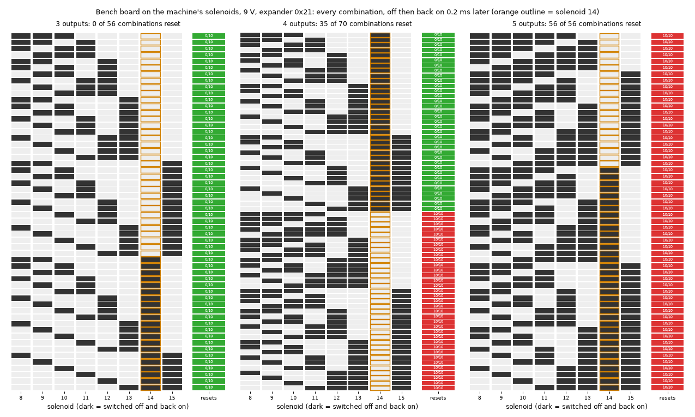

Bench board on the machine's solenoids, 9 V, expander 0x21, each
combination switched off and back on 0.2 ms later, 10 trials each. Every
cell was 0 or 10 out of 10.

| Outputs toggled | Combinations that reset |
|---|---|
| 3 | 0 of 56 |
| 4, not including solenoid 14 | 35 of 35 |
| 4, including solenoid 14 | 0 of 35 |
| 5 | 56 of 56 |

So the outputs add up, all with about the same weight except solenoid 14
(bit 6 of 0x21), which counts for less: three others plus 14 is not enough,
four others is. "The high four do not reset" in entry 146 was this: the
high four include 14.

Whether the lower weight belongs to solenoid 14 itself (higher resistance,
a different coil) or to output 6 of the board is not known yet. On the
machine's board the connector-swap run (entry 142) only used patterns
where it would not show.

Now: 0x21 output 6 alone (solenoid 14) held on 25 s, off 6 s, output 7
alone (solenoid 15) held on 25 s; the user reads the supply current.

## 2026-11-22 20:37 — 149. STARTED: rerun of the solenoid 14 / 15 current hold (the user missed it)

Same as entry 148 but longer: output 6 of 0x21 (solenoid 14) 40 s, off
8 s, output 7 (solenoid 15) 40 s.

## 2026-11-22 20:38 — 150. Timed holds abandoned; solenoids now held until the user has read the display

*Firmware: edgetest on usbserial (flashed 20:38).*

User: "stop this is confusing, I can't count time". Killed the timed
sequence of entry 149. Added a `w AA VV` command to the test sketch (write
one byte and leave it), reflashed the bench board. From now on one state is
held until the user reports the reading, then the next.

Solenoid 14 alone is on now (0x21 = 40, read back 4000).

## 2026-11-22 20:39 — 151. Solenoid 14 on the bench board had a bad contact: that is its "lower weight"

User, with solenoid 14 alone held on: "current was 6mA but then I touched
the S-3 connector and it went to 60mA as expected. note the pin headers
aren't soldered on the bench board so bad contacts aren't a surprise."

So during the combinations run (entry 148) solenoid 14 was most likely not
connected at all. A combination of four that included it had only three
real solenoids. The result then reads simply: three connected solenoids
never, four or more always, with no difference between outputs. The "high
four do not reset" of entry 146 has the same cause.

This applies to the bench board only. The machine's board has soldered
headers and its runs did not depend on solenoid 14 alone.

Still standing and not explained by this: an extra solenoid switched off
and left off prevents the reset (entry 146: extras were 12 and 13, which
were connected; also seen on the machine's board in entry 139).

Solenoid 15 alone is on now (0x21 = 80) for a reading.

## 2026-11-22 20:40 — 152. Solenoid 15 alone: 60 mA. STARTED: four-output combinations again, now that 14 makes contact

*Run with: [tools/combo_session.py](tools/combo_session.py). Firmware: edgetest on usbserial (flashed earlier, 11-22 20:38).*

User: "60mA" with solenoid 15 alone (6 mA idle included, so about 54 mA,
same as 14 after the connector was touched). Rerunning all 70 combinations
of four outputs of 0x21 on the bench board, 9 V, 10 trials each. Expected
now: all 70 reset.

## 2026-11-22 20:41 — 153. RESULT of entry 152: all 70 four-output combinations reset. STARTED: back-on window against time on

Bench board, 9 V, after the S-3 connector was reseated: 70 of 70
combinations of four outputs reset, 10 out of 10 each. Confirms entry 151:
on this board the rule is three never, four or more always, any outputs.

Now, same setup: how late can the outputs come back on and still reset the
chip, for solenoids that had been on 0.1 ms (almost no coil current) and
5 ms. Patterns 0F and 7F, gaps 0 to 10 ms, 10 trials per cell. If the
window is set by coil current still circulating, it should be much shorter
after 0.1 ms on.

## 2026-11-22 20:42 — 154. RESULT of entry 153: the back-on window is not a simple cut-off

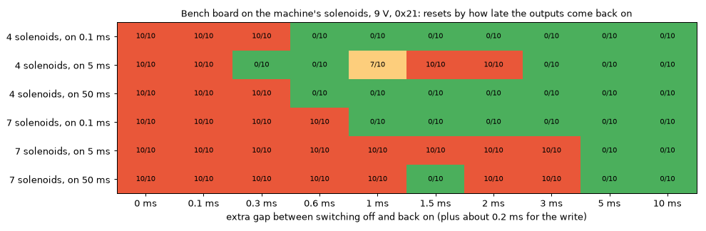

Bench board, 9 V, 0x21, resets out of 10 by extra gap before back-on:

| Solenoids, time on | 0 | 0.1 | 0.3 | 0.6 | 1 | 1.5 | 2 | 3 | 5 | 10 ms |
|---|---|---|---|---|---|---|---|---|---|---|
| 4, on 0.1 ms | 10 | 10 | 10 | 0 | 0 | 0 | 0 | 0 | 0 | 0 |
| 4, on 5 ms | 10 | 10 | 0 | 0 | 7 | 10 | 10 | 0 | 0 | 0 |
| 4, on 50 ms | 10 | 10 | 10 | 0 | 0 | 0 | 0 | 0 | 0 | 0 |
| 7, on 0.1 ms | 10 | 10 | 10 | 10 | 0 | 0 | 0 | 0 | 0 | 0 |
| 7, on 5 ms | 10 | 10 | 10 | 10 | 10 | 10 | 10 | 10 | 0 | 0 |
| 7, on 50 ms | 10 | 10 | 10 | 10 | 10 | 0 | 10 | 10 | 0 | 0 |

Facts:

- Never beyond 3 ms; always within 0.3 ms.
- In between it is not monotonic: four solenoids on for 5 ms reset at 0 and
  0.1 ms, not at 0.3 and 0.6 ms, then again at 1 to 2 ms. Seven on for
  50 ms have a hole at 1.5 ms.
- Time on does change the window (unlike at a 90 µs gap, entry 134), but
  not in order: 5 ms gives a longer window than both 0.1 ms and 50 ms.

Only 10 trials per cell and one pass; the holes need repeating before
being relied on.

Interpretation (not verified): holes and returns in the window look like
something oscillating after switch-off, with the outcome depending on
where in the swing the outputs come back on. That would be the voltage on
the driver outputs ringing after the coils are released. It needs the
scope on a driver output to check.

## 2026-11-22 20:43 — 155. STARTED: bench board on the machine's solenoids at 12 V: threshold, then back-on window

*Run with: [tools/edge_session.py](tools/edge_session.py), [tools/window_session.py](tools/window_session.py). Firmware: edgetest on usbserial (flashed earlier, 11-22 20:38).*

User: "supply is at 12V, go ahead". Last test of the day. `threshold`
(20 trials per cell, both expanders), then the back-on window sweep of
entry 153 with 2, 3, 4 and 7 solenoids.

## 2026-11-22 20:45 — 156. RESULT of entry 155: at 12 V the threshold at 90 µs is still four, but three reset in a second window at 1.5 to 2 ms

Bench board on the machine's solenoids, 12 V.

Threshold (20 trials, back on after 90 µs): identical to 9 V. 0x21 outputs:
1 to 3 solenoids 0, 4 to 7 solenoids 20 out of 20; off only 0 everywhere;
0x20 outputs 0 everywhere.

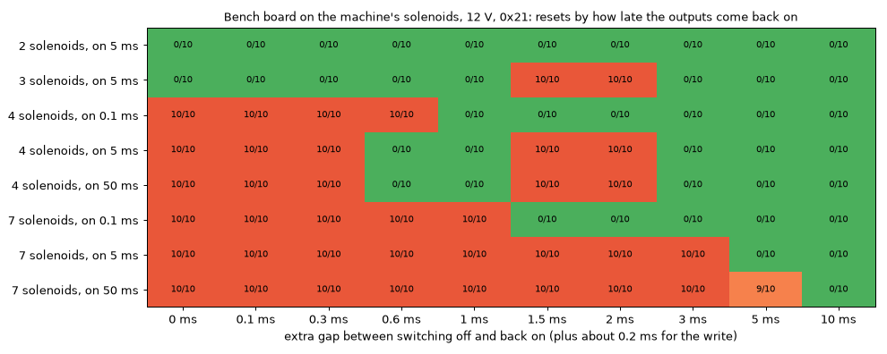

Back-on window, 0x21, resets out of 10 by extra gap:

| Solenoids, time on | 0 | 0.1 | 0.3 | 0.6 | 1 | 1.5 | 2 | 3 | 5 | 10 ms |
|---|---|---|---|---|---|---|---|---|---|---|
| 2, on 5 ms | 0 | 0 | 0 | 0 | 0 | 0 | 0 | 0 | 0 | 0 |
| 3, on 5 ms | 0 | 0 | 0 | 0 | 0 | 10 | 10 | 0 | 0 | 0 |
| 4, on 0.1 ms | 10 | 10 | 10 | 10 | 0 | 0 | 0 | 0 | 0 | 0 |
| 4, on 5 ms | 10 | 10 | 10 | 0 | 0 | 10 | 10 | 0 | 0 | 0 |
| 4, on 50 ms | 10 | 10 | 10 | 0 | 0 | 10 | 10 | 0 | 0 | 0 |
| 7, on 0.1 ms | 10 | 10 | 10 | 10 | 10 | 0 | 0 | 0 | 0 | 0 |
| 7, on 5 ms | 10 | 10 | 10 | 10 | 10 | 10 | 10 | 10 | 0 | 0 |
| 7, on 50 ms | 10 | 10 | 10 | 10 | 10 | 10 | 10 | 10 | 9 | 0 |

Facts:

- The hole and return seen at 9 V (entry 154) are real: at 12 V, four
  solenoids on for 5 ms and for 50 ms both reset up to 0.3 ms, not at 0.6
  and 1 ms, and again at 1.5 and 2 ms. Two separate windows.
- The second window is the more sensitive one: three solenoids reset there
  (10 out of 10) and nowhere else. This is how three could fail at 12 V in
  the probe-6 reports (entries 127 to 130) while the 90 µs threshold is
  four.
- The second window only exists when the solenoids had been on for
  milliseconds (absent after 0.1 ms on). The first window does not care.
- Seven solenoids: the two windows merge, up to 3 ms (5 ms once).
- Nothing at 10 ms in any row.

End of today's session at the machine. Remaining: put the machine's board
back and flash the PR firmware onto its Metro Mini.

## 2026-11-22 22:52 — 157. New fact from the user: the ULN2803s are UMW parts too

User: "I've been focusing on how the UMW PCF8574 may differ from the TI
part but actually on my boards the original TI ULN2803ADWR (discontinued)
was also replaced with UMW ULN2803A."

So "boards with TI parts work" compares two substitutions at once, and the
driver is as much a suspect as the expander. Everything measured today is
about driver events: outputs switched on within 3 ms of being switched
off, a count of outputs, more sensitive at higher solenoid voltage, only
with solenoid power.

Interpretation (not verified): a candidate that fits is the clamp diodes
inside the UMW ULN2803A. If an output's transistor is switched on while
its clamp diode is still conducting, the diode takes a moment to stop
(reverse recovery) and for that moment there is a path from the solenoid
supply pin through the diode and the transistor to ground. The current in
it is limited by the chip, not by the coil, so it does not depend on how
much coil current was flowing (entry 134), it adds up per output, and it
grows with supply voltage. The second window at 1.5 to 2 ms (entry 156)
would be the output voltage swinging back above the supply and the diodes
conducting again. A slow or leaky clamp structure in a clone part would
make this much worse than in the TI part. The pulse returns through the
driver's ground pin, and at the 0x21 position that ground is shared with
the expander over the longer trace.

Not explained by this: why an extra output switched off prevents it
(entry 146).

To check: scope on a driver output and on the expander's ground during a
failing sequence; or fit a TI or other-make ULN2803 at U5 on one board and
rerun the threshold.

## 2026-11-22 22:57 — 158. Driver datasheets compared: TI ULN2803A against UMW ULN2803

The user flashed the PR firmware back onto the machine's Metro Mini
themselves, and downloaded both datasheets: ti-uln2803a.pdf (SLRS049C,
9 pages) and umw-uln2803a.pdf (Jun. 2025, 12 pages), in ~/Downloads.

| Item | TI | UMW |
|---|---|---|
| Internal circuit | 2.7 kΩ input, 7.2 kΩ and 3 kΩ base resistors, clamp diode to COM | same drawing, same values |
| Static table (leakage, saturation voltage, input current, clamp diode 50 µA at 50 V and 1.7 / 2 V at 350 mA) | — | same numbers, row for row |
| Substrate current rating | −2.5 A | 2.5 A ("Emit total current of extremal electrons") |
| Switching | delay 130 ns off, 20 ns on, typical, at 50 V into 163 Ω | "turn-on delay" and "turn-off delay" 1 µs max, no conditions |
| Output voltage after switching, "Latch-Up Test" (Figure 9) | min VS − 20 mV, at VS = 50 V, about 300 mA, load 2 mH + 163 Ω, pulsed at 12.5 kHz (40 µs on, 40 µs off) | absent |
| Clamp diode recovery time | not given | not given |

Facts:

- The UMW static table is the TI table. It says nothing independent about
  the UMW silicon.
- The one dynamic guarantee in the TI sheet has no counterpart in the UMW
  sheet: that with an inductive load switched off and on again every 40 µs,
  the output still returns to the supply voltage. TI names it a latch-up
  test. Its stimulus is today's failing stimulus: outputs switched back on
  while the coil is still discharging through the clamp diode.
- Neither sheet gives a diode recovery time, so the recovery idea of entry
  157 cannot be checked on paper.

Interpretation (not verified): the missing latch-up line is consistent
with the driver being the part that misbehaves, either as in entry 157 or
by an output staying on or conducting to the substrate after such a
sequence. It is an absence in a datasheet, not a measurement.

## 2026-11-22 23:11 — 159. Discussion with the user: the latch-up test, and what is and is not shown about the driver

**TI's latch-up test (Figure 9 of SLRS049C), as explained to the user.**
One output drives 2 mH in series with 163 Ω from 50 V, COM tied to the same
supply. Input pulsed at 12.5 kHz: 40 µs on, 40 µs off. Pass: after each
switch-off the output returns to within 20 mV of the supply, i.e. the
"off" output leaks no more than about 0.12 mA through 163 Ω.

- Coil time constant 2 mH / 163 Ω ≈ 12 µs, so 40 µs on reaches about
  300 mA.
- My estimate, not in the datasheet: with about 1.7 V of clamp diode
  across the coil, 300 mA takes roughly 2 mH × 0.3 A / 1.7 V ≈ 350 µs to
  decay. So every switch-on happens with the clamp diode still carrying
  most of the coil current. That is the situation the test exists for.
- General background, not from the datasheet: all eight transistors and
  diodes share one piece of silicon, isolated by junctions to the
  substrate (the ground pin). A conducting clamp diode injects charge into
  it, which in a poor layout can turn on unintended structures: an output
  conducting with its input low, or current from COM to the substrate.

| | TI's test | The failing sequence here |
|---|---|---|
| Load | 2 mH + 163 Ω | electromagnet, about 160 Ω, inductance unknown |
| Off time before back on | 40 µs | 90 µs to about 3 ms |
| Clamp diode conducting at switch-on | yes | yes in the first window; presumably in the second |
| Outputs at once | one | four or more needed |

The test checks the driver's own output, not its neighbours.

**User's objection: "ok but we do see the PCF8574 resetting".** Correct.
Nothing measured shows the driver misbehaving. What is observed:

- The expander really resets: port reads FF (its power-on state), the
  state persists until rewritten, and the byte being applied at that
  moment is not acknowledged.
- The cause is on the solenoid side: never with solenoid power off, and it
  depends on which outputs are switched and when.

Why the driver stays in the picture: the expander has no connection to the
solenoid supply or the coils. What it shares with that side goes through
or alongside the ULN2803: (1) ground, a shared trace back to the supply;
(2) the eight signal lines, each expander pin straight into a driver input
(2.7 kΩ into the base). So the driver is necessarily the path. Whether it
is also the cause is not shown.

| Route | What would happen | Fits | Does not obviously fit |
|---|---|---|---|
| Ground | Current pulse in the driver's ground pin lifts the expander's ground; its supply collapses for an instant | Only the 0x21 position (longer shared ground trace), on both boards | Bench: ground moved at most 0.2 V, but never under a failing sequence |
| Signal lines | Current pushed back out of the driver's inputs into the expander's pins upsets it internally | The count is per toggled output, and those are the pins involved | Why 0x20 would be immune with the same parts |

Open:

- The UMW expander may be the weak part after all: a TI PCF8574 might ride
  through the same disturbance, with the UMW driver behaving like TI's.
- Or both parts contribute.
- The datasheet comparison (entry 158) only says the UMW driver has no
  stated guarantee for this sequence.

Parts: the user has no TI parts, and the TI ULN2803ADWR is not obtainable.
Candidates for a driver swap, from memory and unchecked: ST ULN2803A (SO-18
availability uncertain), Toshiba TBD62083A (SOP-18, MOSFET outputs; input
threshold to check against what a PCF8574 can drive). Without parts: scope
on the expander's ground and on one signal line during a failing sequence,
which needs four or more real electromagnets or a stand-in load; one
coil's inductance should be measured to judge a stand-in.

Practical position: native single-byte writes never switch an output off
and straight back on, and nothing else reset the expander in any isolated
test, so the PR firmware avoids the trigger whatever the root cause.

## 2026-11-22 23:46 — 160. Discussion with the user after the session: theories weighed, and the plan for the next visit

No measurements in this entry. Everything here is reasoning or planning.

**If the UMW driver suffered true latch-up.** A sustained latch-up would
hold a conduction path on until power is removed: an output stuck on, or
current from clamp common to ground, visible as excess supply current and
heat, with the expander unaffected. Not what is seen: the expander resets
and one write later everything is normal, thousands of times. A transient
version would fit: brief conduction while the clamp diodes still carry
current at switch-on, giving a short pulse into the driver's ground pin.
Hypothesis only.

**Is ground bounce still the best theory?** Weakly. Rough weights given to
the user, judgment not calculation: disturbance of ground or supply at the
expander about half, injection through the signal pins about a third, the
rest unknown.

- For ground: only the 0x21 position resets, on both boards, and the known
  difference is layout; adds up per output; grows with supply voltage.
- Against ground: after 0.1 ms on the coils carry a few milliamps and four
  still reset the chip, so there is no large coil current to commutate;
  switch-on from cold never fails although the outputs fall by the same
  voltage; the protection by an extra output switched off is unexplained;
  the expander's 1 µF capacitor C6 is about 9 mm from it, so its supply
  rides with its ground.
- Signal pins: each expander pin goes straight to a driver input. Fits the
  small-current result and the per-output count. Does not explain the
  position. The driver's internal 2.7 kΩ limits what can come back to a
  few milliamps per pin.

**Board layout facts looked up for this** (ayab_rs.pcb): PCF8574s are
SO16W, ULN2803s SO18W, all surface-mount. Middle pair U3 (0x21) and U5,
with C6 by U3. Pads labelled GND2 and 9V by the supply jack J1; pads
labelled GND and 5V by the Metro Mini. The solenoid rail's capacitors (C3,
C4) are by the jack, about 50 mm from U5; none at either driver. No ground
fill. A fill would help if the ground route is real (lower impedance,
smaller loops), not otherwise, and on two layers it needs re-routing and
via stitching to be worth much.

**Correction.** I told the user that a capacitor at each driver's supply
pin is "ordinary good practice". Wrong, and the user said so: the ULN2803
has no supply pin. Pin 10 (COM) is only the clamp diodes' common cathode,
and the coil discharge loop does not pass through ground. A capacitor
across pins 10 and 9 is only a diagnostic for the hypothesis of abnormal
conduction from COM to ground inside the driver.

**Wire tests for the next visit** (the user has wire, no suitable
capacitor). On the bench board, chip ends soldered beforehand, pad ends
connectable; solder the bench board's pin headers too.

- Wire A: U5 pin 9 (driver ground) to the GND2 pad, about 45 mm.
- Wire C: U5 pin 10 (COM) to the 9V pad, twisted with A, standing in for
  the capacitor by bringing the bulk capacitor at the jack to the chip.
  First check with a meter that the 9V pad and pin 10 are directly
  connected (diode D1 is nearby; not traced).
- Wire B, optional: U3 pin 8 (expander ground) to the GND pad by the Metro
  Mini, about 65 mm.

Threshold run after each step: baseline, A, A + C, then B added. The sign
to look for is the threshold moving up from "three never, four always",
not the fault vanishing; such wires only lower the impedance by a factor
of two or three. If nothing moves in any step, the ground family of
explanations is in serious trouble.

**Scopes.** The user's portable scope (200 kHz, one channel, ×1 probe)
would show the slow part: how long a driver output stays above the supply
after release, any ringing, and so the coil's inductance; it would most
likely miss the sub-microsecond disturbance. The Hantek 6022BE (20 MHz,
two channels, captured from the Mac at 24 MS/s) can do both. Needs both
×10 probes, Mac on battery, zero offsets rechecked.

**Scope plan for the signal-pin hypothesis** (6022BE):

- Ground clip on U3 pin 8, the chip's own ground. Yellow on a toggled
  port pin (same net as U5 inputs, pins 1 to 8), blue on U3 pin 16 (5 V).
- Capture four cases and overlay: four off and back on at 0.2 ms
  (fails); three, same timing (never); four on from cold (never); four
  toggled with a fifth switched off (protected).
- Signal route predicts: pin pushed more than about 0.6 V beyond a rail
  with the 5 V steady. Supply collapse predicts: the 5 V dips.
- A ground shift between expander and controller is invisible with the
  clip on the chip. For that: clip on the GND pad by the Metro Mini,
  yellow on U3 pin 8.
- One capture with yellow on a port pin that should stay low: its rise
  marks the reset instant.
- Rerun the threshold with probes and clip attached before trusting
  captures.

On the ground clip (user asked whether it matters, the scope being
grounded through the Mac): for slow signals no; for fast ones yes. Without
it the reference comes round a couple of metres of USB cable and lands at
the controller's ground, so the picture rings and a shift of the
expander's ground is indistinguishable from a signal moving.

**Reading the bench supply without a ground loop** (side discussion). A
"data-only" USB cable keeps ground, so it does not help. D+ and D− alone
would remove the loop but depends on the supply not needing to see bus
voltage, has a poor return path, and exposes the port to the very
transients under study; through a sacrificial hub if at all. Proven: the
Raspberry Pi. Untested with this supply: a USB isolator (ADuM3160/4160
type, full speed only; newer high-speed parts exist), or an ESP32-S2/S3 as
USB host bridging to Wi-Fi (firmware to write).

**Parts.** Unchecked candidates for a driver swap remain ST ULN2803A and
Toshiba TBD62083A (entry 159).

## 2026-11-23 00:23 — 161. User's objection to the signal-pin route; its weight lowered

User: "but pcf8574 is a bidirectional expander, it expects stuff to happen
on its pins". Correct. Reasoning only, no measurement:

- Between the rails, anything an outside circuit does to a port pin is
  normal use. A pin written high is held by a weak pull-up precisely so it
  can be pulled low from outside; the only consequence is a changed read
  value (and the interrupt output, unused here).
- Only a pin forced beyond a rail (roughly 0.5 V above the 5 V or below
  ground) makes the chip's protection structures conduct, and even that is
  allowed up to a rated clamp current, of the order of 20 mA on the TI
  part.
- The driver input has 2.7 kΩ in series, and its base is held within about
  1.4 V of ground by the transistors' own junctions. To push even a few
  milliamps beyond a rail the driver's base would have to be dragged
  several volts out of range by some internal fault, and the result would
  still be within what a to-spec expander tolerates.

So the signal-pin route needs two unusual things at once: a driver that
drives its own inputs out of range, and an expander that resets on a few
milliamps of clamp current. Weight revised from about a third (entry 160)
to perhaps one in six or seven. Disturbance of the expander's ground or
supply, or of the bus lines as it sees them, takes most of the difference;
"unknown" takes the rest. The scope plan of entry 160 is unchanged: the
port-pin capture is still cheap and would rule this in or out directly.

## 2026-11-23 00:27 — 162. User's question: could the I2C bus cause the "reset"? Two ways it could; a firmware-only test

Reasoning only, no measurement.

What is observed is: port reads FF afterwards, and the write that switches
the outputs back on is not acknowledged. "Reset" is an inference from FF
being the power-on state. The PCF8574 has no reset command on the bus, but
the bus could be involved in two ways.

1. **A false write of FF, no reset at all.** While addressed for writing,
   the chip takes every further nine clock pulses as another data byte. If
   the disturbance makes it see nine or more extra pulses on SCL while SDA
   reads high, it loads FF. The first false edge would also end its
   acknowledge early, which the controller would read as "not
   acknowledged". Against: it needs at least nine clean false pulses every
   single time; fewer would leave the port correct, and over thousands of
   events there was never a miss among 20 or a wrong value other than FF
   ("other" always 0).

2. **The bus lines as the way in for a real upset.** SDA and SCL are driven
   from the controller, 80 mm away, and referenced to the controller's
   ground. If the expander's ground shifts by only about 0.7 V relative to
   the controller's while the controller is holding a bus line low, that
   pin is below the expander's own ground. Its protection structure then
   conducts, and the current is limited by almost nothing, since the
   controller's driver is a hard low. Current injected like that is a
   classic way to upset a chip's internal state. This needs far less
   ground shift than collapsing the supply across C6 would, it explains
   the position (longer shared ground), and the event happens during a bus
   transaction by construction, because outputs only change on a write.

Way 2 is a version of the ground route in which the bus is what turns a
modest ground shift into a reset. It answers the main weakness noted in
entry 160 (the local capacitor keeps the chip's supply intact).

**Firmware-only test, no hardware changes.** Replace Wire by bit-banged
I2C on the same two pins for the back-on write, so the state of each line
at and after the moment the outputs switch is chosen instead of being
whatever the TWI hardware does:

- after the last data bit, hold SCL low for milliseconds, or let it go
  high and stay high for milliseconds, before continuing;
- drive lines low with the pin, or only through the pull-up (released);
- lengthen each phase to find at which clock edge the outputs switch and
  at which the acknowledge is lost.

Predictions: way 2 resets only when the controller is holding a line low
at the critical moment, and not when both lines are released; way 1
depends on false edges and should change with which level SCL rests at; a
supply collapse or anything not involving the bus should not care.

Hardware counterpart, if wanted: a few hundred ohms in series with SDA and
SCL at the expander limits any such current.

## 2026-11-23 00:38 — 163. Bit-banged write test added to the in-firmware probe (version 7), pushed to the PR. Not run on hardware

User: "add the bit-banged I2C test to the probe in the PR". Done as commit
1673053 on branch pcf8574-probe, pushed; the Archive Build action passed,
so the web tool can serve it. PR description updated.

New stage between the replay and the soak, seven report lines (steps 11
to 17 of 19). Each line: ten trials of solenoids 8 to 14 on for 5 ms, off
by an ordinary write, then back on about 0.5 ms later by a write clocked
through port C pins 4 and 5 with the I2C hardware switched off.

| Line | Back-on write |
|---|---|
| wire | I2C hardware, as a reference |
| hand --- | bit-banged, ordinary timing |
| hand L-- | clock held low 0.3 ms before the acknowledge pulse |
| hand -H- | clock left high 0.3 ms during the acknowledge pulse |
| hand LH- | both |
| hand --D | data line also held low by the controller from the last data bit |
| hand -HD | clock left high, data held low |

Reported per line: trials ending with the port at FF, and in how many
trials the expander was acknowledging at the end of the clock's low time,
just after the clock rose, and at the end of its high time. The time from
switch-off to the acknowledge pulse is kept the same across variants (the
variants without the low hold wait 0.3 ms before starting).

What to read from it:

- "wire" and "hand ---" should both show resets on an affected board with
  solenoid power; if "hand ---" does not, the bit-banged write itself
  differs from the hardware's in some way that matters.
- The three acknowledge counts place the reset within the acknowledge
  bit: lost already while the clock is low, lost at the rising edge, or
  only later.
- If resets disappear when the clock is left high (H) and nothing is held
  low by the controller, the reset needs the controller pulling a line
  low after the outputs switch: way 2 of entry 162.
- If D makes it worse or changes nothing, likewise informative.

Static RAM unchanged (data 966, bss 631); flash 17884 to 18932 bytes of
text. No board was connected to the Mac, so this was built only. It must
be run once on the bench board (no solenoids needed: expect ff 0 and ack
10 10 10) before anyone at a machine is asked to flash it.

## 164. 2026-11-24 16:35 — Probe version 7, first run: bench board, 7 solenoids, 9 V

Run by the user, reported in chat. Set-up as they described it: bench
board, seven equivalent solenoids on S-3 (solenoids 8-15; one pin of the
connector has nothing on it), latest PR firmware (commit 1673053, probe
version 7) flashed, 9 V from the bench supply. These are not the
machine's solenoids. This is also the first time the bit-banged stage
has run on any board.

```
=== PCF probe 7: 19 steps, about 25 seconds ===
Please wait for TEST FINISHED before doing anything.
chip 1E950F 423233303738FF191804 boot 1
vcc 4892 sda 1 scl 1 ack 20 21
all off reads 0000
step, bad/portFF of 100: nat p00 p09 p11 pFF
[1/19]  1 on 0/0 0/0 0/0 0/0 0/0
[2/19]  2 on 0/0 0/0 0/0 0/0 0/0
[3/19]  5 on 0/0 0/0 0/0 0/0 0/0
bad p00 9 on #0 want B636 got FF36 re FF36
bad p00 9 on #1 want B637 got FF37 re FF37
bad p00 9 on #2 want B636 got FF36 re FF36
bad p00 9 on #3 want B637 got FF37 re FF37
[4/19]  9 on 0/0 100/100 99/99 99/99 1/1
[5/19] 11 on 1/1 100/100 100/100 99/99 1/1
[6/19] 16 on 0/0 0/0 0/0 0/0 0/0
one by one / adding up: bad per solenoid 0..15
[7/19] one nat 0000000000000000
[8/19] one p09 0000000000000000
[9/19] add nat 0000000000000000
[10/19] add p09 0000000000000090
7 off, back on by hand-clocked write: ff and acks of 10
L/H: clock held low/high 0.3 ms; D: data held low
[11/19] wire     ff 10
[12/19] hand --- ff 10 ack 10 0 0
[13/19] hand L-- ff 10 ack 10 0 0
[14/19] hand -H- ff 10 ack 10 0 0
[15/19] hand LH- ff 10 ack 10 0 0
[16/19] hand --D ff 10 ack 10 10 10
[17/19] hand -HD ff 10 ack 10 10 10
[18/19] soak p09 11 on n 2000 bad 1999 ff 1999
[19/19] stuck 2609 nak w 2931 r 0
whole bank on by itself: 0-7 0 times, 8-15 2679 times
vcc min 4957 max 5001 ram 101
PCF probe 7 end, total bad 2679
=== TEST FINISHED: copy all the text above and send it ===
```

What the lines say, before any interpretation:

- The probe ran to its end. The bit-banged write works as a write: the
  expander acknowledged the address (no extra complaints) and the data
  byte (first count 10 on every line).
- The fault reproduces with these seven solenoids, on the bank 8-15 only
  (0 times on 0-7, 2679 on 8-15), as with the machine's solenoids on
  2026-11-22.
- Every one of the seven lines of the new stage reset 10 times out of 10,
  the hardware-clocked reference included.
- On the four lines where the controller leaves the data line alone, the
  expander was holding it low at the end of the clock's low time in 10
  trials of 10, and in none of 10 at the next sample, which the code
  takes 4 us (plus a few instructions) after releasing the clock, nor at
  the end of the high time.
- On the two D lines the counts 10 10 10 mean nothing: the controller
  itself is holding the data line low, so the reading cannot show what
  the expander does. A flaw in the design of those two lines' report
  (the ff count on them is still valid).
- Native writes: one reset in 100 at "11 on", none elsewhere. pFF: one
  in 100 at 9 on and at 11 on. Not looked into yet.

Missing control: this stage has never run on a board where nothing
resets, so "10 0 0" has no baseline. The prediction for a healthy run is
"10 10 10" (an expander holds its acknowledge for the whole clock pulse),
and the hardware reported one refused write per reset on 2026-11-22,
which agrees, but the same board with the 9 V switched off should be run
once to confirm.

Interpretation (mine, pending that control):

1. The reset is complete within about 5 us of the clock edge that makes
   the expander apply the byte. Holding the clock low for 0.3 ms first
   (L) does not bring it forward: the expander is still acknowledging at
   the end of that time. So the reset goes with the outputs switching
   on, not with the byte arriving.
2. "Way 2" as stated in entry 162 is out. On the "-H-" line the
   controller holds neither line low at the edge nor for 0.3 ms after
   it, and the reset happens all the same. Nothing the controller does
   on the bus after the edge can matter either, since the reset is over
   before it does anything.
3. Whatever upsets the expander is therefore there within microseconds
   of the outputs switching on. A coil's current cannot rise in that
   time. A current that can: through the driver's clamp diodes, which
   are still carrying the coils' current for some time after a
   switch-off, into outputs that switch on again (the diode needs a
   moment to stop conducting), or the charge held on the cable. The
   clamp diode idea would fit "only outputs just switched off count" and
   the first lobe of the window (0 to about 0.5 ms). It does not explain
   the second lobe at 1.5-2 ms nor the "one extra switched off" oddity.
   Not tested.

## 165. 2026-11-24 16:50 — Control for entry 164: same board, 9 V off

Run by the user, reported in chat: same bench board and firmware, the
9 V supply off. They also point out that nothing is plugged into the
connector for solenoids 0-7 on this set-up, so "0-7 never reset" in
entry 164 says nothing about that bank (the 2026-11-22 runs, with the
machine's solenoids on both banks, still stand).

```
=== PCF probe 7: 19 steps, about 25 seconds ===
Please wait for TEST FINISHED before doing anything.
chip 1E950F 423233303738FF191804 boot 1
vcc 5001 sda 1 scl 1 ack 20 21
all off reads 0000
step, bad/portFF of 100: nat p00 p09 p11 pFF
[1/19]  1 on 0/0 0/0 0/0 0/0 0/0
[2/19]  2 on 0/0 0/0 0/0 0/0 0/0
[3/19]  5 on 0/0 0/0 0/0 0/0 0/0
[4/19]  9 on 0/0 0/0 0/0 0/0 0/0
[5/19] 11 on 0/0 0/0 0/0 0/0 0/0
[6/19] 16 on 0/0 0/0 0/0 0/0 0/0
one by one / adding up: bad per solenoid 0..15
[7/19] one nat 0000000000000000
[8/19] one p09 0000000000000000
[9/19] add nat 0000000000000000
[10/19] add p09 0000000000000000
7 off, back on by hand-clocked write: ff and acks of 10
L/H: clock held low/high 0.3 ms; D: data held low
[11/19] wire     ff 0
[12/19] hand --- ff 0 ack 10 10 10
[13/19] hand L-- ff 0 ack 10 10 10
[14/19] hand -H- ff 0 ack 10 10 10
[15/19] hand LH- ff 0 ack 10 10 10
[16/19] hand --D ff 0 ack 10 10 10
[17/19] hand -HD ff 0 ack 10 10 10
[18/19] soak p09 11 on n 2000 bad 0 ff 0
[19/19] stuck 0 nak w 0 r 0
whole bank on by itself: 0-7 0 times, 8-15 0 times
vcc min 4957 max 5023 ram 160
PCF probe 7 end, total bad 0
=== TEST FINISHED: copy all the text above and send it ===
```

No resets anywhere, and "ack 10 10 10" on the four lines where the
reading means something: without the reset the expander holds its
acknowledge for the whole clock pulse. The baseline is as predicted, so
the "10 0 0" of entry 164 is the reset, and points 1 and 2 of that
entry's interpretation stand.

Also noted: "ram 160" here against 101 in entry 164, so the run with
faults used 59 bytes more stack (the "bad ..." lines' path, presumably;
not checked). 101 bytes of margin left.

The user has quit the web tool; the bench board's Metro Mini is free
for me to flash and drive from the Mac.

## 166. 2026-11-24 17:22 — Bench board with the user's 7 solenoids: threshold run from the Mac

*Run with: [tools/edge_session.py](tools/edge_session.py). Firmware: edgetest on usbserial (flashed 17:22).*

Port checked free (lsof), edgetest flashed on the bench board's Metro
Mini (6528 bytes, verified). Starting the "threshold" experiment of
[edge_session.py](tools/edge_session.py) to learn two things: whether
the 9 V is back on (I cannot sense it otherwise; four or more outputs
toggled should reset if it is), and whether these seven solenoids give
the same threshold as the machine's. Result to
/private/tmp/claude-501/-Users-jonathanperret-src-ayab-firmware/aa742363-503d-419f-b7e5-1115f9b11e0a/scratchpad/out/threshold-bench7-1124.json.

Result (17:22): 0/20 in every cell, both banks, both columns; controller
READY, vcc 4979, read-back 0000. With the probe having reset 10/10 on
this same set-up an hour earlier, the likeliest reading is that the 9 V
is still off since the control run. Not confirmed; asked the user.

Side note on entry 164's stray counts (native 1 in 100 at "11 on", FF
prefix 1 in 100 at 9 and 11 on): read from the code, each cell of the
table ends with an all-off write and the next cell starts at once with
its pattern. That is the known trigger (four or more outputs off and
back on within the window), produced by the probe's own cell boundary,
once per cell. It fits where the ones appear ("9 on" native follows the
"5 on" row, which has fewer outputs on in that bank, and shows 0). Not
verified by a run; if right, it is not a failure of native writes in
steady use.

## 167. 2026-11-24 17:25 — Bench board, the user's 7 solenoids, 9 V back on: threshold, then window

*Run with: [tools/edge_session.py](tools/edge_session.py), [tools/window_session.py](tools/window_session.py), [tools/combo_session.py](tools/combo_session.py). Firmware: edgetest on usbserial (flashed earlier, 11-24 17:22).*

The user reports the 9 V is back on. Rerunning the threshold experiment
of entry 166, then [window_session.py](tools/window_session.py) (resets
by gap before back-on and by time on beforehand). Results to
/private/tmp/claude-501/-Users-jonathanperret-src-ayab-firmware/aa742363-503d-419f-b7e5-1115f9b11e0a/scratchpad/out/threshold-bench7-1124b.json and /private/tmp/claude-501/-Users-jonathanperret-src-ayab-firmware/aa742363-503d-419f-b7e5-1115f9b11e0a/scratchpad/out/window-bench7-1124.json.

Results, 17:25 to 17:28 (controller READY, vcc 4979, read-back 0000
before and after each run).

Threshold, resets out of 20, pattern on 5 ms first:

```
                      off only              off, back on ~90us
bank 8-15, 1 on (01)  0/20                  0/20
bank 8-15, 2 on (03)  0/20                  0/20
bank 8-15, 3 on (07)  0/20                  0/20
bank 8-15, 4 on (0F)  0/20                  0/20
bank 8-15, 5 on (1F)  0/20                  20/20
bank 8-15, 6 on (3F)  0/20                  20/20
bank 8-15, 7 on (7F)  0/20                  20/20
bank 8-15, 7 on (FE)  0/20                  20/20
bank 0-7: 0/20 in every cell (nothing plugged in)
```

Window, 0x21, resets out of 10, by extra gap before back-on (add about
0.2 ms for the write):

```
                      0ms     0.1ms   0.3ms   0.6ms   1ms     1.5ms   2ms     3ms     5ms     10ms
03, on 5 ms           0       0       0       0       0       0       0       0       0       0
07, on 5 ms           0       0       0       0       0       0       0       0       0       0
0F, on 0.1 ms         10      10      0       0       0       0       0       0       0       0
0F, on 5 ms           0       0       0       0       10      10      6       0       0       0
0F, on 50 ms          0       0       0       0       0       10      10      0       0       0
7F, on 0.1 ms         10      10      10      10      0       0       0       0       0       0
7F, on 5 ms           10      10      10      10      10      10      10      0       0       0
7F, on 50 ms          10      10      10      10      10      10      10      0       0       0
```

Every set of 4 and of 5 outputs of 0x21, resets out of 10 (gap ~90 us,
on 5 ms): all 35 sets of four that include bit 0 (solenoid 8): 0. All 35
sets of four without bit 0: 10. All 56 sets of five: 10. Raw lists in
the scratchpad's out/combo-bench7-1124.json.

What this shows:

- The pin with nothing on it is solenoid 8 (bit 0). No exception in 70
  sets.
- An output with no coil on it does not count towards the reset, though
  the expander and driver switch it just the same. So the cause is in
  what the coils do, not in the expander's or driver's own switching.
- Counting real coils, the threshold at ~90 us is four, the same as with
  the machine's solenoids on both boards (entries of 2026-11-22). Rows
  "0F" above are three real coils, "7F" six.
- Same two lobes as on the machine: a first one from 0, and a second
  around 1-2 ms that needs milliseconds of on-time and that three coils
  are enough for (seen on the machine only at 12 V; here at 9 V).
- Three coils on for only 0.1 ms reset at gaps of 0 and 0.1 ms; the same
  three on for 5 or 50 ms do not. The first lobe is easier to hit when
  the coils have had almost no time to build up current. Same direction
  as on the machine (0F: to 0.6 ms after 0.1 ms on, to 0.3 ms after 5 ms).

Interpretation: the last point counts against the clamp diode idea of
entry 164 as the explanation of the first lobe, since that idea needs
the diodes to be carrying coil current, and there is least of it after
0.1 ms on. It could still be behind the second lobe, which does need
on-time. I do not have a mechanism that fits both lobes. The scope is
the next step, not more software runs.

## 168. 2026-11-24 17:34 — Scope moved to the Raspberry Pi; zero levels taken

*Run with: [tools/scope_loadfw.py](tools/scope_loadfw.py), [tools/scope.py](tools/scope.py).*

The user connected the 6022BE to the Pi (raspberrypi.local) and put both
probe tips on the scope's ground for calibration.

Set-up of the Pi, nothing installed system-wide: a folder ~/scope with
[tools/scope.py](tools/scope.py) (now picks the USB library by
platform), the pure-Python "usb" package copied from the Mac, the sigrok
firmware file, and a new loader
[tools/scope_loadfw.py](tools/scope_loadfw.py), since the Pi has no
sigrok-cli and the scope showed its factory ID (04b4:6022). Run with
sudo, as for the supply. Firmware loaded; captures work at 24 MS/s on
both channels.

Zero levels, 4 million samples per channel per range, tips on scope
ground:

| Range | CH1 zero (counts) | CH1 noise RMS | CH2 zero | CH2 noise RMS |
|---|---|---|---|---|
| 100 mV | 129.50 | 0.50 | 130.60 | 0.52 |
| 250 mV | 130.00 | 0.08 | 130.57 | 0.50 |
| 500 mV | 130.13 | 0.34 | 130.56 | 0.50 |
| 1 V | 130.21 | 0.41 | 130.41 | 0.50 |

Saved as [tools/scope_zero.json](tools/scope_zero.json); the table of
2026-11-20 is kept as tools/scope_zero_1120.json. Probe attenuation
settings during this calibration were not stated; assumed x10 on both,
to be confirmed. (CH1 at 250 mV sits exactly on a count boundary, hence
the low noise figure.)

Open point before clipping on: whether the Pi shares a ground with the
board by another path (the bench supply's data cable was on this Pi on
2026-11-20). If it does, the ground clip must only go on a ground point.

## 169. 2026-11-24 18:01 — First capture of the reset: port pin and expander supply

*Run with: [tools/scope_trial.py](tools/scope_trial.py), [tools/scope_plot.py](tools/scope_plot.py), [tools/scope_compare.py](tools/scope_compare.py). Firmware: edgetest on usbserial (flashed earlier, 11-24 17:22).*

The user: probes on, both x10 (also during the calibration of entry
168), supply data cable unplugged from the Pi. Ground clip on U3 pin 8,
CH1 (yellow) on U3 pin 5 (port pin, solenoid 9), CH2 (blue) on U3 pin 16
(expander 5 V). Bench board, the user's 7 solenoids, 9 V.

Stimulus from the Mac: edgetest "t 21 7E 00 1 0 5000 100 30" (six real
coils on 5 ms, off, back on ~90 us later, 100 times, 30 ms rest).
Capture on the Pi during it: 24 MS/s, both channels, 250 mV range
(about ±10 V at the tips), 0.5 s. New script
[tools/scope_trial.py](tools/scope_trial.py).

18:03 — capture 1 taken (reply: resets 100 of 100). Before reading
it, four comparison captures with the probes untouched, same timing,
different sets of outputs: 0E (3 coils including solenoid 9, should not
reset), 02 (solenoid 9 alone), 7C (5 coils, not solenoid 9, should
reset), 1C (3 coils, not solenoid 9).

Results. Replies from the board: 7E resets 100/100, 0E 0/100, 02 0/100,
7C 100/100, 1C 0/100; read-back 0000 after each. Captures in the
scratchpad's out/ (cap1.npy, cap1_0E.npy, cap1_02.npy, cap1_7C.npy,
cap1_1C.npy). Plots made with new scripts
[tools/scope_plot.py](tools/scope_plot.py) and
[tools/scope_compare.py](tools/scope_compare.py).

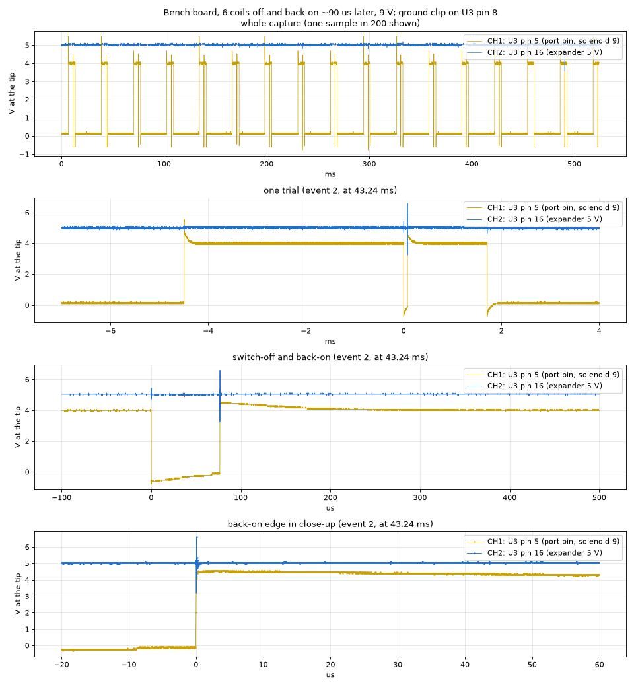

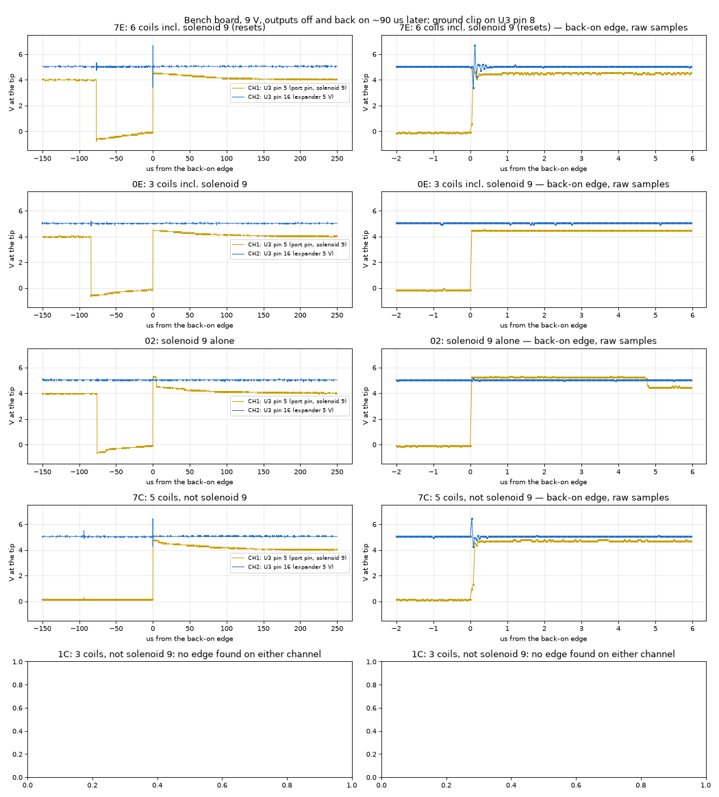

Numbers over all the back-on edges in each capture (volts at the tips,
one count is 78 mV):

| Outputs toggled | Resets | Pin 16 at the back-on edge, lowest / highest sample | Pin 5 lowest in the 100 us before |
|---|---|---|---|
| 7E: 6 coils incl. solenoid 9 | 100/100 | 3.16 / 6.67 | -0.78 |
| 0E: 3 coils incl. solenoid 9 | 0/100 | 3.86 / 6.13 | -0.70 |
| 02: solenoid 9 alone | 0/100 | 4.56 / 5.66 | -0.70 |
| 7C: 5 coils, not solenoid 9 | 100/100 | 3.47 / 6.60 | 0.00 (stays at +0.1) |
| 1C: 3 coils, not solenoid 9 | 0/100 | 3.63 / 6.21 (whole capture; edge finder found no pair) | not toggled |

What the pictures show:

1. Port pin 5 sits at 4.0 V while its solenoid is on and at +0.15 V
   while off.
2. Each time its own solenoid is switched off, pin 5 goes to about
   -0.6 V and creeps back towards 0 over 100 us or more (longer after
   the final switch-off of a trial: about 0.3 ms). It does so with one
   coil as with six, reset or no reset. It does not move when other
   outputs are switched and its own is left off (7C).
3. At the back-on edge, pin 16 against pin 8 shows a burst lasting under
   half a microsecond, a few samples long. Its largest samples grow with
   the number of coils: about ±0.6 V for one, ±1.2 V for three, ±1.8 V
   for five or six. A smaller one at the switch-off edge.
4. In 7C, pin 5 is not written to, yet it jumps from 0.1 V to 4.7 V at
   the back-on edge within two samples (under 0.1 us): that is the reset
   itself (whole port on), caught on the pin. In 7E and 7C the pin then
   sits at 4.5-4.7 V and sinks to 4.0 V over about 150 us.
5. In 02 the pin goes to 5.2 V for 5 us after the back-on, then 4.4 V:
   the expander's brief strong pull-up, as its datasheet describes.

Cautions:

- The burst of point 3 is at the edge of what this scope can show
  (20 MHz, 24 MS/s; the burst is a few samples). Its true size is not
  known, and the scatter between edges of one capture is large.
- It has not been shown to be real. A probe with its ground lead clipped
  some distance away picks up fast current changes nearby. Control still
  to do: a tip on pin 8 itself, where a real signal must read zero.
- The -0.6 V of point 2 is against whatever the clip is actually on.
  Clipping a single leg of an SO16 is hard; to be confirmed with
  the user.

Interpretation (mine):

- Point 4 times the reset far more tightly than the probe did: it is
  there within 0.1 us of the outputs switching on.
- If the burst on pin 16 is real, the expander's supply swings by a
  couple of volts for a fraction of a microsecond at the moment of
  switch-on, in proportion to the number of coils. An expander losing
  its state and coming up with all outputs high is what a supply
  collapse does to it, so this is the leading candidate.
- The -0.6 V after every switch-off means current is being drawn out of
  the expander's pin, enough to take it a diode drop below its ground.
  This is the injection into the pins that I rated at one in six or
  seven in entry 162 and that the user doubted; here it is on the
  scope. It is not sufficient by itself (one coil does it without a
  reset), but it lasts through the first lobe of the window (about the
  first 0.3 ms). I do not know what in the driver draws that current.

## 170. 2026-11-24 18:10 — How the probes are attached; capture to see where the yellow tip is

*Run with: [tools/scope_trial.py](tools/scope_trial.py), [tools/scope_compare.py](tools/scope_compare.py). Firmware: edgetest on usbserial (flashed earlier, 11-24 17:22).*

The user: "Probes are clipped on U3's legs", with a photo.

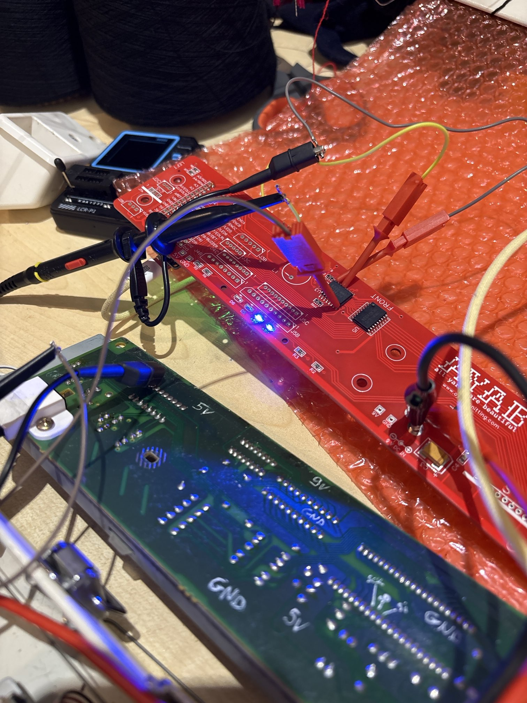

Seen in the photo: three small grabber clips on U3's legs, each on a
flying wire lead of some 10-20 cm going to a probe tip or to the scope's
ground clip. So the reference of entry 169 is U3's ground leg itself,
and the -0.6 V is pin against pin of the same chip. The long leads make
a large loop, which makes pickup of the fast burst more likely, not
less.

They did not say whether the yellow tip has been moved to pin 8 for the
control. Taking one capture with 7E (resets expected) to see: yellow
flat near zero means it has.

Result: resets 100/100; yellow still shows the port pin's waveform
(-0.86 to 5.55 V; -0.55 to -0.78 V before each back-on), so the tip is
still on pin 5 and the control has not been done. The capture repeats
entry 169's first one: pin 16 lowest 3.24, highest 6.75 V at the back-on
edges. Capture in the scratchpad's out/cap2.npy.

## 171. 2026-11-24 18:13 — Pickup control: yellow tip on pin 8 with the ground clip

*Run with: [tools/scope_trial.py](tools/scope_trial.py), [tools/scope_compare.py](tools/scope_compare.py). Firmware: edgetest on usbserial (flashed earlier, 11-24 17:22).*

The user: "Both grabbers on pin 8. Hopefully not touching pin 7."

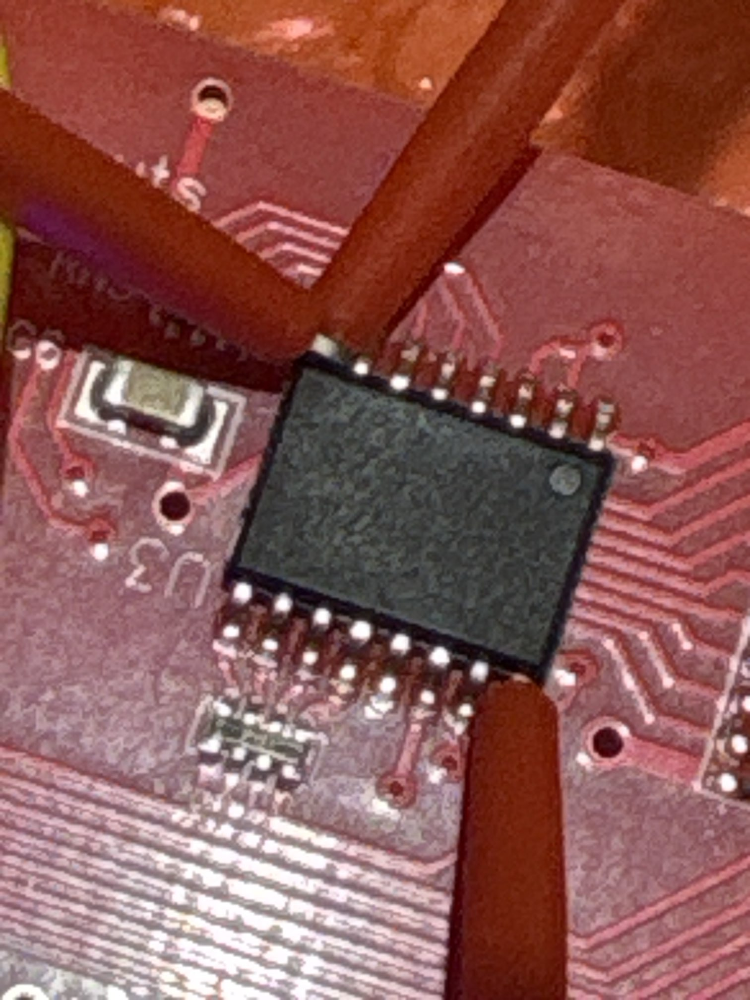

In the photo the pin 1 dot is at the top right, so the top row runs
pins 1 to 8 right to left: the two grabbers at the top left are on
pin 8, the one at the bottom right on pin 16.

First a check that pin 7 (port pin of solenoid 11) is not shorted to
ground by a grabber: write 08 to 0x21 and read the port back; a shorted
pin reads low. Then the same 7E capture as before.

Results.

- Pin 7 check: wrote 08 to 0x21, read back 0800; wrote 04, read back
  0400; all off reads 0000. Pin 7 is not shorted to ground.
- Capture (out/cap3.npy): resets 100/100.

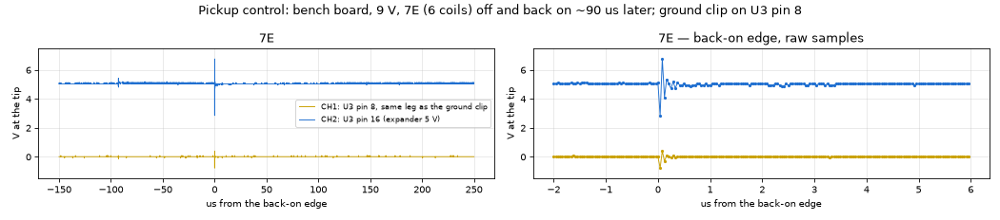

| Channel | Where | Lowest / highest sample in the capture |
|---|---|---|
| CH1 yellow | U3 pin 8, same leg as the ground clip | -1.09 / +1.02 V |
| CH2 blue | U3 pin 16 | 2.85 / 6.75 V (5 V -2.2 / +1.7) |

Yellow is flat at zero except at the switching edges, where it shows a
burst of the same shape and at the same instant as blue's, about half
its size. Before the back-on it sits at -0.08 to -0.16 V (one or two
counts; the zero table is good to about a count).

What this shows: a probe that must read zero reads up to ±1 V at the
edge. So the leads pick up the switching, and the burst on pin 16 in
entry 169 is not evidence of a supply swing at the expander. Blue reads
about twice what yellow does, but the two leads run differently, so the
difference cannot be taken as the real part. The statement in entry 169
"if the burst on pin 16 is real..." stays an if; this set-up cannot
decide it.

What stands from entry 169, because it is slow or large compared with
the pickup: the -0.6 V on pin 5 for 100 us and more after each
switch-off, and pin 5 jumping to 4.7 V at the reset.

Board facts read from the netlist
(/Users/jonathanperret/src/electricwool/ayab-hardware/ayab-interface/schematic/ayab_rs.net),
which I had not consulted before:

- Each port pin of U3 goes straight to the matching input of U5 (U3
  pins 4-7, 9-12 to U5 pins 1-8), with one resistor of RN3/RN4 from
  that net to 5 V. So the arrays are pull-ups, not series resistors,
  and pin 5 of U3 is the same node as input 2 of U5 (pin 2); its output
  is U5 pin 17. The 4.0 V "on" level fits a pull-up of the order of
  1 kohm (value not marked in the files).
- R7 and R8 (5k) are the pull-ups of SDA and SCL, as guessed.
- U5 pin 9 is on GND, U5 pin 10 (clamp diodes) on the 9 V net with the
  connectors' supply pins.
- With the pull-up alone feeding about 5 mA into the node, holding it
  at -0.6 V means the driver's input is drawing more than that out of
  the expander's pin and ground. An input of a driver that is switched
  off should draw nothing.

Next capture planned: ground clip still on U3 pin 8, yellow on U5 pin 9
(driver ground), blue on U5 pin 17 (output for solenoid 9), blue on the
500 mV range since the output goes above 9 V.

## 172. 2026-11-24 18:22 — Driver side: U5 ground and the output for solenoid 9

*Run with: [tools/scope_trial.py](tools/scope_trial.py), [tools/scope_compare.py](tools/scope_compare.py). Firmware: edgetest on usbserial (flashed earlier, 11-24 17:22).*

The user: "Moved the grabbers. Also tried to mitigate lead length by
connecting probe tips and ground clips to the grabbers closer."

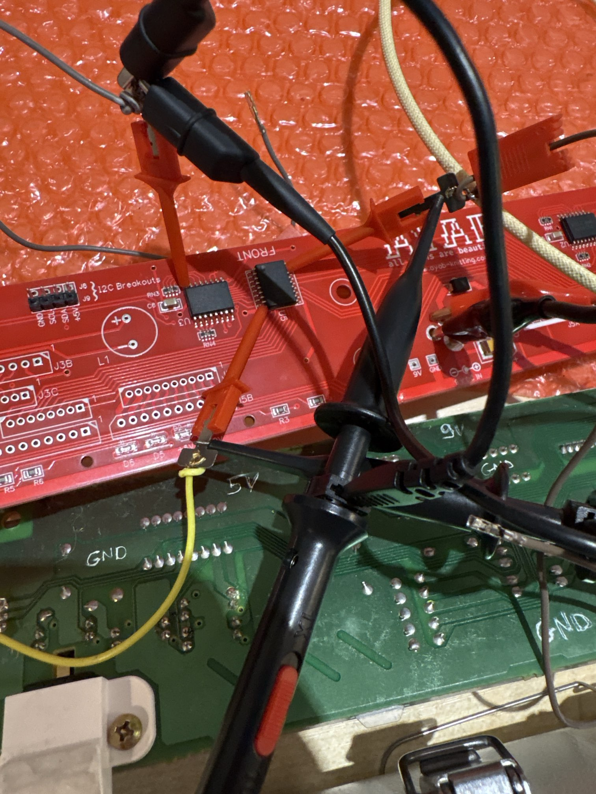

As asked in entry 171: ground clip on U3 pin 8, CH1 (yellow) on U5
pin 9 (driver ground), CH2 (blue) on U5 pin 17 (output, solenoid 9).
The photo shows one grabber on U3 and two on U5, with the probes now
hooked on the grabbers themselves; which leg each is on cannot be read
from the photo. Ranges: CH1 100 mV (39 mV per count at the tip), CH2
500 mV (195 mV per count, about ±25 V). Same stimulus and the same four
sets of outputs as entry 169: 7E, 0E, 02, 7C.

Not run: the Metro Mini's serial port (/dev/cu.usbserial-10) is gone
from the Mac, and no USB serial device is listed at all. Nothing was
captured. Asked the user to check the USB cable.

18:23 — Metro Mini plugged back in (/dev/cu.usbserial-10); running the four captures of this entry.

Results. Replies: 7E resets 100/100, 0E 0/100, 02 0/100, 7C 100/100;
read-back 0000 after each. Captures: out/cap4_7E.npy, cap4_0E.npy,
cap4_02.npy, cap4_7C.npy. [tools/scope_compare.py](tools/scope_compare.py)
now takes a range per channel and puts blue on its own axis.

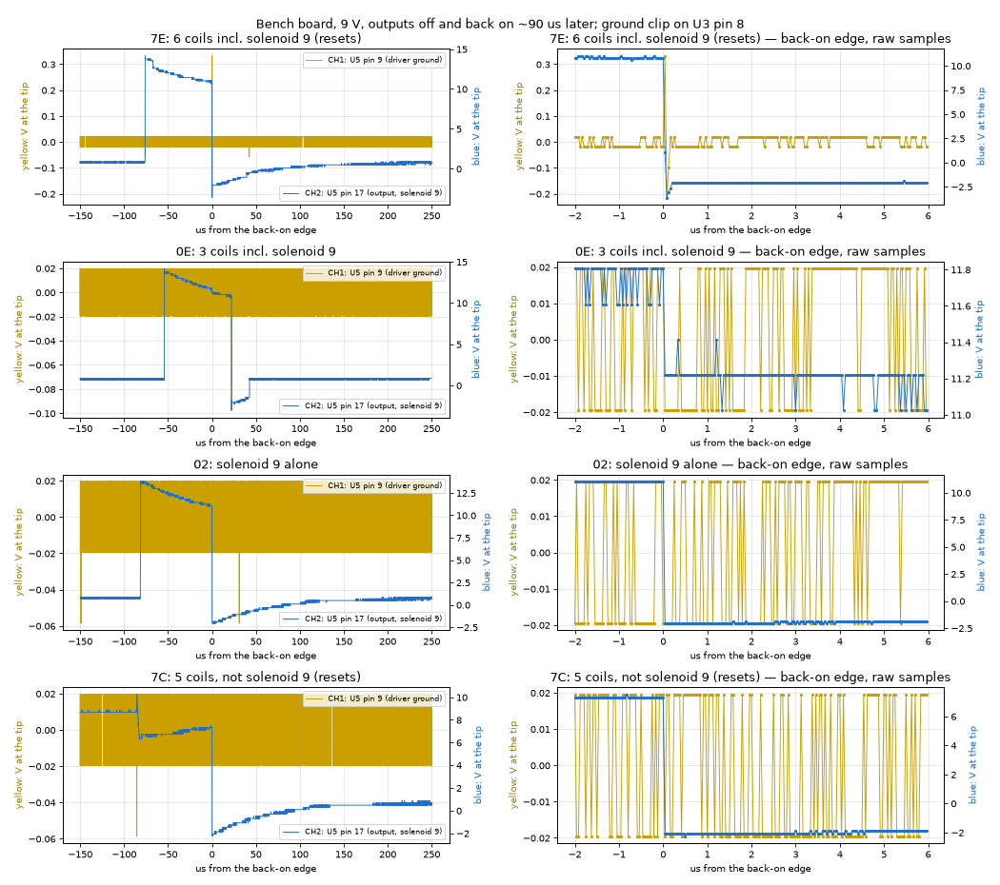

What the picture shows:

1. Yellow (U5 pin 9 against U3 pin 8) stays within one count (±20 mV)
   of zero at all times except in a burst of a few samples at the edges,
   at most +0.37 / -0.25 V with six coils, +0.10 / -0.06 V with one.
2. Blue (the output) with solenoid 9 toggled: about 0.7 V while on; at
   switch-off it jumps to 13-14.7 V and sinks to about 10.5 V over the
   80 us before the back-on; at back-on it drops to about -3 V and
   creeps back up to near 0.7 V over more than 100 us.
3. Blue with solenoid 9 left off and five others toggled (7C): 8.8 V;
   at the others' switch-off it steps down to about 6.5 V and stays
   between 6.5 and 7.2 V until the back-on; at the back-on (the reset
   switches every output on) it drops to about -2 V and creeps up.

Interpretation, and a retraction:

- Point 2 is not believable as a voltage. An output cannot sit 3 V
  below ground with its transistor on, nor 4-5 V above its clamp. Every
  step is followed by an overshoot of 30-40 % of the step, of the same
  sign as the step, dying away over about 100 us. That is what a x10
  probe does when its compensation trimmer is set too high for the
  input it is plugged into. Blue was not used on a signal with large
  steps before now.
- The same pattern, smaller, is in yellow's captures of entry 169: after
  the 4 V step down, -0.6 V creeping back over 100 us; after the 4 V
  step up, +0.5 V (4.5 V sinking to 4.0 V) over about 150 us. About
  15 % of the step each way. So "the port pin goes 0.6 V below its own
  ground" in entry 169, and everything I built on it there and in entry
  171 (current drawn out of the expander's pin; "the injection on the
  scope"), is most probably the yellow probe's compensation and not the
  board. Withdrawn until the probes are trimmed and the capture
  repeated. The zero calibration could not show this: it is taken with
  no steps.
- Still standing from entry 169: the reset seen on pin 5 within 0.1 us
  of the back-on edge (a 4 V step is a 4 V step whatever the overshoot),
  and the short 5.2 V plateau after a normal switch-on.
- Point 1 holds whatever the compensation, since there is no step on
  that channel: no lasting difference between the driver's ground and
  the expander's, to within 20 mV. What happens within the first tenth
  of a microsecond cannot be judged (bursts of that length are at
  pickup level, entry 171). Pickup itself is down by about a factor of
  three from entry 171 on this channel with the probes hooked on the
  grabbers, though the point measured is not the same.
- Point 3's step down to about 6.5 V while five neighbours switch off
  is a sustained level, not an overshoot shape, so it may be real: the
  coils sharing some magnetic path would do that (the collapsing field
  of the neighbours inducing a voltage in the idle coil). Its size is
  uncertain by the same 30-40 %. Not pursued yet.

Next: trim both probes on a square wave at the ranges in use, then
repeat the captures of entry 169 and of this entry.

## 173. 2026-11-24 18:29 — Probe compensation check on the scope's calibration output

*Run with: [tools/scope_comp.py](tools/scope_comp.py).*

The user: both probes on the scope's calibration post, both at x10.

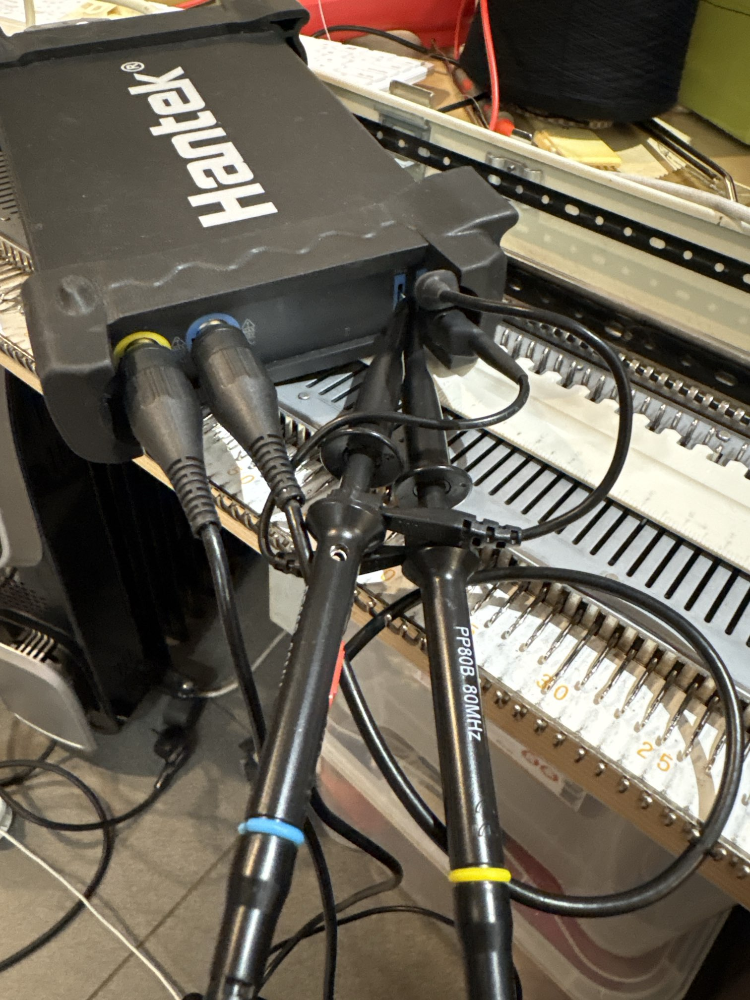

Capturing the square wave on both channels at each of the four ranges,
24 MS/s, and measuring how far each edge overshoots the level it
settles to. New script [tools/scope_comp.py](tools/scope_comp.py).

Results. A first pass of the script measured with a window that ran
into the falling edge and gave nonsense (+165 %, +87 %); discarded,
picture overwritten. It did reveal something else, below. Corrected
script, 16 MS/s, settled level taken 300-380 us after the edge:

| Range | CH1 yellow: step, edge excess | CH2 blue: step, edge excess |
|---|---|---|
| 100 mV | 1.90 V, +22 %, dies away in ~93 us | 1.90 V, +1 % |
| 250 mV | 1.92 V, +21 %, ~107 us | 1.93 V, +2 % |
| 500 mV | 1.95 V, +23 %, ~109 us | 1.91 V, +0 % |
| 1 V | 1.82 V, +32 %, ~117 us | 1.92 V, +2 % |


Square wave reads 1000 Hz at 16 MS/s.

What this shows:

- Yellow is over-compensated by about 22 %, with a tail of about
  100 us. On the 3.85 V steps of U3 pin 5 that predicts about 0.85 V of
  false excursion; 0.5 to 0.75 V was seen. So the withdrawal of the
  "-0.6 V on the port pin" (entry 172) is now backed by a measurement.
- Blue is flat to within 2 % on every range. So blue's readings on the
  driver output in entry 172 (13-14.7 V after switch-off, about -3 V
  after switch-on, tails of ~100 us) are NOT explained by its
  compensation, contrary to what I wrote there an hour ago. That part
  of entry 172's interpretation is wrong as stated. What they are is
  open: those voltages still look impossible for an output with a clamp
  diode to 9 V and a diode to ground, and the calibration step is only
  2 V where the output's is 9.5 V. To be settled by looking at the same
  pin with the other probe once it is trimmed, and at U5 pin 10.

Time base error found: with the scope set to 24 MS/s on the Pi, the
1000 Hz square wave reads 1172 Hz. So the Pi receives only about
20.5 million samples per second per channel (the link carries
~38 MB/s where 48 are needed) and samples are being lost. Consequences
for entries 169 to 172, all taken at 24 MS/s:

- every time read from those plots is too short: multiply by 1.17 (the
  "~78 us" between the edges is the known ~90 us);
- where the samples are lost is unknown (evenly or in blocks), so
  "within 0.1 us" for the reset on pin 5 (entry 169, point 4) is not
  safe; "within a few samples of the edge, so well under a microsecond
  unless a block was lost exactly there" is what the data supports;
- voltages are unaffected.

From now on: 16 MS/s (reads 1000 Hz exactly).
[tools/scope_comp.py](tools/scope_comp.py) defaults to it;
scope_trial.py, scope_plot.py and scope_compare.py still say 24 and
must be changed before the next capture.

The user, in chat while this ran: the coils sit next to each other
inside one metal armature, so some magnetic sharing is plausible
("maybe something for later"); and all the coils share a single supply
wire from the board.

## 174. 2026-11-24 18:32 — Live page for trimming the probes

*Run with: [tools/scope_live.py](tools/scope_live.py).*

The user asked for a web page showing the overshoot in real time while
they turn the trimmer. New script
[tools/scope_live.py](tools/scope_live.py), copied to ~/scope on the Pi
and started there (sudo, port 8000, stops by itself after 30 minutes):
it captures the calibration square wave continuously at 16 MS/s on the
250 mV range and serves a page with each channel's average rising edge
and its excess in percent. Opened on the Mac at
http://raspberrypi.local:8000/. While it runs it holds the scope, so no
other capture can be taken.

## 175. 2026-11-24 18:34 — Yellow probe trimmed

*Run with: [tools/scope_comp.py](tools/scope_comp.py).*

The user: "yellow is trimmed as best I could, can't get below 5.5%".
Live page read +5.5 % (yellow) and 0 % (blue) at the end; page stopped,
scope free again. Re-measured with scope_comp.py at 16 MS/s:

| Range | CH1 yellow | CH2 blue |
|---|---|---|
| 100 mV | +7 %, tail ~138 us | +1 % |
| 250 mV | +7 %, ~126 us | +1 % |
| 500 mV | +8 %, ~146 us | +1 % |
| 1 V | +11 %, ~111 us | +1 % |


Yellow went from +22 % to about +7 % (its trimmer is at the end of its
travel). To keep in mind when reading yellow: after a step it shows up
to 7 % of the step too much, dying away over about 130 us; on a 4 V
step that is 0.3 V, on a 9.5 V step 0.7 V. Blue is the probe to trust
for levels after steps.

scope_trial.py, scope_plot.py and scope_compare.py now use 16 MS/s.

## 176. 2026-11-24 18:35 — Live page for the captures

*Run with: [tools/scope_page.py](tools/scope_page.py).*

The user asked for a web page that stays up and shows whatever captures
I run. New [tools/scope_page.py](tools/scope_page.py), running on the
Mac at http://localhost:8010/ (local only): it lists the newest
pictures first and switches to a new one by itself within 2 seconds.
[tools/scope_trial.py](tools/scope_trial.py) now draws a quick-look
picture of every capture (the event and its back-on edge in close-up)
into the scratchpad's live/ folder, which the page shows along with the
scope pictures of the journal folder. The page shows pictures of
finished captures, a few seconds after each; it is not a continuous
trace (the scope is only read during a capture).

## 177. 2026-11-24 18:45 — Driver output with the other probe, and the clamp rail

*Run with: [tools/scope_trial.py](tools/scope_trial.py), [tools/scope_compare.py](tools/scope_compare.py), [tools/scope_page.py](tools/scope_page.py), [tools/scope_offonly.py](tools/scope_offonly.py). Firmware: edgetest on usbserial (flashed earlier, 11-24 17:22).*

The user: probes on (asked beforehand whether to connect both ground
clips; answered yes, both to the U3 pin 8 grabber). As asked in entry
175: ground on U3 pin 8, CH1 (yellow, now +7 %) on U5 pin 17 (output,
solenoid 9), CH2 (blue, +1 %) on U5 pin 10 (clamp diodes' common, 9 V
net). Both on the 500 mV range (195 mV per count), 16 MS/s, 0.5 s.
Same stimulus and four sets of outputs as before: 7E, 0E, 02, 7C.

18:47 — the four captures are in (replies: 7E 100/100, 0E 0/100, 02
0/100, 7C 100/100). Before writing them up, a follow-on with the probes
untouched: the same outputs switched off and NOT switched back on, to
see how long the output stays up at its clamp level (how long the clamp
diodes carry the coils' current), for 6 and 3 coils, after 5 ms and
after 0.1 ms on. To compare with where the first lobe of the reset
window ends (entry 167).

Also: The user reports "the live webpage isn't live". Cause: the page's
script declared a variable called "top", a name browsers reserve, so
the script never ran; the server itself was answering, which is all I
had checked. Renamed, server restarted.

## 178. 2026-11-24 18:50 — Scope server on the Pi: live view and recordings through one program

*Run with: [tools/scope_daemon.py](tools/scope_daemon.py), [tools/scope_page.py](tools/scope_page.py), [tools/scope_trial.py](tools/scope_trial.py), [tools/scope_offonly.py](tools/scope_offonly.py). Firmware: edgetest on usbserial (flashed earlier, 11-24 17:22).*

The user asked that the page show live raw data from the scope, as
long as it does not get in the way of the analyses.

- New [tools/scope_daemon.py](tools/scope_daemon.py), running on the Pi
  (start with "sh ~/scope/start_daemon.sh"), is now the only program
  that talks to the scope. It captures 65 ms frames continuously at
  16 MS/s for the live view and, on request, records a block to a file
  and then goes back to live. Volts use the zero table of entry 168.
- [tools/scope_trial.py](tools/scope_trial.py) now asks that server to
  record instead of running scope.py over ssh.
- The page at http://localhost:8010/
  ([tools/scope_page.py](tools/scope_page.py)) has a live panel on top
  (window around a software trigger, and the whole frame), with the
  pictures below. Trigger by default: the second of two edges less than
  0.3 ms apart, which is the back-on.
- The off-only captures announced in entry 177 did not happen: a
  quoting mistake of mine sent malformed commands (replies showed 0
  resets, outputs left off). Files discarded. Redoing them now through
  the server: 7E and 0E, on for 5 ms and for 0.1 ms, switched off and
  left off.

## 179. 2026-11-24 19:20 — Results: driver output and clamp rail (entry 177), and how long the clamp diodes conduct

Captures at 16 MS/s through the scope server: out/cap5_7E, cap5_0E,
cap5_02, cap5_7C (off and back on, gap measured 94 us), and
out/cap6_7E_5000, cap6_7E_100, cap6_0E_5000, cap6_0E_100 (off only).
New script [tools/scope_offonly.py](tools/scope_offonly.py).


Levels (yellow on U5 pin 17, blue on U5 pin 10; averages over all
events of a capture):

| | on | 5-15 us after switch-off | 60-80 us after | 5-15 us after back-on | 150-250 us after |
|---|---|---|---|---|---|
| Output, 6 coils (7E) | 0.88 V | 10.32 V | 10.04 V | 0.64 V | 0.80 V |
| Output, 3 coils (0E) | 0.87 | 10.32 | 10.14 | 0.63 | 0.79 |
| Output, alone (02) | 0.86 | 10.32 | 10.13 | 0.63 | 0.79 |
| Clamp common, all three | 8.68-8.72 | 8.70-8.75 | 8.71-8.77 | 8.68-8.74 | 8.68-8.72 |

At the back-on edge itself (14 samples, under 1 us): clamp common
lowest sample, median over the edges, 5.9 V with six coils (lowest seen
2.8 V, highest 16.5 V), 8.7 V with three (one edge down to 4.4 V) and
with one (down to 6.7 V); 7C (five others, reset): 3.4 to 12.6 V. At
the switch-off edge: 9.1-9.5 V at most.

Idle output while five neighbours switch (7C): 8.9 V; at their
switch-off a spike to about 10.2 V, then 7.2 V rising to 7.6 V until
the back-on.

Off only, output of solenoid 9:

| | just after switch-off | at rest | halfway back at |
|---|---|---|---|
| 6 coils, on 5 ms | 10.27 V | 9.11 V | 3.6 ms |
| 6 coils, on 0.1 ms | 10.13 V | 8.94 V | 1.4 ms |
| 3 coils, on 5 ms | 10.25 V | 9.10 V | 3.3 ms |
| 3 coils, on 0.1 ms | 10.14 V | 8.94 V | 1.4 ms |

Clamp common 8.84 V throughout.

What this shows:

1. The driver output behaves as it should: about 0.9 V when on, clamped
   1.0 to 1.5 V above the clamp rail after a switch-off, back to 0.6 V
   at once at switch-on. Nothing below ground, nothing 4 V above the
   clamp. So blue's readings of entry 172 (13-14.7 V, -3 V) were wrong.
   Blue's compensation is good (entry 173), so the cause was something
   else in that set-up, most likely where or how its grabber sat; not
   established. Lesson kept: a reading that looks impossible gets a
   second probe before any interpretation.
2. The clamp rail does not move, to within 0.1 V, at any time longer
   than a microsecond. The 9 V rail under these loads is 8.7-8.85 V.
3. The idle coil's output does drop by about 1.5 V while its neighbours'
   current decays, now seen with the second probe: the coils are
   coupled through their common armature, as the user suggested.
4. The clamp diodes keep conducting for a long time: about 3.5 ms after
   5 ms on, 1.4 ms after only 0.1 ms on, whether three or six coils
   were on. That 0.1 ms is enough for 1.4 ms of conduction says the
   current builds much faster at first than a simple coil would allow
   (an iron armature does that), which removes my objection in entry
   167 to the clamp diode idea ("least current after 0.1 ms on").
5. Compare with the reset window of entry 167 for six coils: after
   0.1 ms on, resets up to a gap of about 0.8 ms and none at 1.2 ms;
   after 5 ms on, resets up to 2.2 ms and none at 3.2 ms. Both windows
   end before the diodes stop conducting (1.4 and 3.5 ms) and scale
   with it. So with six coils, a reset happens only when the outputs
   are switched on while their clamp diodes are still carrying current.
6. At that instant the clamp rail at the driver shows a dip of several
   volts lasting a fraction of a microsecond, larger with more coils.
   Same caution as before about bursts of that length (entry 171), but
   the direction fits: switching an output to ground while its clamp
   diode is conducting pulls a short, large current from the 9 V rail
   through the diode and the transistor into ground, until the diode
   lets go.

Interpretation: the clamp diode idea of entry 164 is back as the
leading candidate, and better supported than then. What remains
unexplained by it: the three-coil rows of entry 167 (after 5 ms on,
resets at gaps of 1.2-2.2 ms but not at 0-0.8 ms, where the diodes
carry more current), and "one extra switched off prevents the reset".
How the current spike reaches the expander (shared ground trace, 5 V
rail, or the port pins) is not shown by anything yet.

A test that would decide it without a faster scope: fast external
diodes (Schottky) from each output to the 9 V pad, which take the
coils' current instead of the driver's own diodes. If the resets stop,
that is both the proof and the cure.

## 180. 2026-11-24 19:25 — DHO814 check

The user is considering a Rigol DHO814 and asked whether I could use it
the same way; I answered from memory, then had the details checked in
the background (first run stopped by a misclick, restarted). Report
saved as /Users/jonathanperret/Downloads/dho814-check.md. Held:
100 MHz, 4 channels, 12 bits, 1.25 GSa/s shared (625 with two channels,
312.5 with three or four), LAN + USB + HDMI, SCPI and web control, no
generator. Corrected: memory is 25 Mpts only with one channel (10 with
two, 5 with three or four); the scope is not earthed through its
adapter and floats until its ground cable or a USB/HDMI connection
grounds it. They want this topic continued in a separate conversation.

## 181. 2026-11-24 18:56 — Switching back on in two stages

*Firmware: edgetest on usbserial (flashed 18:56).*

The user has no Schottky diodes at hand. A software test of the same
idea instead. If what matters is how many clamp diodes are caught
conducting at the same instant, then switching six coils back on three
at a time, 90 us apart, should not reset, though the same six come back
on within the window. If what matters is only how many come back on
within the window, it should reset all the same.

edgetest gets a mode 4: one three-byte write [off][first stage][full
pattern], the bytes about 90 us apart. Flashing it on the bench board's
Metro Mini (port checked free). Bench board, the user's coils, 9 V, six
coils (7E) on 5 ms, 20 trials each; probes untouched (yellow U5 pin 17,
blue U5 pin 10).

Results (edgetest with mode 4 flashed, 6566 bytes verified; controller
READY, vcc 4979; read-back 0000 at the end). Resets out of 20, coils on
5 ms first, each stage about 90 us after the previous byte:

| Sequence | Bytes | Resets |
|---|---|---|
| six at once (reference) | 7E>00>7E | 20 |
| 3 then 3 | 7E>00>0E>7E | 0 |
| 3 then 3, other split | 7E>00>70>7E | 0 |
| 3 then 3, interleaved | 7E>00>2A>7E | 0 |
| 4 then 2 | 7E>00>1E>7E | 0 |
| 2 then 4 | 7E>00>06>7E | 20 |
| 5 then 1 | 7E>00>3E>7E | 20 |
| 1 then 5 | 7E>00>02>7E | 20 |
| nothing, then six (~180 us after off) | 7E>00>00>7E | 20 |
| six, then the same again | 7E>00>7E>7E | 20 |
| five coils: 3 then 2 | 3E>00>0E>3E | 0 |
| five coils: 2 then 3 | 3E>00>06>3E | 0 |
| five coils at once | 3E>00>3E | 20 |
| four coils: 2 then 2 | 1E>00>06>1E | 0 |
| four coils: 3 then 1 | 1E>00>0E>1E | 0 |
| four coils at once | 1E>00>1E | 20 |
| six at once (reference again) | 7E>00>7E | 20 |

Every cell 0 or 20, as always. One NAK per reset.

What this shows:

- The same six, five or four coils come back on within 0.2 ms in every
  row. They reset when four or more come on in the same write and never
  when they come on three (or fewer) at a time. So what counts is how
  many outputs switch on at the same instant, not how many come back
  within the window. That was the prediction of the clamp diode idea.
- One exception to "four or more in the same write": "4 then 2" does not
  reset at its first stage, where four switch on together while two
  others are still off. It is the oddity of 2026-11-22 again (four
  toggled with one extra switched off and left off: no reset; five with
  one or two left off: reset). So coils that are off but still
  discharging through their clamp diodes at that instant make a reset
  less likely: four need none of them, five tolerate one or two.

Interpretation (mine): fits a current spike drawn from the clamp rail
by the diodes of the outputs being switched on, with the coils left off
still feeding current into that same rail through their own diodes and
so supplying part of it locally. Not measured.

Practical consequence: no firmware change is needed beyond what the
native-write firmware already does (it never switches an output off and
back on), but if such a sequence were ever needed, doing it three
outputs at a time would avoid the reset on this board.

18:59 — The user has no diodes of any kind at hand (asked about
1N4148 / 1N914 as a substitute for Schottkys). The external-diode test
waits for parts. What can still be done today with wire only: a twisted
pair soldered from U5 pin 10 and pin 9 to the "9V" and "GND2" pads by
the supply jack (wire tests C and A of entry 162), which gives the
spike a shorter loop; a higher threshold with it fitted would show the
loop through the board's 9 V and ground traces matters. Parts worth
ordering for the next session: Schottky diodes (1N5819 or similar, 16),
ceramic capacitors 100 nF and 1-10 uF, a ULN2803A from another maker
(ST) and a TBD62083A, resistors 220-330 ohm.

## 182. 2026-11-24 19:03 — Where the spike current flows on the board (from the layout)

*Run with: [tools/pcb_ground.py](tools/pcb_ground.py).*

The user: "ok but still no theory on how the expander resets?" Before
answering, traced the ground, 9 V and 5 V copper in the layout file
with a new script, [tools/pcb_ground.py](tools/pcb_ground.py) (tracks,
vias and pads joined by geometry).


Caution: the script's route lengths are rough (it joins T junctions
approximately, and ignores the two polygons on the top layer); the
figures of 200 mm and 150 mm below agree with the pictures, others it
printed do not (it gave 76 mm from U3 pin 16 to C6, which sits 9 mm
away). The pictures are what I rely on.

What the pictures show:

- Ground is a wide bus along the bottom edge of the board. The supply
  jack, the GND2 pad and the bulk capacitors C3/C4 attach near its
  middle (x about 6300-7100 mil). The "GND" pad by the Metro Mini is at
  its left end (x 2000 mil).
- U5's ground pin (pin 9) does not go to that bus nearby. It goes by a
  single bottom-layer track LEFT, about 75-85 mm, to the GND pad by the
  Metro Mini, and only there joins the bus. Its way back to the supply
  is then along the bus to the right: about 200 mm in all.
- U3's ground pin and C6 hang, by a thinner track of about 25 mm, from
  the same point as U5's ground pin. Nothing else is on that branch.
- The right-hand pair is built the same way in itself (U2 and C5 hang
  from U4's ground pin), but U4's ground goes straight down to the bus
  on the right, about 30 mm, and back along the bus to the supply,
  about 150 mm in all. It never passes the Metro Mini.
- 9 V is a 100 mil bottom track from the jack area to both sides; U5
  pin 10 taps it about 50 mm from the 9V pad.
- So the current pulse of entry 179 (9 V rail, clamp diode, transistor,
  ground) circulates in a loop of about 12 cm2 for U5: out along the
  9 V track, back by the ground track to the left, through the ground
  point at the Metro Mini, and along the bus. For U4 the loop is of
  similar area (9 V track and bus run 16 mm apart for 80 mm) but lies
  entirely to the right of the supply.

Theory as it stands (interpretation; no measurement yet shows the last
two steps):

1. After a switch-off the coils' current keeps flowing through the
   driver's clamp diodes for 1.4 to 3.5 ms (measured, entry 179).
2. Switching an output on during that time connects its conducting
   diode straight from the 9 V rail to ground through the transistor
   until the diode stops conducting: a very short, large current pulse.
   Four or more at the same instant add up (entry 181); the clamp rail
   at the driver dips by volts (entry 179).
3. That pulse flows in the large loop above, so for its duration there
   are volts between the two ends of U5's ground track.
4. U3 and its capacitor sit at the far end of that track, with their
   5 V supply and bus lines arriving from the Metro Mini at the other
   end. For those tens of nanoseconds the expander's ground jumps
   against everything that reaches it from the controller.
5. The expander loses its state and comes up as after power-on: all
   outputs high, bus interface idle. That matches what is seen exactly
   (port FF, acknowledge dropped in mid-bit, normal behaviour
   afterwards).

Not explained: why the right-hand expander never resets when its
driver's loop is of similar size (the one difference found: its
driver's return current does not pass the controller's ground point);
why the UMW part and reportedly not the TI part; the three-coil gap of
entry 167. Which of "supply across the chip collapses" or "a pin is
driven outside the supply" does step 5 is open; the bit-banged test
(entry 164) only ruled out the version that needs the controller to
hold a bus line low.

Test this suggests, with wire only: one wire from U5 pin 9 straight to
the GND2 pad (about 50 mm instead of 200), ideally twisted with a wire
from U5 pin 10 to the 9V pad. It takes the pulse off the track that
leads past the controller. If the threshold rises or the resets stop,
steps 3 and 4 are confirmed.

## 183. 2026-11-24 19:16 — Expander ground against controller ground

*Run with: [tools/scope_trial.py](tools/scope_trial.py), [tools/scope_bounce.py](tools/scope_bounce.py). Firmware: edgetest on usbserial (flashed earlier, 11-24 18:56).*

The user asked whether the pulse should not be visible on the scope.
Answered: only its aftermath (62 ns per sample, 20 MHz), not separable
from pickup, and no capture so far measured the right pair of points,
since all used U3 pin 8 as reference. They have now placed the probes as
proposed: both ground clips on the "GND" pad by the Metro Mini, CH1
(yellow) on U3 pin 8 (expander ground), CH2 (blue) on U3 pin 14 (clock
line at the expander), leads laid along the board.

Plan: 16 MS/s, yellow on the 100 mV range (39 mV per count), blue on
250 mV. Seven sequences on six-or-fewer coils of 0x21, on 5 ms first:
six at once, 3 then 3, 4 then 2, 2 then 4, four at once, three at once,
one alone. Each capture also contains the switch-on from cold at the
start of every trial, as a control with the same leads. Edges located
from the clock line (the expander applies a byte at the ninth clock
pulse of that byte). New script
[tools/scope_bounce.py](tools/scope_bounce.py). Known limits stated
before looking: the reading depends on how the leads lie, and anything
shorter than about 50 ns is reduced or missed.

Results. Replies: six at once 100/100 resets, 3 then 3 0/100, 4 then 2
100/100 (!), 2 then 4 100/100, four at once 100/100, three at once
0/100, one alone 0/100. Captures out/cap7_*.npy, 12 to 14 trials in
each.


Yellow (U3 pin 8 against the GND pad by the Metro Mini), within 4 us of
the clock edge that applies the byte; peak-to-peak, median over the
trials (largest in brackets). At rest it reads 0.02 V and is flat.

| Sequence | Resets | switch-on from cold | switch-off | back-on, stage 1 | back-on, stage 2 |
|---|---|---|---|---|---|
| six at once | yes | 0.12 (0.20) | 0.08 (0.12) | 0.47 (0.82) | |
| 3 then 3 | no | 0.12 (0.16) | 0.08 (0.08) | 0.27 (0.43) | 0.16 (0.43) |
| 4 then 2 | yes, at stage 1 | 0.08 (0.16) | 0.08 (0.08) | 0.21 (0.43) | |
| 2 then 4 | yes, at stage 2 | 0.12 (0.20) | 0.08 (0.08) | 0.16 (0.31) | 0.23 (0.59) |
| four at once | yes | 0.06 (0.16) | 0.04 (0.08) | 0.21 (0.62) | |
| three at once | no | 0.04 (0.12) | 0.04 (0.08) | 0.20 (0.43) | |
| one alone | no | 0.04 (0.08) | 0.04 (0.04) | 0.08 (0.16) | |

What this shows:

- There is a burst on the expander's ground against the controller's
  at the back-on edge, a few samples long, that is two to five times
  what the same outputs give when switched on from cold or switched
  off, and it grows with the number of coils (0.08 V for one, 0.2 V for
  three or four, 0.47 V for six).
- Its visible size is a few tenths of a volt, and it does not separate
  the sequences that reset from those that do not: three at once (no
  reset) 0.20 V, four at once (reset) 0.21 V, first stage of 3 then 3
  (no reset) 0.27 V.

So this capture neither confirms nor rules out steps 3-4 of entry 182.
Either the real jump is much larger and shorter than this scope can
show (one or two samples per burst; what is plotted is mostly its
ringing), or the ground jump is not what resets the expander. Same
limits as stated before the run.

Unexpected, and possibly more telling: "4 then 2" now resets, 100 out
of 100, where it did not reset once in 20 at 19:00 (entry 181). Reran
the staged table at 19:18 with the probes as they are now:

| Sequence | 19:00, clips on U3 pin 8, tips on U5 pins 17 and 10 | 19:18, clips on GND pad, tips on U3 pins 8 and 14 |
|---|---|---|
| six at once | 20 | 20 |
| 3 then 3 (two splits) | 0 | 0 |
| 4 then 2 (1E first) | 0 | 20 |
| 4 then 2 (78 first) | not run | 20 |
| 2 then 4 | 20 | 20 |
| 5 then 1 | 20 | 20 |
| five: 3 then 2 | 0 | 0 |
| four: 2 then 2, 3 then 1 | 0 | 0 |
| four at once | 20 | 20 |
| three at once | not run | 0 |

Only the marginal case changed, and completely (0/20 to 20/20, twice).
Nothing was changed between the two runs but where the probes and
their ground clips sit. With no scope attached at all (2026-11-22,
both boards), "four toggled with one extra left off" did not reset
either. So the present probe position makes the board more prone to
reset. Candidates: the probe and lead now hanging on the clock line at
the expander (pin 14), the lead from the expander's ground to the
scope, or the scope's ground no longer being attached at the
expander. To be separated by removing one thing at a time.

## 184. 2026-11-24 19:21 — Which probe makes "4 then 2" reset: blue removed from the clock line

*Run with: [tools/staged_table.py](tools/staged_table.py), [tools/rate.py](tools/rate.py), [tools/drift.py](tools/drift.py). Firmware: edgetest on usbserial (flashed earlier, 11-24 18:56).*

The user unclipped only the blue grabber from U3 pin 14; everything
else as in entry 183 (both ground clips on the GND pad by the Metro
Mini, yellow on U3 pin 8). Rerunning the staged table
([tools/staged_table.py](tools/staged_table.py)).

Results, blue off the clock line.

Staged table at 19:21 (resets out of 20): six at once 20, 3 then 3 0,
4 then 2 (1E first) 10, 4 then 2 (78 first) 20, 2 then 4 20, 5 then 1
20, five as 3 then 2 0, four as 3 then 1 0, four at once 20, three at
once 0, 4 then 2 (1E first) again 7.

First time in this whole investigation that a cell is neither 0 nor
full. Then 200 trials of each marginal sequence in four blocks of 50,
the sequences interleaved, 19:22:00 to 19:22:43
([tools/rate.py](tools/rate.py)):

| Sequence | block 1 | 2 | 3 | 4 | total |
|---|---|---|---|---|---|
| 4 then 2, 1E first | 25 | 8 | 1 | 0 | 34/200 |
| 4 then 2, 78 first | 50 | 50 | 50 | 50 | 200/200 |
| 4 then 2, 3C first | 17 | 5 | 2 | 1 | 25/200 |
| 3 then 3 | 0 | 0 | 0 | 0 | 0/200 |
| four at once | 50 | 50 | 50 | 50 | 200/200 |

What this shows: the rate of the marginal cases falls steadily while
the test runs, from every time (19:15-19:18) to half (19:21) to none
(19:22:40), over about seven minutes of nearly continuous switching
that followed a quarter of an hour with everything off. The 19:00 run
that gave 0/20 came after a long stretch of captures.

So my reading in entry 183 was premature: the change of "4 then 2" may
have nothing to do with the probes. A drift with something that builds
up during use (warming of the coils or of the driver is the obvious
candidate) explains the sequence of numbers without them, and the
removal of the blue probe happened to fall in the middle of the
decline. Not to be attributed to the clock line until drift is
excluded. Which four come on first also matters (78 first: always;
1E or 3C first: marginal).

Test of the drift: leave everything off for five minutes, then measure
"4 then 2" in short blocks for three minutes. If the rate comes back
high and falls again, it is drift with use, and the marginal cases are
a thermometer, not a probe detector. Running in the background, probes
untouched: [tools/drift.py](tools/drift.py).

## 185. 2026-11-24 19:29 — Coil measurements from the user's component tester

Reported in chat (measured earlier, on these bench solenoids): 150 ohm;
about 55 mH with the armature away from the core, 95 mH with the
armature held against the core.

Worked out from these (mine):

- Steady current at the measured levels (rail 8.8 V, output 0.9 V when
  on): 7.9 V / 150 ohm = 53 mA per coil.
- Time constant L/R: 0.37 ms (55 mH) to 0.63 ms (95 mH). So 5 ms on is
  full current; 0.1 ms on is 15 to 24 % of it, 8 to 13 mA.
- Expected time for the current to die away through a clamp of about
  1.2 V (entry 179: output 1.0-1.5 V above the rail): L/R x ln(1 +
  I R / 1.2 V), that is 0.75 to 1.3 ms from full current, 0.2 to
  0.35 ms after 0.1 ms on.
- Measured in entry 179: the output stays above the rail for about
  3.5 ms after 5 ms on, and 1.4 ms after 0.1 ms on. Three to five times
  longer than these inductances give.

So either the coils' inductance for slow, large changes is several
times what the tester reads (plausible with a solid iron core: a tester
measures with a short, small pulse, and currents induced in the iron
make the coil look smaller the faster one measures), or the plateau of
entry 179 is not only clamp diode conduction. Open. It matters for
point 5 of entry 179 (the reset window ending with the conduction): the
windows for six coils (0.8 ms and 2.2 ms) are close to the conduction
times computed from the tester's 95 mH for... no: computed 0.35 and
1.3 ms; the measured windows are longer than those too. Not resolved by
these numbers.

The armature's position changes the inductance by 70 %, so it is one
more thing that could move a marginal case.

## 186. 2026-11-24 19:31 — Drift test result: the marginal case follows use, not the probes

Run of [tools/drift.py](tools/drift.py), probes untouched (blue still
off the clock line), 19:23:13 to 19:29:38. Resets out of 20:

- 19:23:13, thirty seconds after the blocks of entry 184 had fallen to
  0-1 in 50: 4 then 2 (1E first) 20/20, (3C first) 20/20.
- All off for 300 s.
- Then blocks every 2.7 s, each 20 trials of 1E-first, 3C-first and
  3 then 3:

| Time after the rest | 4 then 2, 1E first | 4 then 2, 3C first | 3 then 3 |
|---|---|---|---|
| 0 to 38 s (15 blocks) | 20 every block | 20 every block | 0 |
| 41 to 47 s | 20, 20, 19 | 19, 18, 16 | 0 |
| 50 to 63 s | 16, 13, 11, 15, 10, 13 | 16, 11, 12, 13, 14, 11 | 0 |
| 66 to 80 s | 9, 12, 9, 10, 8, 5 | 7, 10, 12, 9, 13, 11 | 0 |

What this shows:

- The marginal sequences reset every time when the board has rested,
  for about 40 s of continuous testing, then less and less often. Half
  a minute with everything off is enough to bring them back to every
  time (19:22:43 nearly none, 19:23:13 all).
- The blue probe was off the clock line throughout, so the 100 % seen
  with it on (entry 183) needs no probe to explain it. The suspicion
  raised there against the clock line is withdrawn. Likewise the 0/20
  of entry 181 came at the end of a long stretch of switching.
- "3 then 3" never resets, rested or not (0/600 here). "Four at once"
  and "six at once" always do. Only the in-between case moves.

Interpretation: something that builds up within a minute of use and
decays within half a minute makes a reset less likely. Coils are too
massive to warm and cool that fast; the driver's or the expander's
silicon is not. Warming of the driver, changing how its clamp diodes
recover, would fit, but nothing here shows what it is; the bench
supply's behaviour under a pulsed load is not excluded either.

Consequence for method: a marginal sequence can only be compared
between two set-ups if both are measured the same way, e.g. after a
60 s rest and within the first 20 s. The oddity "extra coils left off
prevent the reset" (2026-11-22, entry 181) should be re-measured that
way before being relied on.

## 187. 2026-11-24 23:12 — End of session: state left

The user had to leave. State:

- Bench board: all outputs off (read-back 0000 just now). Its Metro
  Mini runs edgetest with mode 4, not the AYAB firmware. Solenoid
  supply as the user left it; nothing is energised.
- Probes as in entry 184: both ground clips on the GND pad by the Metro
  Mini, yellow on U3 pin 8, blue unclipped.
- Scope server on the Pi stopped (restart: "sh ~/scope/start_daemon.sh"
  on the Pi). ~/scope on the Pi holds the scripts and the recordings.
  The scope's firmware is lost when it is unplugged
  (scope_loadfw.py reloads it).
- The page server on the Mac (http://localhost:8010/) lives only as
  long as this session.
- Captures of today are in the session's scratchpad (out/, live/),
  which a reboot may clear; the pictures used in the journal are in
  journal/.
- Machine's Metro Mini: flashed back by the user on 2026-11-22.

Where things stand: trigger established (four or more outputs switched
on at the same instant while their clamp diodes still carry the coils'
current; three at a time never). Path into the expander not shown.
Next, all hardware: wire from U5 pin 9 to GND2 (twisted with pin 10 to
9V); Schottky diodes across the coils; a few-ohm resistor in series
with one coil to see the current; re-measure the "extra coils left off"
oddity after a fixed rest. Not committed: the pcf8574-probe folder is
still untracked.

Correction to entry 187, 23:13: two statements in it were written
before the commands' results were in, and both commands failed. The
Metro Mini is no longer on the Mac's USB and the Pi does not answer on
the network, so the user has presumably already unplugged things.
Therefore: (1) there was no read-back "just now"; the last one is the
0000 at 19:29:38, at the end of the drift test, with all outputs
written off. (2) The scope server on the Pi was NOT stopped by me; if
the Pi is still powered it is still running (it holds the scope, uses
some processor time, nothing else); stop it with "sudo pkill -f
scope_daemon" on the Pi, or it ends with the Pi's power.

## 188. 2026-11-24 23:18 — Coil inductance deduced from the captures

The user (checking in remotely): with all the captures of the driver
output, can the inductance not be deduced? They are confident of the
150 ohm.

Yes. Two independent readings from captures already taken (yellow on
U5 pin 17, trimmed; averages over 11 to 16 events; yellow's 7 % tail is
gone after 0.5 ms).

A. Switch-off and left off (cap6_*, entry 179). Output minus its own
rest level (8.94 V), which is the drop across the conducting clamp
diode:

| ms after switch-off | 0.5 | 1.0 | 1.5 | 2.0 | 2.5 | 3.0 | 3.5 | 3.75 | 4.0 | 4.5 | 5.0 |
|---|---|---|---|---|---|---|---|---|---|---|---|
| six coils, on 5 ms | 0.95 | 0.88 | 0.84 | 0.82 | 0.81 | 0.80 | 0.76 | 0.63 | 0.41 | 0.21 | 0.15 |
| three coils, on 5 ms | 0.95 | 0.89 | 0.85 | 0.83 | 0.80 | 0.78 | 0.69 | 0.61 | 0.40 | 0.21 | 0.14 |

| ms after switch-off | 0.3 | 0.5 | 0.75 | 1.0 | 1.25 | 1.5 | 2.0 |
|---|---|---|---|---|---|---|---|
| six coils, on 0.1 ms | 0.82 | 0.81 | 0.80 | 0.78 | 0.70 | 0.36 | 0.09 |
| three coils, on 0.1 ms | 0.84 | 0.81 | 0.80 | 0.79 | 0.70 | 0.37 | 0.09 |

A diode drop that sinks slowly from 0.95 to 0.8 V and then collapses is
a diode whose current is dying away and then stops: so the plateau is
clamp diode conduction (this answers the doubt of entry 185), ending at
about 3.75 ms after 5 ms on and about 1.35 ms after 0.1 ms on. Correction
to entry 179: the clamp drop is 0.8-0.95 V, not "1.0 to 1.5 V" (that
compared two probes whose zeros differ by a quarter of a volt, and
included yellow's tail).

With a coil of resistance R discharging into a constant drop Vd, the
current reaches zero after L/R x ln(1 + I0 R / Vd). Here I0 R = 8.94 -
0.88 = 8.06 V (53.7 mA), Vd about 0.87 V, T = 3.75 ms: L/R = 1.61 ms,
L = 242 mH. Over the plausible range of T (3.6-3.9 ms) and Vd
(0.80-0.95 V): 225 to 260 mH.

B. Switch-on from cold (cap5_*). The output's on-level creeps up as the
current builds, because the transistor drops a little more at more
current:

| ms after switch-on | 0.3 | 0.5 | 1.0 | 1.5 | 2.0 | 3.0 | 4.0 |
|---|---|---|---|---|---|---|---|
| six coils | 0.768 | 0.787 | 0.818 | 0.836 | 0.848 | 0.864 | 0.878 |
| three coils | 0.763 | 0.781 | 0.807 | 0.826 | 0.838 | 0.857 | 0.866 |
| one coil | 0.764 | 0.776 | 0.799 | 0.814 | 0.824 | 0.840 | 0.856 |

Still rising at 3 to 4 ms. With L/R of 0.4-0.6 ms (the tester's 55-95
mH) the current would be within 1 % of final by 2.5 ms. The remaining
rise roughly halves every millisecond, i.e. a time constant of 1.5 to
2.5 ms depending on the final level assumed. Cruder than A (the whole
effect is one and a half counts of the converter, resolved only by
averaging), but it agrees.

C. The short pulse. After only 0.1 ms on, the diodes conduct for
1.35 ms. With L/R = 1.61 ms the current after 0.1 ms would be 3.2 mA,
which would die away in 0.8 ms. To last 1.35 ms it must have been about
7 mA, 13 % of full: the current rises twice as fast at the very start
as later, as if the coil were about 115 mH for the first tenth of a
millisecond.

Result: about 240 mH (225-260) for millisecond-long changes, about
115 mH for the first 0.1 ms. The tester's 55-95 mH is the short-time
figure; it measures with a brief pulse. A coil on solid iron behaves
this way: currents induced in the iron keep the field out of it at
first. No sign of a difference between one, three and six coils, so
the coupling between coils adds little to this.

Coil current at the moment of switching back on, from L/R = 1.61 ms
(per coil, mA; gap = table gap of entry 167 plus 0.2 ms for the write):

| gap, ms | 0.2 | 0.5 | 0.8 | 1.2 | 1.7 | 2.2 | 3.2 |
|---|---|---|---|---|---|---|---|
| after 5 ms on | 47 | 38 | 30 | 23 | 15 | 9 | 2 |

| gap, ms | 0.2 | 0.3 | 0.5 | 0.8 | 1.2 |
|---|---|---|---|---|---|
| after 0.1 ms on (7 mA at switch-off) | 5.6 | 4.9 | 3.7 | 2.2 | 0.5 |

Laid against the reset window of entry 167:

- Six coils reset at every gap where the diodes still carry more than
  roughly 2 to 9 mA each: after 5 ms on, resets to 2.2 ms (9 mA), none
  at 3.2 ms (2 mA); after 0.1 ms on, resets to 0.8 ms (2 mA), none at
  1.2 ms (0.5 mA).
- Three coils reset only at 1.2-2.2 ms after 5 ms on (23 to 9 mA each)
  and at 0.2-0.3 ms after 0.1 ms on (about 5 mA each). They do NOT
  reset at 0.2-0.8 ms after 5 ms on, where each diode carries 30 to
  47 mA.

So the "second lobe" and the "three-coil gap" of the window are one
thing seen in terms of current: with three coils a reset needs the
diodes to be carrying a small current, not a large one.

What this does to the theory of entry 182: its step 2 pictured a
current pulse that grows with the current the diodes are carrying and
adds up over the outputs. That is not what the numbers say. Six coils
at 2 mA each (12 mA in all) reset; three coils at 40 mA each (120 mA in
all) do not. What counts is how many outputs switch on together while
their diode conducts at all, and for the borderline number a large
coil current protects. A diode's stored charge grows with its current,
so "stored charge dumped at switch-on" cannot be the quantity. Step 2
as written is wrong or at least incomplete; the trigger conditions
themselves (entries 167, 179, 181) stand. One thing that does differ
with a large coil current: the transistor must take that current over
the instant it switches on, so the output cannot fall as fast. Not
tested.

## 189. 2026-11-24 23:58 — How to measure the coils' inductance without the driver in the way

The user asked how to measure the inductance (armature open and
closed) without the driver confounding the reading.

Tried first whether an existing capture already does it with no parts:
cap5_7C has yellow on the output of solenoid 9, idle, while its five
neighbours are switched on from cold; an idle coil should show a
voltage proportional to how fast its neighbours' current changes. It
does not work on the board as it is: the idle output rises by 0.6 V and
sits there for about 0.3 ms (its own clamp diode catches it, so the
idle coil carries current and the reading is no longer a clean copy),
then crosses zero at about 1 ms and settles at -0.17 V. That steady
-0.17 V is useful by itself: it is the drop in the supply wiring shared
by the coils when five are on (265 mA), about 0.65 ohm.

Method proposed (needs one resistor of a few ohms to a few tens):

- Resistor in the bench supply's negative lead, between the supply and
  the board's GND2. The supply floats (its data cable is unplugged), so
  the scope can sit with its ground clip on board ground and one tip on
  the supply side of the resistor: it reads the board's current
  directly. With 10 ohm and a x1 probe, one coil is 0.53 V.
- Switch one coil on from cold, long pulses (20 ms on, 200 ms off) so
  the current settles and the iron comes to rest between pulses;
  average some fifty of them.
- Use the switch-ON only. There the coil sees supply minus the
  transistor's drop, which changes by 0.1 V out of 8 during the pulse
  (entry 188, part B), and the second scope channel on the driver
  output records even that. The clamp diode plays no part.
- Fit the current against time. A single exponential gives one L; the
  departure from it at the start gives the short-time value. Repeat
  with the armature held closed.
- The result is not one number for a coil on solid iron: quote it at
  two time scales (first 0.1 ms, and several ms).

Cross-check without the board at all: coil plus resistor straight on
the bench supply through any switch, scope across the resistor, same
fit on the rising part after the contact has settled.

## 190. 2026-11-25 00:02 — Current measurement: INA180 breakout instead of a bare resistor

The user has an INA180 breakout they could put on the high side. Better
than the resistor of entry 189. From memory of the part, not checked
against its datasheet today: current-sense amplifier with its output
referred to ground, inputs allowed up to 26 V, supply 2.7-5.5 V, one
direction of current only, fixed gain by variant (A1 20, A2 50, A3 100,
A4 200) with bandwidth from about 350 kHz (A1) down to about 100 kHz
(A4). Enough for features at 0.1 ms.

Where: in the single wire that carries 9 V from the board to all the
coils, not in the supply's lead to the board. The coils' current flows
in that wire both while they are on and while they discharge through
the clamp diodes (the loop closes through the board's 9 V), so the
amplifier shows the coil current at every moment, including at the
instant of switching back on. In the supply's lead the discharge would
not be seen. Power it from the board's 5 V and ground; output to the
scope with the ground clip on board ground.

To learn from the user: the gain variant and the shunt value on their
breakout, to choose the scope range (53 mA per coil).

00:04 — the user's breakout is an INA180A1 (gain 20) with a 100 milliohm
shunt: 2 V per ampere. One coil (53.7 mA) gives 107 mV, six give
0.64 V. For the scope: the probe on the amplifier's output at x1
(3.9 mV per count on the 100 mV range, span ±0.5 V: 27 counts for one
coil; 7.8 mV per count on the 250 mV range, span ±1 V, for six). A x1
probe has no compensation to trim, but its zero differs by range (entry
85), so take the zero from the all-off level of each capture. The
amplifier cannot bring its output all the way to 0 V (a few millivolts
typically, up to some tens by its data sheet, from memory), so currents
of a few milliamperes could be clipped; cure if needed: hold the
seventh coil on throughout as a pedestal of 107 mV.

00:06 — The breakout will sit on a breadboard. Answered: fine for this
measurement (the shunt and amplifier are on the breakout itself, so the
breadboard's contact resistance is outside what is measured and only
adds a little to the 0.65 ohm of wiring; 0.4 A at most; frequencies of
interest below a megahertz). Two cautions: a contact that opens while
coils are energised breaks the discharge loop, and the coils' common
end then swings below ground, outside what the amplifier's inputs
tolerate; and the added wiring changes the board slightly, so rerun
the threshold table with the breakout in place before comparing with
earlier results.

## 191. 2026-11-25 00:08 — Were the bursts on the expander's 5 V pin written off as pickup?

The user's question. Answer given: no, not entirely, and the journal
should not be read that way. Recap of what exists:

- Entry 169: blue on U3 pin 16 against pin 8, bursts at the back-on
  edge of about ±0.6 V (one coil), ±1.2 V (three), ±1.8 V (five or
  six).
- Entry 171, the control: yellow on pin 8 itself read up to ±1.0-1.1 V
  where it must read zero, in a capture where blue on pin 16 read
  -2.2 / +1.7 V. So pickup of about half the size of blue's reading
  was demonstrated; the other half was neither shown to be real nor
  shown to be pickup, because the two leads ran differently.
- Never done: blue itself on pin 8 as its own control; pin 16 again
  after the leads were shortened (which cut pickup about threefold on
  another node, entry 172); any of it at 16 MS/s (those captures lost
  samples).

A test that can tell real from pickup, using entry 188: three coils
after 5 ms on do not reset when switched back on after 0.2-0.8 ms (30
to 47 mA in each diode) and do reset after 1.2-2.2 ms (9 to 23 mA).
Pickup from switching currents should be no larger in the second case,
where less current is switched. If the burst on pin 16 is larger in
the cases that reset, it follows the reset and not the current, and is
then both real and a candidate cause. Set-up: short leads, blue on
pin 16, yellow on pin 8 beside the ground clip as a running control,
16 MS/s, three coils at gaps of 0.2, 0.5, 0.8, 1.2, 1.7, 2.2, 3.2 ms.

## 192. 2026-11-25 00:33 — Did the expander outputs / driver inputs fluctuate at the edges, and is that normal?

The user's question. Recap given, all from entry 169 (yellow on U3
pin 5, which is also U5's input 2; yellow was then untrimmed, +22 %,
and the captures were at the sample-losing 24 MS/s setting):

| Seen on the port pin | Status |
|---|---|
| 4.0 V when on, not 5 V | normal: the 1 kohm pull-up feeds about 1 mA into the driver's input (2.7 kohm and two junctions) |
| 0.15 V when off | normal: the expander sinking the pull-up's 5 mA |
| -0.6 V creeping back over 100 us after switch-off; 4.5 V sinking to 4.0 V after switch-on | probe artefact (entries 172, 173): what a +22 % probe does to a 3.85 V step |
| 5.2 V for about 5 us right after a switch-on, then lower | normal, the expander's brief strong pull-up for half a clock period, as its data sheet describes; the 5.2 is inflated by the same artefact |
| jump to 4.5-4.7 V on a pin not written to | the reset itself |
| pin left off while five neighbours switch: stays at 0.1 V, a blip of a few tenths at the edges | at pickup level |

So nothing abnormal was seen on the pins, within what that set-up
could show (pickup of up to ±1 V at the edges, 62 ns or worse per
sample). Not looked at: a pin held ON while others switch; any pin
with the good probe and short leads at 16 MS/s; the last microsecond
before a reset on a pin of the expander.

00:35 — Follow-up question: so no back-feeding from the driver's outputs
to its inputs? Answer given: none seen, with these bounds. (1) A pin
left off while five other outputs switched off and back on (7C, entry
169) stayed at 0.00-0.08 V through the 100 us of their discharge; that
reading has no step on it, so no probe artefact, and it rules out
anything lasting from other channels above about a tenth of a volt.
(2) For a channel's own output feeding its own input, the 100 us after
each edge were masked by the untrimmed probe's false excursion (0.5 to
0.8 V seen, 0.85 V predicted), so anything real under a few tenths of a
volt there is undetermined. (3) Anything shorter than a microsecond is
below the pickup (up to ±1 V). Expected in any case: a brief current
through the transistor's collector-base capacitance while the output
swings, a few milliamperes for some tens of nanoseconds, behind the
input's 2.7 kohm; too short and small for this set-up to show.

2026-11-25 00:36 — The user: "faster scope is in the mail" (presumably the
Rigol DHO814 of entry 180; model not restated). The sub-microsecond
questions wait for it: the burst on the expander's 5 V pin (entry
191), the expander's ground against the controller's (entry 183), the
port pins just before a reset (entry 192), the clamp rail at the
driver (entry 179). The INA180 current measurement and the three-coil
gap run do not need it.

## 193. 2026-11-25 10:45 — Theoretical chart: air core against solid iron core; scratchpad purge

*Run with: [tools/coil_model_chart.py](tools/coil_model_chart.py).*

The user asked for the theoretical rise and fall of the current for a
given inductance in an air-core coil, and how an iron core modifies it.


Made with [tools/coil_model_chart.py](tools/coil_model_chart.py). A
model, not a measurement. 150 ohm, 8 V, final current 53 mA. Air core:
single exponentials for 80 mH (L/R 0.53 ms) and 240 mH (1.60 ms). Iron
core: 80 mH in series with (160 mH in parallel with 160 ohm standing
for the iron), i.e. 80 mH at first, 240 mH in the end, changeover time
1 ms; values chosen to resemble entry 188, not fitted. The fall is into
a short circuit, with no diode. Currents from the model, mA:

| ms | rise: air 80 mH | air 240 mH | iron | fall: air 80 mH | air 240 mH | iron |
|---|---|---|---|---|---|---|
| 0.1 | 9.1 | 3.2 | 8.3 | 44.2 | 50.1 | 45.0 |
| 0.5 | 32.4 | 14.3 | 23.6 | 20.9 | 39.0 | 29.7 |
| 1.0 | 45.2 | 24.8 | 30.7 | 8.2 | 28.5 | 22.6 |
| 2.0 | 52.1 | 38.1 | 38.6 | 1.3 | 15.3 | 14.7 |
| 4.0 | 53.3 | 49.0 | 47.0 | 0.0 | 4.4 | 6.3 |

Housekeeping, found while drawing it: at midnight a clean-up removed
older files from the session's scratchpad, among them the contents of
its Python environment (installed 2026-11-20), which stopped working.
Yesterday's captures were still there. Done:

- New Python environment in the project folder, .venv (numpy,
  matplotlib, pyserial, pyusb from the package index). All tools are
  now run with .venv/bin/python.
- All captures and result files copied from the scratchpad's out/ and
  live/ to [captures/](captures/) in the project folder: 68 files,
  541 MB. Wherever earlier entries say "out/..." in the scratchpad,
  read captures/. Both folders carry a .gitignore that ignores their
  contents.
- Lost with the scratchpad's older files (not checked one by one):
  whatever was written there before about 2026-11-22 and not copied
  into the project, e.g. the datasheet extracts in ds/ and the helper
  w.py may or may not survive the next clean-up. Paths hard-coded to
  the scratchpad in tools (scope_trial.py, scope_comp.py) still need
  changing to captures/.

Tools scope_trial.py and scope_comp.py now write to captures/.

## 194. 2026-11-25 10:58 — The address pins, and how 5 V actually reaches U3

*Run with: [tools/pcb_ground.py](tools/pcb_ground.py).*

The user's question: U3 has only two of its address pins grounded (the
third is at 5 V, which makes it 0x21), while U2 has all three grounded;
could that affect the behaviour?

Netlist (entry 171): U3 pin 1 (A0) on the 5 V net, pins 2 and 3 on
ground; U2 pins 1, 2, 3 all on ground. So yes, this is a difference
between the expander that resets and the one that never does, the
second known one after the ground routing of entry 182. It cannot be
separated from position on the board by anything measured so far: U3
is 0x21 on every board.

Looked at the tracks around U3 in the layout file (coordinates in mil,
read straight from the Line and Via records, not from the route
finder):

- 5 V runs as a bus along the top edge of the board (bottom layer).
- U3 pin 1 (A0) at (4356, 330): top track to a via at (4420, 330), on
  to (4465, 330), then diagonally up to the bus at (4685, 110).
- U3 pin 16 (supply) at (4355, 691): fed from that same via at
  (4420, 330) by a bottom track down to a via at (4420, 615), then top
  to the pin. So the chip's supply pin gets its 5 V through the address
  pin's connection, about 7 mm further on.
- C6's 5 V pad at (3770, 475): top track straight up to a via at
  (3770, 75) on the bus. It does not go to U3 directly.
- C6's ground pad: about 9 mm of track to U3 pin 8.

So C6 sits 9 mm from U3 but, on the 5 V side, the path from C6 to
pin 16 is: up to the bus, about 23 mm along it, down the diagonal to
the via at pin 1, down to pin 16; roughly 55-60 mm. The route finder
printed 76 mm for it in entry 182 and I set that aside as an error of
the script because "C6 sits 9 mm away". It was the layout, not the
script. Correction to entry 182 accordingly; the summary's "C6 1 uF
~9 mm from U3" is true of the distance only.

What follows (interpretation):

- A0 itself: as a logic input it is read only while the address byte
  is compared, and it sits on the same feed as pin 16, a few
  millimetres upstream, so the two move together. I do not expect it
  to matter directly, and nothing tests it.
- The decoupling loop of U3 is long and encloses an area of the order
  of 2 cm2 (C6, up to the bus, along it, down to pin 16, through the
  chip to pin 8, back to C6), right beside U5. A fast-changing current
  nearby induces a voltage in such a loop, in series with the chip's
  supply, and C6 cannot hold the supply at the chip's pins for events
  of tens of nanoseconds through 55 mm of track. This is a concrete
  way for the "supply across the chip collapses" variant of entry 182,
  and it is the quantity blue measured in entry 169 (pin 16 against
  pin 8), still unresolved between real and pickup (entry 191).
- For U2 the route finder gives 39 mm from pin 16 to C5 and 8 mm from
  pin 8 to C5: shorter, not checked by hand.

Tests this suggests: a capacitor (100 nF ceramic) soldered directly
between U3 pin 16 and pin 8; if the threshold rises or resets stop, the
supply at the chip is the way in. To separate the address pin from
everything else one would have to rewire A0 (lift pin 1 and tie it to
pin 2), which makes both expanders answer at 0x20; possible on the
bench board with the reset detected by coil current instead of
read-back, but fiddly.

## 195. 2026-11-25 11:21 — Picture of the paths from each expander to its capacitor

*Run with: [tools/pcb_paths.py](tools/pcb_paths.py).*

The user asked to see the path lengths graphically. New tracer,
[tools/pcb_paths.py](tools/pcb_paths.py), which splits tracks exactly
where other tracks, vias and pads join them (the first one,
pcb_ground.py, approximated those joins) and draws the route found.


| | 5 V side: capacitor to supply pin | ground side: capacitor to ground pin |
|---|---|---|
| U3 (0x21, resets) and C6 | 76 mm (34 mm top, 42 mm bottom) | 10 mm |
| U2 (0x20, never resets) and C5 | 39 mm (12 mm top, 28 mm bottom) | 8 mm |

Correction to entry 194: I estimated the 5 V path of U3 by hand at
55-60 mm, assuming the diagonal from pin 1 met the bus straight above.
It does not. From C6 the 5 V goes up to the bus, runs right along it
for about 35 mm, past U3 and over the area of U5, and only then turns
back on a top track to the diagonal, the via at pin 1, and down to
pin 16. 76 mm, as the first script said all along.

What the picture shows beyond the lengths: U3's loop (C6, bus, back to
pin 16, through the chip, pin 8, C6) is long and open, and its far end
lies over U5. U2's 5 V path runs from C5 under the chip to pin 16, so
its loop is about half as long and encloses much less area, with U4
outside it. A third difference between the two expanders, and the one
that best fits "only 0x21 resets" so far. Still inference: no
measurement shows the supply at U3's pins collapsing.

## 196. 2026-11-25 11:25 — Where an 0603 capacitor could go on U3 without long wires

*Run with: [tools/pcb_paths.py](tools/pcb_paths.py).*

The user has 0603 ceramics in the right range, but reaching pins 16
and 8 (diagonally opposite corners, about 13 mm apart) needs wires.
Earlier in chat: why 100 nF and not 10 uF; answered that for an event
of tens of nanoseconds the value hardly matters (about 50 nF is enough
charge; a ceramic's speed is set by its size and connections), only
that it be ceramic and at the pins.

Looked for places where 5 V and ground come close together at U3:


| Where | 5 V side to pin 16 | ground side to pin 8 | wires |
|---|---|---|---|
| as built (C6) | 76 mm | 10 mm | - |
| across pins 1 and 2 (A0 at 5 V, A1 at ground; adjacent, 1.27 mm) | 12 mm | 43 mm | none |
| bottom side, from the via at (4420, 615) that feeds pin 16 to the ground track 70 mil (1.8 mm) below it | about 3 mm | about 23 mm (by hand from the track list, not traced) | none, but solder mask to scrape |
| on pin 16 with one wire across the chip to pin 8 | 0 | about 13 mm of wire | one |

The grounded address pins do not help as much as hoped: their ground
runs right round the chip (43 mm) before reaching pin 8. That same
ground track passes under the row of pins 9-16 on the bottom layer,
1.8 mm from the via that brings 5 V to pin 16, which is what makes the
bottom-side position possible.

Advice given: pins 1-2 first because it takes two minutes and no
wires, but a "no change" there proves little (still 55 mm of loop);
the wire across the chip is the conclusive version.

## 197. 2026-11-25 11:30 — Vias near U3's pin 16; pictures redrawn

*Run with: [tools/pcb_paths.py](tools/pcb_paths.py).*

The user asked whether there is a via in the pad there, then pointed
out that my picture showed one in pin 16's pad. It did not: the round
dot in the pad was my own marker for the end of a route, and it looked
exactly like a via. Both layout pictures (entries 195 and 196)
redrawn: vias are now rings with a dot, route ends are coloured
squares.

From the Via records of the layout file (position in mil, pad
diameter, hole):

| Via | Net | Position | Pad / hole |
|---|---|---|---|
| beside pin 1 | 5 V | (4420, 330), 65 mil right of the pad | 46 / 20 mil |
| beside pin 16 | 5 V | (4420, 615), 65 mil right and 76 mil above the pad centre | 46 / 20 mil |
| right of pin 16 | ground (end of the track from U5 pin 9) | (4480, 690), 125 mil right of the pad centre | 70 / 36 mil |

No via in any pad of U3. All three have a mask opening of zero in the
file, i.e. covered by solder mask as designed. The 5 V via beside
pin 16 and the ground via are 96 mil (2.4 mm) apart centre to centre,
about 1 mm between their pads: an 0603 fits between them on the top
side (5 V side about 3 mm to pin 16, ground side about 24 mm to pin 8,
both read by hand from the track list). Also visible in the redrawn
picture: the bottom-layer ground track passes directly under pin 16's
pad.

11:31 — At the user's request, the two wire-free positions for an 0603
drawn to scale on a close-up of U3 (pcb_paths.py can now draw a part
between two points):


A: across pins 1 and 2, on the pads' outer ends. B: lying diagonally
between the 5 V via beside pin 16 and the larger ground via to its
right, one end on each (both need their solder mask scraped). Some
labels in the picture overlap (the two pin labels at the top, the scale
bar and the legend); positions and sizes are right.

2026-11-25 11:32 — The user has also ordered through-hole ceramic capacitors
(values not stated). With those the conclusive version of the test
becomes easy: body lying on top of U3, one leg down to pin 16 and the
other to pin 8, legs as short as the reach allows (the pins are about
13 mm apart diagonally).

2026-11-25 11:38 — At the user's request, the absolute path to the firmware's lib
folder in the nine sketches' platformio.ini files was replaced by the
relative ../../lib. All nine build.

2026-11-25 11:42 — At the user's request, the absolute paths in battery.sh,
variants.sh, burst_scope.py and solenoid_step.py were made relative to
the script's own location. The two shell scripts used copies of the
sketches and a Python environment in the session scratchpad, which the
clean-up has since removed; they now use the project's ident/,
mcp-readback/ and ramsoak/, tools/readserial_ts.py and .venv, and
battery.sh makes its working copies in a temporary folder. Syntax
checked only: none of the four has been run since (they need boards,
the supply and the scope). Whether the project's sketches are identical
to the scratchpad copies those scripts last ran with could not be
checked, the copies being gone.

## 198. 2026-11-25 11:44 — Captures compressed

*Run with: [tools/scope_offonly.py](tools/scope_offonly.py).*

The user asked whether the captures folder could be made smaller. All
35 raw captures compressed without loss from .npy to .npz
([tools/compress_captures.py](tools/compress_captures.py); each file
read back and compared with the original before the original was
removed): 540 MB to 62 MB, folder now 72 MB with pictures and result
files. The analysis scripts read either form through
[tools/capio.py](tools/capio.py); scope_offonly.py rerun on two
compressed captures gives the same figures as in entry 179. Where
entries name a capture as "….npy", the file is now "….npz".

## 199. 2026-11-25 12:12 — Scripts and test firmwares made readable

The user asked for the test scripts and firmwares to be made
human-readable. Done in two steps, each checked mechanically, since
nothing can be re-run without the boards:

1. Layout: all 39 Python scripts in tools/ reformatted with black (100
   columns) and the ten firmware sources with clang-format (the
   repository's own settings). One statement per line throughout.
2. Explanation: a header for every file (purpose, usage, what it needs,
   what it prints), a description of every function, and comments on
   the steps and on the non-obvious lines. Written by four background
   workers under a comments-only rule, then checked by me.

Checks, run after each step and again at the end:

- Python: every file parses to exactly the same program as before once
  docstrings are set aside ([tools/check_same.py](tools/check_same.py)):
  39 files, 0 differences.
- Firmware: all ten sketches build to images byte-identical to those
  built before any change.
- The four shell scripts: identical once comment and blank lines are
  removed, and they pass a syntax check.

Sizes: Python 1,846 lines to 5,568; firmware 1,226 to 2,984.

Not done, on purpose: variable names are unchanged (renaming would
defeat the first check), and the web pages embedded as text in
scope_page.py and scope_live.py keep their long lines. The backup of
the originals was removed once the checks passed.

Oddities the workers noticed while reading the code. None fixed; listed
so they are not lost:

- analyze.py scales the 250 mV range with a x10 probe as 12.5 V per 128
  counts, chipcap.py and all later scripts as 10 V. One of the two is
  wrong; readings in the entries of 2026-11-20 that came through
  analyze.py may be 25 % off. To be checked against a known voltage.
- scope_compare.py: "lowest in the 100 us before" is a 150 us window
  since the change to 16 MS/s (the window is in samples). Same kind of
  leftover in scope_plot.py ("at least 1 ms" is 150 us). The figures
  quoted from them in entries 177 and 179 are right as values; only
  the stated window is off.
- edge_session.py: in "threshold" the last pattern FE is outputs 1-7,
  not "the lowest k" as its comment said; an unknown experiment name
  runs nothing, silently.
- edgetest firmware: any mode other than 0, 1, 2 or 4 behaves as mode
  3; "hung 1" reports a bus timeout from any earlier command, not only
  the current one; a missing expander reads the same as FF.
- machine firmware: reads the reset cause register directly, which the
  bootloader may already have cleared, so it may always print 00.
- mcp-readback firmware: several build variants compare the read-back
  against a state they never write; an unused array; the meaning of the
  OLD variant is not evident from the code.
- ramsoak firmware: the NOIRQ variant without NOTWI would hang.
- drift.py documents a "load" argument that it never reads;
  burst_scope.py likewise "[hold-state]".
- pcb_ground.py under-reports shared track length (it joins tracks at
  junctions without splitting them; pcb_paths.py does it properly).
  Both tracers ignore copper polygons.
- scope_daemon.py has a single recording slot; scope_live.py never
  clears an error once shown; run_capture.py and crash_capture.py have
  a serial port name written into them.
- usbpower.sh only reads the USB ports' current and voltage; it does
  not switch anything.
- scope_comp.py, scope_trial.py and psu contain the login name of the
  account on the Pi in their ssh commands.

Follow-up on the first oddity (analyze.py's 12.5 V against 10 V per
128 counts on the 250 mV range): 10 is the right figure. The
calibration square wave of entry 173, measured with 10 V on that range,
reads 1.92-1.93 V, in line with 1.90 V on the 100 mV range and 1.95 V
on the 500 mV range, whose scales are not in question; with 12.5 it
would read 2.4 V. So any channel 2 voltage that came through
analyze.py on the 250 mV range is 25 % too high. Which entries of
2026-11-20 that touches has not been gone through yet.

## 200. 2026-11-25 12:38 — Past entries now name the scripts and firmware; housekeeping decisions

The user asked whether the journal names the tools and firmwares that
were run. It did so only in part (six scripts were never named, about
seven more only in entry 199), and the user allowed past entries to be
edited to put that right.

Done by a background worker from the session's command record, which
holds every command run with its time, and checked by me:

- 95 of the 199 numbered entries now carry one line under their
  heading, "Run with: (scripts). Firmware: (sketch) on (port) (flashed
  at ...)". 78 include the firmware, 5 give the firmware only.
- Check: removing those 95 lines gives back the journal exactly as it
  was before; every script linked exists; no name in them.
- A run is attached to the entry that reports it. Many early entries
  (4 to 21, and others) were written just after their run, so going by
  time windows alone would have been one entry off.

Limits of those lines:

- They name the script, not its version. Most scripts were edited
  after they had first been run (see below), and no earlier version is
  kept in the project.
- Runs made with code typed inline have no script to name; such
  entries have no line, or the firmware only (e.g. entries 89, 135,
  136, 145, 149, 153, 181).
- Runs made by the user (entries 127-130, 164-165) and firmware flashed
  through the web tool are not in my commands and are not annotated.
- Scripts called by other scripts are not listed separately.
- Flashes that failed are not counted (14:02 and 19:20 and 19:39 on
  2026-11-20).

The user also asked whether I ever edited tools after running them.
Yes, routinely; from the command record, with changes in behaviour:
scope_trial.py (sample rate 24 to 16 MS/s, recording through the scope
server, quick-look picture, output folder), scope_compare.py (sample
rate, range per channel, separate axes), scope_comp.py (measurement
window), scope.py, scope_page.py, pcb_paths.py, scope_offonly.py,
drift.py, combo_session.py, variants.sh, readserial_ts.py, psu,
ayab_testmode.py, burst_scope.py, analyze.py, toggle.py, cmd.py, and
the edgetest firmware (second byte option, write-and-leave command, bus
timeout, two-stage mode). Consequence to keep in mind: scope_compare.py
and scope_plot.py now assume 16 MS/s, so run on the captures of entries
169-172 (taken at the 24 MS/s setting) they would draw a wrong time
axis. Offered to the user: commit the folder so changes are tracked
from here on, and a table of when each script's behaviour changed; not
decided.

Other housekeeping today, at the user's request or decision:

- The captures stay as they are (35 files, compressed without loss,
  folder 72 MB). Deleting three groups, and trimming to the active
  parts (tried in memory only: 32 MB at 1 ms before / 8 ms after),
  were both considered and declined.
- captures/ is no longer ignored by git. __pycache__ folders are
  ignored. The nine ignore files in the sketch folders, redundant with
  the probe folder's own, are removed.
- The sketches stay as separate PlatformIO projects with a build folder
  each (a single project with ten targets was offered and declined).
- Not yet done: the swap of the two probes between channels to see
  whether yellow's leftover overshoot belongs to the probe or to
  channel 1 (entry 175); offered, optional.

2026-11-25 12:41 — At the user's request the probe folder was committed for the
first time, on the branch pcf8574-probe (201 files: journal, pictures,
tools, sketches, captures). Not pushed. From here on, changes to
scripts and sketches are tracked.

## 201. 2026-11-25 12:44 — A summary document alongside the journal

At the user's request there is now a short document,
[SUMMARY.md](SUMMARY.md), giving the findings and the current status of
the investigation: what is established, what the layout shows, what is
not established, ideas withdrawn, next steps, state of the equipment.
Unlike this journal it is rewritten as things change, and is to be
kept up to date whenever a finding, a withdrawal or the plan changes.

## 202. 2026-11-25 12:49 — "Bit-banged" replaces "hand-clocked"; probe version 8; summary given entry numbers

The user prefers the standard term "bit-banging" to my "hand-clocked /
clocking by hand", and asked for it to be changed everywhere.

- [SUMMARY.md](SUMMARY.md): reworded.
- This journal: six places in the prose of entries 163, 164 and 182
  reworded. The probe reports pasted in entries 164 and 165 are left as
  printed, since they are what version 7 of the probe actually wrote
  ("hand ---", "back on by hand-clocked write").
- Probe firmware (src/ayab/pcfprobe.cpp and .h): the test's names and
  comments say bit-banged; its report lines now read "back on by
  bit-banged write" and "bitbang LHD ...", with the reference line as
  "wire        ff". Probe version raised from 7 to 8 so that the two
  report formats can be told apart. No change to what the test does.
  Built for the uno target: RAM 1597 bytes (unchanged), flash 19902
  bytes (4 more, from the longer text). Not run on a board.
- The PR description is being updated to match.

The user also asked why the summary gave a date and no entry number for
"only 0x21 resets". Because I wrote that line from memory of the
session of 2026-11-22 without looking the entries up. Now cited:
entries 134 and 142; and entry numbers added to the other lines of the
summary that had none (the table of sequences, the two-board
statement, the reason the MCP23008-style write triggers it, the state
of the machine's controller).

2026-11-25 12:51 — At the user's request the description of PR #3 on the fork
was cleared, and it will not be maintained from now on: the PR exists
only to trigger a firmware build. What the probe prints and how to read
it is in the firmware's own comments (src/ayab/pcfprobe.h) and in this
journal (entries 163-165, 202).

2026-11-25 12:52 — The user has ordered Schottky diodes (1N5819). With the
through-hole ceramic capacitors and the faster scope, everything the
next steps need is now on order. For the diode test: one across each
coil, cathode (the banded end) towards the coils' 9 V side, so that it
takes the coil's current at switch-off in place of the driver's own
clamp diode; three or four coils fitted is enough to see the threshold
move. [SUMMARY.md](SUMMARY.md) updated.

## 203. 2026-11-25 14:08 — INA180: the output floor checked against the datasheet; my figure was wrong

The user asked whether the floor I had mentioned for the INA180's
output (entry 190 and its follow-up: "a few millivolts typically, up to
some tens by its data sheet, from memory") is really in the datasheet.
Checked in TI's datasheet SBOS741H (revised July 2022), electrical
characteristics at 25 degrees C, 5 V supply:

| Item | Typical | Maximum | Condition |
|---|---|---|---|
| Swing to ground | 0.5 mV above ground | 5 mV above ground | 10 kohm load, input overdriven |
| Swing to the supply rail | 20 mV below it | 30 mV below it | same |
| Offset at the input, sensing near ground | ±25 uV | ±150 uV | |
| Offset at the input, at 12 V | ±100 uV | ±500 uV | |
| Gain error | ±0.1 % | ±1 % | output between 0.5 V and supply minus 0.5 V |
| Bandwidth, A1 | 350 kHz | | 10 pF load |
| Slew rate | 2 V/us | | |

So the floor exists and is in the datasheet, but it is ten times
smaller than I said: 0.5 mV typical and 5 mV at most, not "tens". With
the user's breakout (gain 20, 0.1 ohm, 2 V per ampere) that is 0.25 mA
typical, 2.5 mA at most.

What limits small currents more than the floor, for a breakout in the
9 V wire:

- The offset: up to ±500 uV at the input is ±10 mV at the output, i.e.
  ±5 mA (typically ±1 mA). A negative offset pushes small currents
  below the floor, where they all read the same.
- The gain accuracy is only specified for outputs above 0.5 V, which is
  250 mA here. One coil (107 mV) is below that.

Both are cured the same way as proposed, with a better reason and a
better number: hold five coils on throughout (0.53 V at the output) and
pulse a sixth, so that the part of interest sits inside the range the
datasheet specifies. The offset then drops out as a constant.

Also in hand since the last entries, not yet journalled:

- The user does not trust the component tester's inductance readings;
  the current measurement is to decide. Until then the question of a
  smaller inductance at the start is open.
- Correction to entry 188, part C: the "0.1 ms on" case was really on
  for 0.34 ms and the "5 ms" case for 5.26 ms, measured on the captures
  (the requested time does not include the write that switches the
  outputs off). With 0.34 ms a single inductance of about 240 mH gives
  roughly the current that part C attributed to a smaller starting
  inductance, so that argument falls. The rows labelled "0.1 ms on" in
  entries 167 and 188 are 0.34 ms.
- A slow model of one coil and its driver channel is being fitted to
  the captures ([tools/sim_extract.py](tools/sim_extract.py),
  [tools/sim_fit.py](tools/sim_fit.py)), with a one-inductance and a
  two-inductance variant, and can be watched while it runs
  ([tools/sim_watch.py](tools/sim_watch.py), http://localhost:8011/).
  Results to follow.
- [tools/coil_current_preview.py](tools/coil_current_preview.py) draws
  what the current capture should show for each description of the coil
  (journal/coil-current-preview.png).

## 204. 2026-11-25 14:30 — Slow model of a coil and its driver channel: fitted, and written for ngspice and LTspice

*Run with: [tools/sim_extract.py](tools/sim_extract.py), [tools/sim_fit.py](tools/sim_fit.py), [tools/sim_spice.py](tools/sim_spice.py), [tools/sim_ltspice.py](tools/sim_ltspice.py), [tools/asc_netlist.py](tools/asc_netlist.py). No board involved: existing captures only.*

The user asked whether there is enough data for a SPICE simulation.
Answered: for the slow part (coil currents, clamp diode conduction),
yes; for the fast event that resets the expander, no, since the
driver's behaviour in the first tens of nanoseconds, the expander's
sensitivity and the size of the pulse are all unknown. Agreed to build
the slow model first.

Data: averaged curves from the captures of entries 177-179 (yellow on
the driver output, 16 MS/s), in sim/measured.json: the output above
its rest level after a switch-off of six coils that had been on 5.26 ms
and 0.34 ms, and the on-level after a switch-on from rest.

Model (diagram in [sim/schematic.svg](sim/schematic.svg)): supply
8.94 V, shared wiring 0.65 ohm per coil on, coil resistance 150 ohm
(fixed), an inductance L1, then L2 with a resistance RI across it
(standing for currents induced in the iron); driver on = a fixed drop
plus a resistance; driver off = a clamp diode back to the supply; plus
the yellow probe's overshoot. Fitted by a global search followed by a
local one, in two variants.


| | One inductance | Two inductances |
|---|---|---|
| Error (rms over all fitted points) | 91 mV | 26 mV |
| Inductance | 264 mH | 143 mH at first, plus 85 mH through 91 ohm (change-over 0.94 ms); 228 mH in all |
| Clamp diode drop at 50 mA / 5 mA | 0.99 / 0.75 V | 0.97 / 0.81 V |
| Driver on | 0.75 V + 2.7 ohm x current | 0.73 V + 3.1 ohm x current |
| Probe overshoot | 0.24 V | 0.19 V |
| Current at switch-off after 5.26 ms / 0.34 ms on | 50.1 / 9.6 mA | 50.0 / 14.9 mA |
| Diode current below 0.5 mA after | 4.0 / 1.8 ms | 3.7 / 1.25 ms |

Why the one-inductance model fails, as seen in the pictures: it puts
the end of the diodes' conduction after the short on-time at 2.1 ms
where the capture has 1.4 ms, and it has the output drop straight to
its rest level when the current stops, where the captures show it
still several tenths of a volt above rest and sinking over a further
1.5 ms. That slow tail is a voltage the coil keeps producing after its
own current has stopped; in the two-inductance model it is the field
still dying away in the iron.

How firmly the split is fixed. With L1 held at a value and everything
else refitted:

| L1 held at | best error | rest of the coil | total |
|---|---|---|---|
| 60 mH | 34 mV | +151 mH through 234 ohm | 211 mH |
| 80 mH | 34 mV | +138 mH through 214 ohm | 218 mH |
| 100 mH | 31 mV | +122 mH through 176 ohm | 222 mH |
| 120 mH | 28 mV | +105 mH through 137 ohm | 225 mH |
| 143 mH | 27 mV | +87 mH through 101 ohm | 230 mH |
| 170 mH | 27 mV | +64 mH through 51 ohm | 234 mH |

(At 200 and 228 mH the local refit ended at about 200 mV; I take those
as failed refits, the one-inductance search above being the proper
figure for "no second element", 91 mV.)

What this shows:

- The total is well fixed: 211 to 234 mH whatever the split.
- A second element is needed: without it the error is three times
  larger and two visible features are missed.
- The starting inductance is NOT fixed by these captures: anything from
  about 60 to 170 mH fits within 27 to 34 mV. The best fit says 143
  mH, but the preference over 80 mH is slight.

So, on the question of entry 188 part C and entry 203: the claim "the
coil shows a smaller inductance at first" comes back, for a different
and better reason than the one I first gave (which rested on a wrong
on-time): the tail after the diodes stop, and the timing of the knee.
How much smaller is open. The current measurement will settle it; this
model predicts 5.5 mA at 0.1 ms after a switch-on from rest if L1 is
143 mH, 9 mA if it is 80 mH.

Coil current at the moment of switching back on, from the two-
inductance fit (per coil, mA):

| gap, ms | 0.2 | 0.5 | 0.8 | 1.2 | 1.7 | 2.2 | 3.2 |
|---|---|---|---|---|---|---|---|
| after 5.26 ms on | 39.5 | 28.9 | 21.9 | 15.6 | 10.3 | 6.7 | 2.0 |
| after 0.34 ms on | 10.0 | 5.4 | 2.7 | 0.6 | 0 | 0 | 0 |

These replace the rougher figures of entry 188. The conclusions drawn
there from them stand: six coils reset down to a few milliamperes per
diode; three coils reset at about 7 to 16 mA and not at 22 to 40 mA.

Circuit files:

- [sim/coil_driver.cir](sim/coil_driver.cir) for ngspice, written from
  the fitted values by sim_spice.py. Run in ngspice it reproduces the
  measured points to 23 mV (long on-time) and 31 mV (short) rms, with
  the same currents at switch-off as the fitting script's own solver
  (49.9 and 14.8 mA).

  

- [sim/coil_driver.asc](sim/coil_driver.asc), the same circuit as an
  LTspice schematic, written by sim_ltspice.py. LTspice on this Mac
  cannot be run from the command line to check it, so I checked its
  wiring another way: asc_netlist.py derives the connections from the
  schematic using LTspice's own symbol files, and gives exactly the
  intended circuit. (A first version had the switch's control pins the
  wrong way round; caught by reading the symbol file.) The rotation
  rules of that checker were validated on a schematic shipped with
  LTspice. Not yet opened or run in LTspice itself.

Limits: nothing faster than about 20 us is in the model; the diode
is the textbook law; the driver's on-voltage is taken as a straight
line in the current; and the whole fit rests on one probe and on the
150 ohm.

While the fit ran, a page showed it live at the user's request
([tools/sim_watch.py](tools/sim_watch.py)): the chart with the best fit
so far, the error against time, the circuit diagram with current
values, and one bar per parameter showing where the search had looked.
Two false starts on the way: the first solver stalled on some settings
and my time limit for it crashed the run; replaced by a fixed-step
solver that takes the same 25 ms for any setting.

2026-11-25 14:37 — The user opened sim/coil_driver.asc in LTspice and ran it;
screenshot of the plot:


It opens and runs, and the traces agree with the fit and with ngspice:
V(out) 0.73 rising to 0.88 V while on; about 9.9 V after switch-off
with a knee and a tail; knees about 1.4 ms after the short pulse's
switch-off and about 4.0 ms after the long one's; clamp diode current
starting at 15 mA and 50 mA and reaching zero at the knee; the current
in L2 lagging that in L1 and still flowing after the diode has stopped.
So the LTspice file is now checked by an actual run, not only by my
wiring checker.

The two inductor currents plot negative in that run: the inductor
symbols pointed from output to supply. Schematic regenerated with them
turned round, so that coil current counts positive from supply to
output; wiring rechecked with asc_netlist.py (same circuit). This
second version has not been run in LTspice yet.

2026-11-25 18:49 — The user asked whether LTspice can be automated. Tried it:
LTspice 17.2.4 on this Mac does run in batch mode on a netlist
("LTspice -b file.net"): it wrote the waveform file and a log in a
tenth of a second, with the stepped runs and a measurement directive
honoured (coil current just before the long pulse's switch-off:
49.9 mA, as in ngspice and the fitting script). What it will not do
from the command line on a Mac is turn a schematic (.asc) into a
netlist; [tools/asc_netlist.py](tools/asc_netlist.py) already derives
the connections from a schematic and could be extended to write the
complete netlist. So a chain "schematic edited by hand in LTspice ->
netlist -> batch run -> results read back by a script" is feasible
here. Not built yet. Test files in the session scratchpad only.

## 205. 2026-11-25 18:52 — LTspice automated: schematic to netlist to background run to results

*Run with: [tools/ltspice_run.py](tools/ltspice_run.py), [tools/asc_netlist.py](tools/asc_netlist.py). No board involved.*

Built at the user's request, after the batch-mode test noted above.

- asc_netlist.py now writes the complete netlist of a schematic
  (--spice): one line per component with its nets in the symbol's pin
  order, its value and extra parameters, then the directives typed on
  the schematic. It fills the one gap: LTspice on a Mac does not
  convert a schematic from the command line.
- ltspice_run.py turns a schematic into that netlist (optionally
  overriding .param values from the command line), runs LTspice on it
  in the background, reads the waveform file and the log, prints the
  log's measurements and a summary of chosen traces, and draws them.
  It can also be used from other scripts: run(schematic, params)
  returns the waveforms of each stepped run.
- Files it writes go to sim/build/, which git ignores (as it now does
  sim/live/).

Checks:

- sim/coil_driver.asc run this way gives, against ngspice on
  sim/coil_driver.cir: output voltage identical to within a millivolt;
  coil current within 0.06 mA at worst (median difference 0.005 mA).
- The coil currents now come out positive, so the turned-round
  inductors of the last note are read by this chain as intended. That
  is my converter's reading of the schematic; the regenerated file has
  still not been reopened in LTspice's own window.


First use, a sweep through the override: coil current after a
switch-on from rest, with the starting inductance changed and the
total kept at 228 mH.

| Starting inductance | at 0.1 ms | at 0.5 ms | at switch-off (5.26 ms) |
|---|---|---|---|
| 60 mH | 11.2 mA | 29.7 mA | 48.2 mA |
| 80 mH | 8.8 mA | 26.7 mA | 48.6 mA |
| 143 mH (best fit) | 5.3 mA | 19.6 mA | 49.9 mA |
| 170 mH | 4.5 mA | 17.6 mA | 50.4 mA |
| 228 mH (one inductance) | 3.5 mA | 15.2 mA | 50.9 mA |

These are what the current measurement with the INA180 has to tell
apart: a factor of three at 0.1 ms across the range the voltage
captures leave open.

Limits: flat schematics made of LTspice's library symbols; transient
analyses; the waveform reader handles the binary format LTspice writes
by default.
