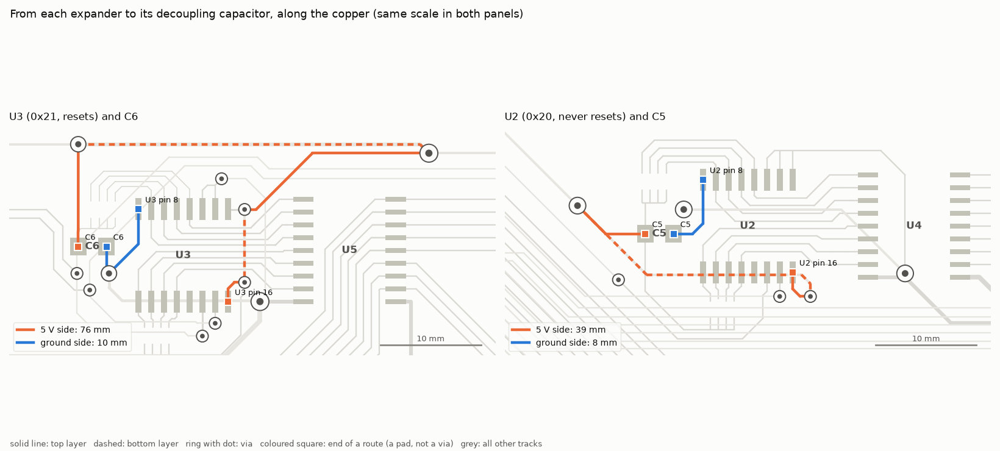

# PCF8574 expander resets: findings and status

Last updated: 2026-11-25. The full record, run by run, is in [JOURNAL.md](JOURNAL.md); entry numbers below refer to it.

## The problem

On the AYAB interface board (two PCF8574 port expanders at 0x20 and 0x21, each feeding a ULN2803 driver and eight solenoid coils), the expander for solenoids 8-15 sometimes ends up with all eight outputs on. It happens on a knitting machine when the firmware writes to the expanders in the style of an MCP23008 (a register byte, then the data), and not when it writes single bytes. Both the expanders and the drivers on the affected boards are UMW parts.

## Where things stand

- **The trigger is established** and reproduces every time on two boards, with the machine's solenoids and with a set of seven on the bench (entries 127, 145, 167).
- **A firmware workaround exists:** writing single bytes never produces the trigger.
- **How the event reaches the expander is not established.** The board layout suggests where to look; no measurement confirms it yet.
- **Next steps are all hardware,** and wait for parts and a faster oscilloscope.

## What is established

**The trigger.** The expander at 0x21 resets when four or more of its outputs that have coils attached are switched on in the same write, while the driver's clamp diodes are still carrying those coils' current from a switch-off shortly before.

| Sequence on 0x21 | Result | Entries |
|---|---|---|
| Four or more coils switched off and back on together within the window | resets every time | 134, 153, 167 |
| The same coils switched back on three at a time, 90 µs apart | never resets | 181, 186 |
| Switch-off only, or switch-on from rest, any number | never resets | 132, 134 |
| Outputs with no coil attached | do not count towards the four | 167 |
| Outputs held on throughout | make no difference | 139, 146 |

- **Why the MCP23008-style write does it:** its first byte is applied to the outputs as data, so the outputs go off and come back on about 90 µs later (entries 127, 132).
- **The reset happens at the clock edge that switches the outputs on.** The expander stops acknowledging in the middle of that bit and then behaves as after power-on: all outputs high, bus interface idle, normal operation afterwards (entries 164, 165).
- **The state of the bus lines does not matter.** Bit-banging the write, with the lines held in different states around the acknowledge bit, changes nothing (entry 164).
- **Only 0x21 resets, never 0x20,** even with the solenoid connectors swapped (entries 134, 142).
- **The window follows the clamp diodes' conduction.** The coils keep discharging through the diodes for about 1.4 ms after 0.1 ms on and 3.5 ms after 5 ms on; six coils reset up to about 0.8 ms and 2.2 ms respectively (entries 167, 179).
- **It does not take a large diode current.** Six coils reset with only a few milliamperes in each diode. Three coils reset only with a small current (about 7 to 16 mA each) and not with a large one (22 to 40 mA) (entries 188, 204; currents from the fitted model, not measured).
- **Borderline cases drift with use.** A sequence that sits on the threshold resets every time on a rested board and less often after a minute of continuous switching (entry 186). Comparisons of borderline cases need a fixed rest first.

**The coils.** 150 Ω each, about 53 mA at 9 V. A model fitted to the voltage captures gives a total inductance of about 225 mH (211 to 234), and needs a second element to fit: part of that inductance only comes in after about a millisecond, as expected of a coil on solid iron. How large the inductance is at the very start is not fixed by these captures (60 to 170 mH all fit); a direct current measurement is to decide (entry 204). Neighbouring coils are weakly coupled through the common armature.

## What the board layout shows

Read from the layout file; these are facts about the copper, and their link to the reset is inference (entries 182, 194, 195).

| | Expander at 0x21 (resets) | Expander at 0x20 (never resets) |
|---|---|---|
| Path from its capacitor to its supply pin | 76 mm, passing over the driver | 39 mm, under the chip |
| Path from its capacitor to its ground pin | 10 mm | 8 mm |
| Its driver's ground return to the supply | about 200 mm, past the controller's ground point | about 150 mm, straight to the ground bus |
| Address pins | one at 5 V, two at ground | all three at ground |

## Not established

- **The way in.** Candidates: the supply across the expander collapsing for tens of nanoseconds (favoured by the layout); a jump of its ground against the controller's; a disturbance through the port pins, which connect straight to the driver's inputs.
- **What exactly the driver does at that instant.** A current pulse through diodes that are still conducting fits most of the evidence, but not the finding that a small diode current is enough.
- **Why the UMW parts and reportedly not the TI ones.** No TI parts are available to compare.

Measurements so far cannot decide these. The oscilloscope used (20 MHz, 16 million samples per second) shows bursts of a few samples at the right instant, on the expander's supply pin, on its ground against the controller's, and on the driver's clamp rail, but they cannot be told apart from pickup in the probe leads (entries 169, 171, 183, 191).

## Ideas raised and withdrawn

- "The port pin goes 0.6 V below ground after a switch-off": an uncompensated probe (entries 172, 173).
- "The reset needs the controller to hold a bus line low": ruled out by the bit-banged write (entry 164).
- "A probe on the clock line makes the board more prone to reset": it was the drift with use (entry 186).
- "The current pulse grows with the diode current and adds up across outputs": contradicted by the small-current finding (entry 188).

## Next steps

In order, each followed by a rerun of the threshold table, which takes about a minute:

1. A ceramic capacitor directly between pins 16 and 8 of the 0x21 expander. Tests the supply-collapse idea; would also be a one-part fix.
2. A wire from the driver's ground pin straight to the ground pad by the supply jack, twisted with one from its clamp pin to the 9 V pad. Tests the ground-return idea.
3. Schottky diodes across the coils. Tests whether the driver's own clamp diodes are the source.
4. Coil current measured with a current-sense amplifier in the coils' common supply wire: replaces the calculated currents with measured ones and settles the inductance. Hold five coils on throughout and pulse a sixth, so the amplifier works inside its specified range (entry 203).
5. With the faster oscilloscope and short probe grounds: the expander's supply pin, its ground against the controller's, and a port pin, in the microsecond around a reset.
6. Tell a real disturbance on the expander's supply pin from pickup in the probe leads. Three coils are switched off, then back on after a gap; the run repeats this for seven gaps from 0.2 to 3.2 ms while the scope watches the supply pin. With three coils the short gaps (large coil current) never reset and the middle gaps (small current) always do (entry 188). Pickup should shrink as the current shrinks; if the burst is instead largest at the gaps that reset, it is real and tied to the reset (entry 191).
7. Re-measure, after a fixed rest, the earlier observation that coils left off make a reset less likely.

Waiting on, all ordered: through-hole ceramic capacitors, Schottky diodes (1N5819) and the faster oscilloscope.

## State of the equipment

- The bench board's controller runs the edge-test sketch, not the AYAB firmware. The machine's controller was flashed back to the AYAB firmware by the user after the session of 2026-11-22 (entry 187).
- The yellow probe still overshoots by about 7 % after trimming; the blue one is good.

## Where things are

| | |
|---|---|
| [JOURNAL.md](JOURNAL.md), [journal/](journal/) | the record of every run, with pictures |
| [tools/](tools/) | scripts for the boards, the supply, the scope and the analysis |
| [edgetest/](edgetest/) and the other sketch folders | test firmware |
| [captures/](captures/) | raw scope captures and result tables |
| [sim/](sim/) | the slow model of a coil and its driver channel, for ngspice (`coil_driver.cir`) and LTspice (`coil_driver.asc`); `tools/ltspice_run.py` runs an LTspice schematic in the background and reads the results back |
| `src/ayab/pcfprobe.cpp` in the firmware | the self-contained probe that runs from hardware-test mode (version 8) |
